<p align="center"></p>

<h1 align="center">cob-rag-engine</h1>

<p align="center"><b>Run an AI assistant business from one server.</b></p>

<p align="center">
<a href="https://github.com/callobuzz/cob-rag-engine/releases"></a>
<a href="https://github.com/callobuzz/cob-rag-engine/actions/workflows/ci.yml"></a>
<a href="LICENSE"></a>
<a href="clients/"></a>


<a href="https://github.com/callobuzz/cob-rag-engine/stargazers"></a>
</p>

<p align="center">
<a href="https://callobuzz.github.io/cob-rag-engine/"><b>Website</b></a> ·
<a href="https://callobuzz.github.io/cob-rag-engine/getting-started.html">Get started</a> ·
<a href="https://callobuzz.github.io/cob-rag-engine/guide.html">Guide</a> ·
<a href="https://callobuzz.github.io/cob-rag-engine/deploy.html">Deploy</a> ·
<a href="https://callobuzz.github.io/cob-rag-engine/benchmarks.html">Benchmarks</a> ·
<a href="#roadmap">Roadmap</a> ·
<a href="https://callobuzz.com/open-source">Callobuzz open source</a>
</p>

cob-rag-engine is an open-source engine for AI chat assistants. Each business you serve gets an
assistant that answers from its own documents and website, on its website and on WhatsApp, in
English, Hindi and Hinglish. You run the server, you set the prices, and you keep the margin.

<picture>
  <source media="(prefers-color-scheme: dark)" srcset="docs/assets/screenshots/dashboard-overview-admin-dark-1440.png">
  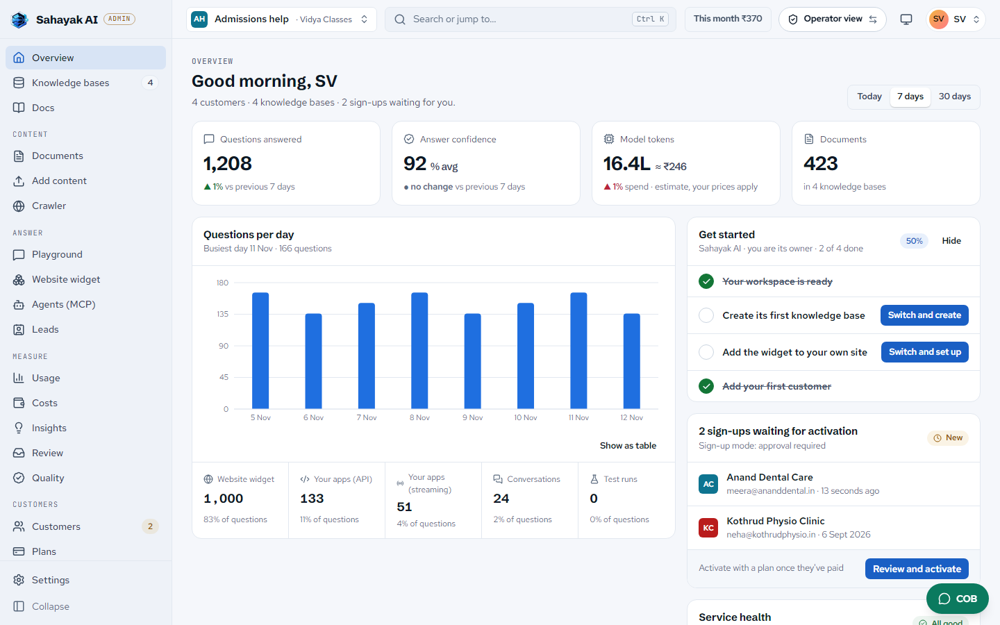
</picture>

> **Release status, 0.2.0.** The engine has run real deployments before. This release passed its
> automated tests (about 19,000 unit tests, about 400 integration tests and the dashboard's tests),
> but the newest parts (online payments, WhatsApp answers, the public website and the installer)
> have not yet had a full live run on a fresh server. Payments and WhatsApp were tested against
> simulated Razorpay and Meta servers only. Agent mode and web search are written but not in the
> API. If something breaks, please [open an issue](https://github.com/callobuzz/cob-rag-engine/issues).

## Who it is for

**Founders and agencies** sell AI assistants to clinics, shops, coaching classes and service firms,
under their own brand. Everything between "a business signs up" and "the business pays you" is
already built:

- your name, logo and colours on the dashboard, the e-mails and the widget;
- self sign-up, a four-step first-run setup, owners and members;
- plans, prepaid wallets and fair-use limits, in rupees or dollars;
- online payments through Razorpay, with numbered GST invoices and credit notes;
- a public website for your brand, with an editor, three languages and a live chat demo.

**Developers** use it as the knowledge layer under their own product or their AI agents: a REST
API with streaming answers, Python and JavaScript clients (MIT), and an MCP server,
[cob-rag-mcp](https://github.com/callobuzz/cob-rag-mcp) (MIT), for Claude, Cursor, n8n and other agents.

## From install to invoice

1. **Install.** `sudo bash deploy/install.sh` on a fresh Ubuntu or Debian server: Docker, HTTPS on
   one domain, nightly backups, upgrades with a rollback.
2. **Add a business.** It signs up, picks a plan and sets up its assistant in four steps: website,
   brochures, the widget, a first question.
3. **Learn.** PDF, Word, Excel, PowerPoint, scans (with Hindi OCR) and audio, plus the business's
   website, which is checked again for changes.
4. **Answer.** On the website widget and on the business's own WhatsApp Business number. Every
   price, date, number and name in an answer must appear in a cited passage; when the documents
   do not say, the assistant says so and offers a person.
5. **Leads.** Contact details with a consent notice, a reference code, handoff on WhatsApp, phone
   or e-mail, a daily digest and a monthly value report in rupees.
6. **Get paid.** Each answer is charged once from a prepaid balance. Top-ups through Razorpay,
   statements, spending caps, and a free local model for cheap plans.

<table>
<tr>
<td width="50%"><picture><source media="(prefers-color-scheme: dark)" srcset="docs/assets/screenshots/dashboard-overview-owner-dark-1440.png">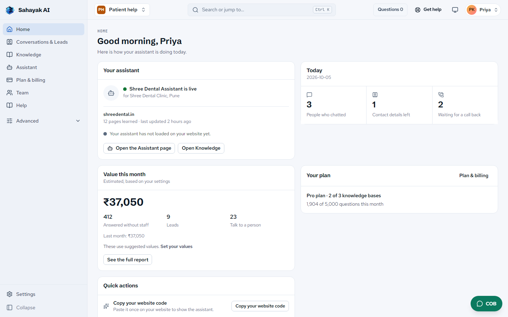</picture><br><sub>A business's Home</sub></td>
<td width="50%"><picture><source media="(prefers-color-scheme: dark)" srcset="docs/assets/screenshots/dashboard-widget-dark-1440.png">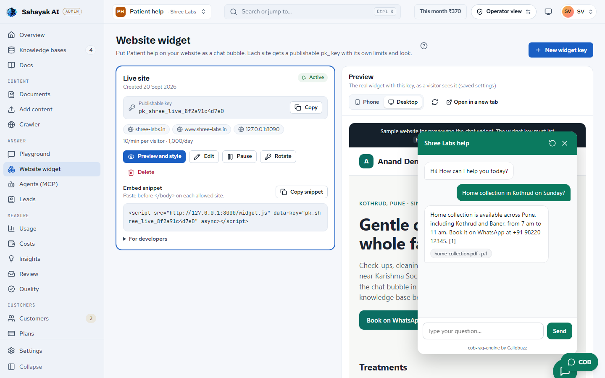</picture><br><sub>Website widget</sub></td>
</tr>
<tr>
<td width="50%"><picture><source media="(prefers-color-scheme: dark)" srcset="docs/assets/screenshots/dashboard-plan-usage-dark-1440.png">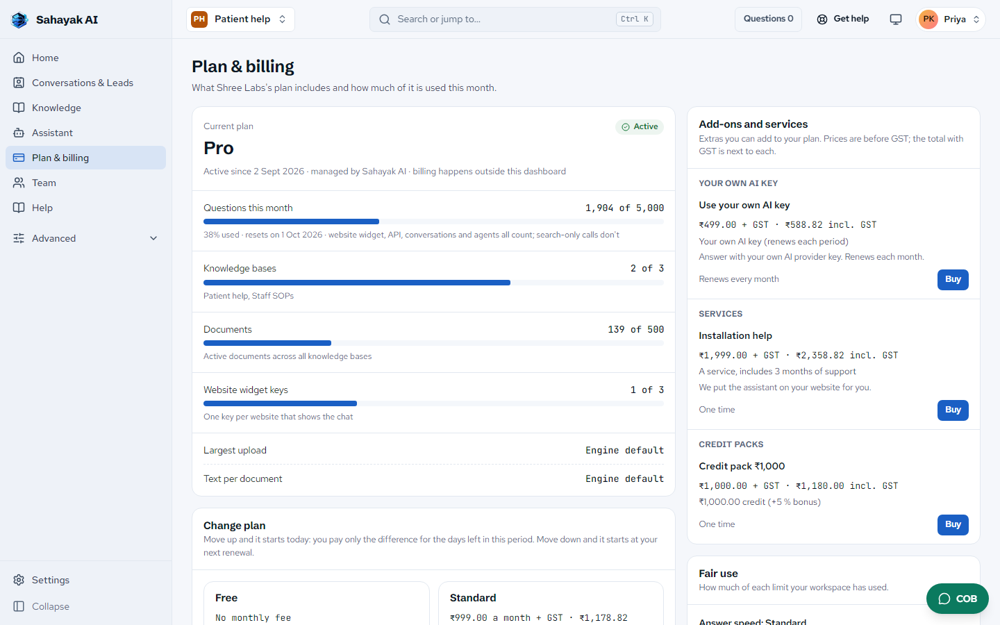</picture><br><sub>Plan &amp; billing</sub></td>
<td width="50%"><picture><source media="(prefers-color-scheme: dark)" srcset="docs/assets/screenshots/dashboard-leads-dark-1440.png">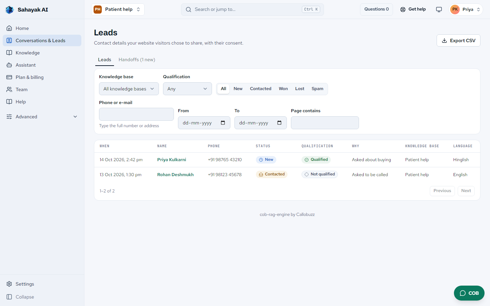</picture><br><sub>Leads</sub></td>
</tr>
</table>

Example data: an operator called "Sahayak AI" in Pune, serving local businesses. Every screen, in
light and dark at desktop and phone widths, is in [`docs/assets/screenshots/`](docs/assets/screenshots/).

## Why cob-rag-engine

Every clinic, shop, school and SaaS wants AI — assistants now, agents next — that actually
knows their business: their policies, products and documents, not a generic model that makes
things up. Agents fail in production mostly on exactly this layer: evaluation, governance and
reliability of what they are fed. Most of
them can't build one, and the ones that try end up gluing together a vector database, an
embedding API, a reranker, an LLM, a chat widget, API keys, rate limits and billing.

**cob-rag-engine is that whole stack as one self-hosted engine**, designed from the start to be
run by *one operator for many customers*:

- **Multi-tenant by design.** Tenants own knowledge bases ("corpora"); each has its own keys,
  vectors, model, prompt and retrieval settings. No customer can see another's data.
- **A website chatbot in one line.** Publishable `pk_` widget keys are locked to the customer's
  domains, rate-limited per visitor and per day, and can never pick the model or see credentials.
- **Metered and billed.** Every answered request is counted — requests, tokens and what it really
  cost, from the provider's own figure — per tenant, knowledge base, model, payer and widget, and
  charged once from the business's prepaid balance.
- **Accounts built in.** E-mail sign-up with approval, teams with owner/member roles, plans with
  usage caps, white-label branding, bring your own SMTP. Your brand is what customers see on the
  public pages, the dashboard and every e-mail; the "cob-rag-engine by Callobuzz" line is shown by
  default and you can hide it.
- **Any model, any budget.** Fully local (Ollama, TEI, a local reranker — CPU or GPU, zero API
  cost) or any hosted provider, chosen per engine, per customer, or per request.
- **Bring your own key.** Every model call takes its key from the request, else the client's
  own encrypted key, else yours — so a client can pay their AI provider directly while you
  charge for hosting, or you pay and mark up from the usage records.
- **Retrieval that is measured, not claimed.** Hybrid dense + BM25 keyword search with weighted
  score fusion, optional cross-encoder reranking, MMR, citations and answer validation. On six
  public BEIR datasets it beats the published scores of its own embedding model on every one —
  locally, with no LLM and nothing paid. [Benchmarks](#benchmark), reproducible from the repo.
- **Yours.** Self-hosted on Postgres, Qdrant, Valkey and your own files or any S3. Open source under
  AGPL-3.0, with a commercial licence on request; the SDKs and the widget scripts are MIT.

## Why cob-rag-engine if LangChain, LlamaIndex, Dify and agent SDKs exist?

### The short answer

LangChain and agent SDKs (OpenAI Agents SDK, Claude Agent SDK, LangGraph) are toolkits for building AI. cob-rag-engine is the finished knowledge platform and chatbot business your agents and your customers use: install it and sell AI assistants the same day.

In plain words: a toolkit is a box of parts, and you still have to build the product around them. LlamaIndex is the same kind of thing, focused on getting your data indexed and retrieved. Dify is different: a platform where you build an AI app in a visual builder. cob-rag-engine is the finished product for one job, running knowledge-based assistants for many businesses from one self-hosted engine, already built, tested and measured. It is not an agent framework and it does not try to replace one. Your agents can use it as their knowledge layer.

### What you would still build on a toolkit

Start from LangChain, LlamaIndex, LangGraph or an agent SDK and you get a very good way to call models and tools. To reach what cob-rag-engine ships today, you would still have to build and keep working:

- **Customers, keys, roles and isolation.** Tenants (your customers), knowledge bases, five kinds of credential, owner and member roles, plans and caps. The isolation is tested against attack attempts: 412 of 412 refused in the isolation benchmark (every key kind, owner and member sign-ins, forged tokens, refresh reuse, suspended accounts, enumeration, lockout).
- **Document ingestion.** PDF, DOCX, XLSX, PPTX, HTML, Markdown and audio; OCR for scans, including Hindi (`RAG_OCR_LANGS=hi,en`); page furniture stripped before indexing; near-duplicate review; versioned re-ingestion.
- **Search that is measured.** Hybrid dense and BM25 keyword search with weighted fusion, benchmarked on six public BEIR datasets (mean nDCG@10 0.537 against 0.526 published for the same embedding model, bge-base-en-v1.5, the earlier default; the default is now BGE-M3 and its re-run is pending) and on real documents.
- **Answers that do not make things up.** A search-confidence gate, and a fact check that makes every price, date, time, number, phone, e-mail, link and name appear in the cited passages, sentence by sentence as the answer streams. When the documents do not say, it says "I don't know" and offers a person.
- **A conversation director.** Greetings, small talk, off-topic and abuse handled before any answer is written; English, Hindi and Hinglish; a model per language; thinking switched off or limited per model; answers started early while the message is still being understood.
- **A website widget that sells.** One script tag, locked to the customer's domains and rate limited; leads with a consent notice that follows the DPDP Act's notice elements; a handoff to a person on WhatsApp, by phone or by e-mail; guided sales replies with one next step. The same assistant also answers on the business's own WhatsApp Business number.
- **Billing and costs.** Plans, prepaid wallets in rupees or dollars, per-question pricing or the real AI cost plus a markup, usage counted per customer, knowledge base and widget, Razorpay payments and GST invoices.
- **Dashboard, COB and evaluation.** An operator and customer dashboard, COB (the built-in assistant), these in-app docs, and a re-runnable retrieval, answer and conversation benchmark suite in the repository.
- **MCP and SDKs.** `cob-rag-mcp` (52 tools) for any MCP client, and Python and JavaScript clients.

### How it differs from LlamaIndex and Dify

- **LlamaIndex** is a developer framework for data ingestion, indexing and retrieval in LLM apps (LlamaCloud and LlamaParse are its paid hosted services). It is a strong retrieval library. You still build the product around it: tenants, widget, leads, billing and a dashboard.
- **Dify** is an open-source platform for building LLM apps, with a visual workflow and agent builder, a knowledge base, a cloud and self-hosting. It is the better choice when you want to design workflows visually, and it has a large plugin and model ecosystem that cob-rag-engine does not. Its licence is Apache 2.0 with added conditions (checked 5 October 2026): you may not use its source to operate a multi-tenant environment without written authorization, and you may not remove its logo or copyright in the console or apps. Read the current text before you build a business on it.
- **What cob-rag-engine has that is built for resale:** customers (tenants), plans, wallets and billing, white-label branding and an operator workspace; Hindi and Hinglish handling with a model per language and Hindi OCR, DPDP consent on leads, WhatsApp handoff and rupee pricing; a fact gate and an honest "I don't know"; published benchmarks; COB and these docs inside the app; and an MCP server.

### They work together

Agents built with LangChain, LlamaIndex, LangGraph, the OpenAI Agents SDK, the Claude Agent SDK, n8n or any MCP client use cob-rag-engine as their knowledge layer. They reach it through MCP (`cob-rag-mcp`, 52 tools), REST, or the Python and JavaScript SDKs, each agent with its own read-only named key.

An agent SDK gives you the loop: the model, the tools, the hand-offs. It does not give you a governed, multi-customer, benchmarked knowledge base, billing, or a chatbot you can sell. That is the part cob-rag-engine adds. You host it yourself; there is no hosted cob-rag-engine.

### Why the answer pipeline has no LangChain

- **Speed and control.** Every step is visible and tunable: early-start answers, a model per language, thinking control, and the fact gate.
- **Stability.** No framework releases to chase underneath a product you sell.
- **A smaller surface.** No LangChain in the default install: our own core handles ingestion, search and answers. The optional evaluation add-on uses RAGAS, which brings LangChain in as its own dependency, used only for quality scoring.
- **Our own provider pattern.** Models, vector databases, parsers, embeddings and storage each sit behind one small interface and can be swapped.

### When another tool alone is the right choice

If you are building a one-off prototype, an unusual pipeline, or an agent for your own use, and you want to hand-build every step, LangChain, LlamaIndex or an agent SDK on its own is the right tool. If you want to design workflows visually, or build internal AI apps for your own company, Dify is a good fit. cob-rag-engine is the right choice when the knowledge belongs to businesses, must stay separate, must be answered honestly, and has to be sold. It has no visual agent builder and no agent loop of its own.

### Side by side

| | LangChain | LlamaIndex | Dify | Agent SDKs | cob-rag-engine |
|---|---|---|---|---|---|
| What it is | An open-source library of parts for AI apps | A framework for ingesting, indexing and retrieving data (paid hosted LlamaCloud and LlamaParse) | An open-source platform to build LLM apps visually: workflows, agents, knowledge base | Libraries that run an agent: model, tools, loop | A self-hosted knowledge platform and chatbot service |
| Time to a working chatbot business | You build the app, accounts, interface and billing around it | You build the product around the retrieval | Quick for your own app in its builder; reselling needs its written authorization | You build the product around the agent | Install, create a customer, upload documents, paste one script tag |
| Multi-customer platform | Not part of the library | Not part of the framework | Multi-tenant operation needs Dify's written authorization (modified Apache 2.0) | Not part of the SDKs | Tenants, per-knowledge-base keys, roles, plans; isolation tested, 412 of 412 attempts refused |
| Document pipeline, including Hindi OCR | Loaders you choose and wire up | Strong loaders and parsing; Hindi OCR is yours to set up | Knowledge base and pipelines; scans depend on plugins | Not what they are for | Parsing, OCR with Hindi, cleanup, near-duplicate review, versions |
| Grounded answers, no made-up facts | You write the checks | You write the checks | Retrieval and citations; checks are built in your workflow | Guardrail hooks; you write the checks | Confidence gate and a sentence-by-sentence fact check; says "I don't know" |
| Website widget, leads, WhatsApp | Not part of the library | Not part of the framework | Embeddable chat app; leads and handoff are yours to build | Not part of the SDKs | Widget and WhatsApp answers, leads with DPDP consent, handoff to a person |
| Billing | Not part of the library | Not part of the framework | App logs; not a billing system for your customers | Not part of the SDKs | Plans, wallets, per-question or cost-plus pricing, Razorpay payments, GST invoices |
| Dashboard and in-app assistant | Not part of the library | Not part of the framework | Its own studio and console | Not part of the SDKs | Dashboard, COB and in-app docs |
| Works with agents | Yes, it is an agent toolkit | Yes, it has agents too | Builds agents itself and has APIs | Yes, it is the agent loop | Yes: MCP (52 tools), REST, Python and JS SDKs, read-only named keys |

### Say it in four lines

1. LangChain, LlamaIndex and the agent SDKs give you parts to build with; cob-rag-engine is the finished knowledge platform: customers, keys, documents, fact-checked answers, a website widget and billing, already built and tested.
2. They are not rivals: your LangChain, LlamaIndex, OpenAI or Claude agent plugs into it over MCP and uses it as its governed knowledge base.
3. Dify is a full platform too, but it is built for designing apps, and its licence needs written authorization to run it for many customers; cob-rag-engine is built to resell, with plans and billing, Hindi and Hinglish, WhatsApp and DPDP consent, and answers that stay inside the customer's own documents.
4. So you sell assistants from day one instead of building the platform under them, and if all you need is a one-off prototype, LangChain alone is the right call.

### Questions people ask

**LangChain is there and good, so why would anyone use cob-rag-engine?** LangChain builds AI; cob-rag-engine is a finished product built for one job: running knowledge-based assistants for many customers from one self-hosted engine. They solve different problems, and they work together.

**What about LlamaIndex?** LlamaIndex is a retrieval framework for developers; you still build tenants, the widget, leads, billing and the dashboard around it. cob-rag-engine ships those, and your LlamaIndex agent can call it over MCP.

**Dify is a full platform too, so why cob-rag-engine?** Dify is for building apps in a visual workflow builder, and has a bigger plugin ecosystem. cob-rag-engine is for reselling: customers, plans, wallets, white-label, Hindi and Hinglish, DPDP consent, WhatsApp handoff and a fact-checked "I don't know". Dify's licence needs written authorization to run it as a multi-tenant service. If you want to design workflows visually for your own company, Dify is a good fit.

**Is cob-rag-engine a LangChain alternative?** Not for building agents. It has no agent framework and no visual builder. It is the knowledge platform an agent, or a customer's website, asks.

**Can I use LangChain, LangGraph, the OpenAI Agents SDK or the Claude Agent SDK with it?** Yes. Use MCP (`cob-rag-mcp`), REST, or the Python and JavaScript SDKs, with a read-only named key for each agent.

**Does it use LangChain inside?** Not in the default install: our own core handles ingestion, search and answers. The optional evaluation add-on uses RAGAS, which brings LangChain in as its own dependency, used only for quality scoring.

**Does it make up answers?** It is built not to. A search-confidence gate and a fact check stop unsupported facts, and with no documented answer it says so and offers a person or a lead form.

**When should I use LangChain or LlamaIndex alone?** For a one-off prototype, an unusual pipeline, or an agent for your own use, where you want to hand-build every step.

**Is there a hosted version?** No. You host it yourself on Postgres, Qdrant and Valkey (a Redis-compatible store), with uploaded files in a folder on your server or in any S3-compatible storage.

## The vision

> Developers, founders and companies self-host cob-rag-engine as the knowledge layer behind
> the AI assistants and agents they build and sell — each grounded in one business's own data,
> isolated, measured and billable — so no one has to build AI infrastructure from scratch.

1. **Host the engine** — one `docker compose up` on a VPS or your cloud.
2. **Onboard customers** — a tenant and a knowledge base each; upload their PDFs, docs and pages.
3. **Paste the widget** — one script tag on their site. Domain-locked, rate-limited, metered.

The engine is the product's backbone. Sign-up, teams, plans with usage caps, white-label branding,
prepaid wallets, Razorpay payments and GST invoices are built in; your prices are up to you.

## For AI agents: MCP + CLI

Agents already have a brain; what they lack is a business's own knowledge. The companion
package **[cob-rag-mcp](https://github.com/callobuzz/cob-rag-mcp)** plugs your engine into any
MCP client — Claude Desktop, Claude Code, ChatGPT, Cursor, VS Code, n8n or an agent framework —
and ships the `cob-rag-engine` command-line tool for scripts and automations.
Repo: [callobuzz/cob-rag-mcp](https://github.com/callobuzz/cob-rag-mcp) · site:
[callobuzz.github.io/cob-rag-mcp](https://callobuzz.github.io/cob-rag-mcp) · npm:
[cob-rag-mcp](https://www.npmjs.com/package/cob-rag-mcp).

> **You host it.** There is no hosted cob-rag-engine. `cob-rag-mcp` connects to the engine URL and
> key you give it. A client (`ck_`) key reaches only its own knowledge base, so each agent sees
> exactly one business; tenant and admin keys unlock management tools, and destructive tools stay
> off unless you enable them.

```jsonc
// claude_desktop_config.json
{
  "mcpServers": {
    "shree-labs": {
      "command": "npx",
      "args": ["-y", "cob-rag-mcp", "start"],
      "env": { "COB_RAG_URL": "https://rag.yourcompany.com", "COB_RAG_API_KEY": "ck_…" }
    }
  }
}
```

```bash
npm i -g cob-rag-mcp
cob-rag-engine login --url https://rag.yourcompany.com --key ck_…
cob-rag-engine search "fasting before a lipid profile"
cob-rag-engine ask "Do I need to fast for a lipid profile test?"
```

Agents get tools such as `search` (passages with sources, for the agent's own model to reason
over) and `ask` (a full cited answer), plus documents, ingestion and usage. See the
[cob-rag-mcp README](https://github.com/callobuzz/cob-rag-mcp) (or its [site](https://callobuzz.github.io/cob-rag-mcp)) for every client's setup and the
full tool list. Its types are generated from this repo's [`docs/openapi.json`](docs/openapi.json).

**Give each agent its own key.** A knowledge base and a customer can each have any number of
named keys, and each key has a **permission**: `read` (search, ask, list, get), `write` (also add
and change content and non-destructive settings) or `full` (also delete and manage keys). The
dashboard's **Agents → Connect an agent** picks a client (Claude Code, Claude Desktop, Cursor,
VS Code, n8n), makes a `read` key named "Agent – <client>" and shows the exact cob-rag-mcp config
with the key in it, once; revoking that one key cuts that agent off and touches nothing else.
Before the package is on npm, the dashboard shows the local install
(`git clone`, `pnpm install && pnpm build && npm link`, then the `cob-rag-mcp` command), exactly as
the cob-rag-mcp README's "Install before npm publish" gives it.

## Use cases

| | |
|---|---|
| **AI chatbot agency** | Resell "an assistant for your website" to local businesses: a tenant per client, a widget per site, usage per client for invoicing. |
| **AI inside your SaaS** | Give each of your customers an assistant over their own data. Tenant keys map to your accounts; your backend uses the API or SDKs. |
| **Customer-support deflection** | Answer policy, shipping and how-to questions instantly with citations, 24/7, and escalate the hard ones. |
| **Internal knowledge** | HR handbooks, runbooks, SOPs and wikis — asked in plain language, answered with sources, on infrastructure you control. |
| **Regulated industries** | Clinics, law and finance keep data on-prem with local models and no third-party AI calls at all. |
| **E-commerce assistants** | Sizing, product care, returns and order questions on the storefront; exact SKUs and order numbers found by keyword search. |

## What's inside

| | |
|---|---|
| **Multi-tenancy** | Tenants → corpora → widget keys, and the tenant's people (owners, members); admin / `tk_` / `ck_` / `pk_` keys (bcrypt-hashed secrets) and dashboard sign-ins; per-corpus Qdrant collection, model, prompt and retrieval config; bring-your-own LLM key (Fernet-encrypted) |
| **Accounts** | E-mail sign-up (open, approval or closed), teams with owner/member roles and invitations, plans with four usage caps, white-label branding (the "cob-rag-engine by Callobuzz" line is shown by default and can be hidden), your own SMTP, an operator audit log; argon2id passwords, 15-minute tokens with rotating refresh and reuse detection, limits that fail closed |
| **Website chat widget** | `<script>` embed, Shadow-DOM isolated, streaming, sources, branding, mobile; domain allow-list, per-visitor + daily limits; dashboard management and preview |
| **Retrieval** | Hybrid dense + BM25 (Snowball stemming) with weighted score fusion or RRF, keyword-only mode, optional cross-encoder or LLM reranking, MMR, temporal decay, HyDE, query classification; per-chunk dense, keyword and rerank scores |
| **Answers** | Citations, 3-stage validation with confidence, SSE streaming, conversations, long-term memory |
| **Ingestion** | PDF (typeset and scanned, with OCR), DOCX, XLSX, CSV, PPTX, HTML, Markdown, audio (Whisper, when `RAG_TRANSCRIPTION_PROVIDER` is set), web scraper; a bulk records API for FAQs and catalogs that re-syncs only what changed; structure-aware chunking that keeps section headings; near-duplicate review (pages that only share a site's menu and footer are not duplicates); page furniture stripped before indexing; a passage stored in several documents shown once; versioned re-ingestion |
| **Models** | Any LiteLLM provider or Ollama for generation; TEI, local, Jina or any LiteLLM embedding model; local or LLM reranking — CPU or GPU |
| **Money** | Plans with self-service changes, prepaid wallets in rupees or dollars with an append-only ledger checked nightly, per-question or cost-plus pricing, add-ons and credit packs, Razorpay top-ups and refunds, numbered GST invoices and credit notes, statements, spending caps, fair-use limits and answer-speed tiers |
| **Channels** | The website widget and the business's own WhatsApp Business number, through the same answer rules; a "Talk to a person" button, reference codes, and handoff on WhatsApp, phone or e-mail |
| **Your public side** | A public website for your brand with an editor (three languages, versions, a live chat demo), eight legal page templates, a demo mode that resets nightly |
| **Operations** | One-command installer with HTTPS, backups, upgrade and rollback; usage metering API, a dashboard for the operator and each customer's team, Python & JS SDKs, Langfuse tracing, RAGAS evaluation, knowledge-gap detection, blue-green embedding migrations |

## Screenshots

Sample data: an operator called "Sahayak AI" in Pune serving local businesses (Shree Labs, a
pathology lab; Anand Dental Care, a dental clinic), with prices in ₹.

| The widget on a customer's site | Managing widget keys in the dashboard |
|---|---|
|  |  |
| **On a phone** | **Usage and estimated cost** |
| 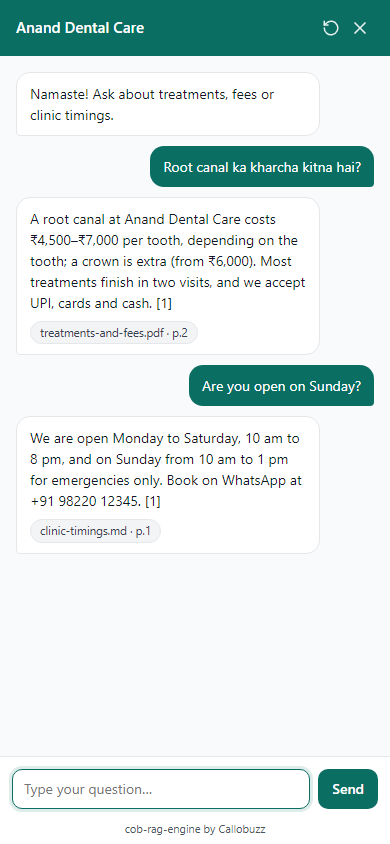 | 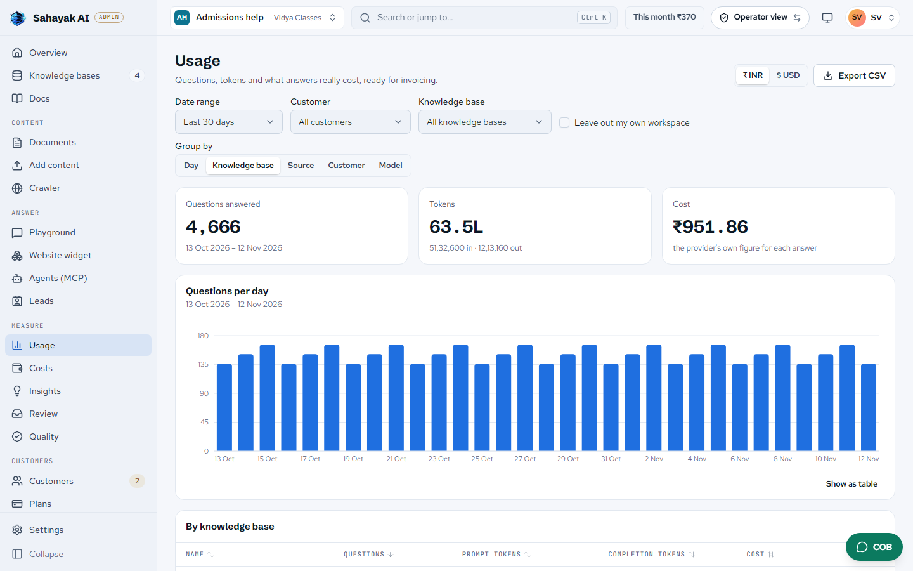 |
| **The operator's overview** | **The playground, in English and Hindi** |
|  | 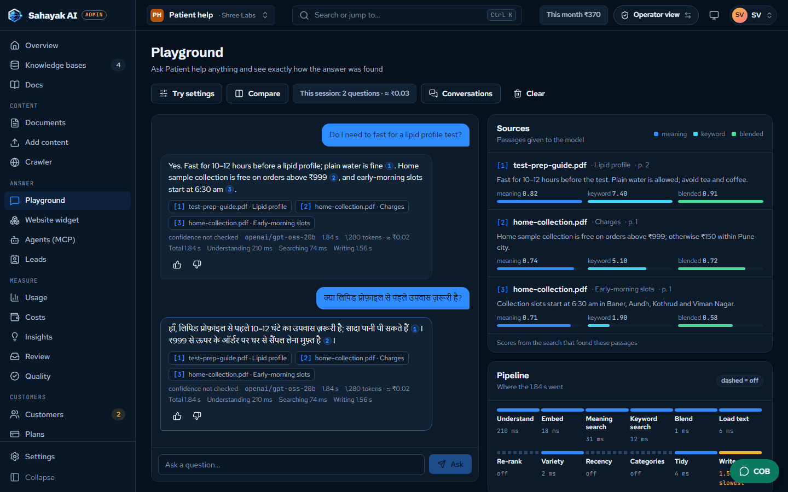 |

More, in light and dark at desktop and phone widths, are in
[`docs/assets/screenshots/`](docs/assets/screenshots/) (`dashboard-<screen>-<theme>-<width>.png`).

## How it compares

Great RAG projects exist; cob-rag-engine is built for one job they don't center on:
**operating an AI chat service for many client businesses from one self-hosted engine.**

| | **cob-rag-engine** | RAGFlow | Dify | AnythingLLM | Onyx |
|---|---|---|---|---|---|
| License | AGPL-3.0 (commercial licence on request) | Apache-2.0 | Dify Open Source License¹ | MIT | MIT + proprietary `ee/` |
| Serve many client businesses | **Built for it**: tenants → knowledge bases, isolation tested | Knowledge base owned by one user account² | Needs written authorization¹; one workspace in Community | Multi-user, one organization | Multi-tenant in their cloud |
| API keys | Per tenant **and per knowledge base** | Per account² | Per app | Instance key | Scoped keys |
| Website chat embed | **Script tag**, public `pk_` key, domain allow-list, per-visitor + daily limits | iframe; maintainers note it exposes URL and key² | iframe / script, public app token | Script, domain allow-list, chat limits | Web-component widget |
| Usage metering per client | **Built in**: per day, knowledge base, widget | Not in open source | App logs | — | Analytics in `ee/` |
| Scanned PDFs, complex layouts | Docling layout + OCR | **Strongest**: DeepDoc, 12 chunking templates | Via plugins | — | — |
| Data connectors | Web crawler, records API | **~40** | Knowledge pipelines | Some | **50+** |
| Visual agent / workflow builder | — | Yes | Yes | Yes | Agents |
| Published retrieval benchmark | **BEIR, six datasets, reproducible** | None found | — | — | — |
| Memory, default install | **2.1 GB measured** | 16 GB minimum stated | 4 GB minimum stated | 2 GB | ~24 GB (Lite <1 GB) |

From each project's own license, docs and issue tracker, reviewed 29 September 2026; "—" means
not a documented core feature we could find. ¹ Dify's license adds conditions to Apache-2.0,
including that its source may not be used to operate a multi-tenant environment without written
authorization. ² RAGFlow issues #15812 and #2344. FastGPT's license likewise bars multi-tenant SaaS,
and Open WebUI's bars rebranding above 50 users. Corrections welcome — please open an issue.

**Where others shine:** RAGFlow's document understanding (DeepDoc), about 40 connectors, visual
agent canvas and knowledge compilation; Onyx's 50+ workplace connectors; Dify's app and workflow
builder; AnythingLLM's desktop simplicity. If one company needs those most, they are excellent
choices. The full comparison, with sources and the market for what you can sell, is on the
[project page](https://callobuzz.github.io/cob-rag-engine/).

## Benchmark

Retrieval is what every answer depends on, so it is benchmarked on public data, through the
public API, with **no LLM and no API key** — and anyone can re-run it.
**[Full report](https://callobuzz.github.io/cob-rag-engine/benchmarks.html)** ·
[method and commands](benchmarks/README.md).

**BEIR, nDCG@10** — six public datasets, 272k documents, 3,727 test queries, official judgements:

| | SciFact | NFCorpus | ArguAna | SCIDOCS | FiQA | TREC-COVID | Mean |
|---|---|---|---|---|---|---|---|
| BM25 keyword search | 0.665 | 0.325 | 0.315 | 0.158 | 0.236 | 0.656 | 0.393 |
| bge-base-en-v1.5, published | 0.743 | 0.374 | 0.638 | 0.217 | 0.406 | 0.780 | 0.526 |
| **cob-rag-engine, default hybrid** | **0.761** | **0.382** | **0.640** | **0.221** | **0.417** | **0.803** | **0.537** |

These numbers were measured with `BAAI/bge-base-en-v1.5` (768-d), the default until this release;
the default is now multilingual `BAAI/bge-m3` (1024-d) and a BGE-M3 re-run is still to come. Same
embedding model, higher on every dataset — from the keyword leg (BM25 with stemming) and how
the two are fused (weighted scores; the reciprocal-rank fusion most engines default to scored
0.505 and lost to dense-only on five of six). Hosted embedding APIs used alone score 0.518
(OpenAI text-embedding-3-small) and 0.527 (Cohere v3) on the same six.

| Also measured | Result |
|---|---|
| Real documents — typeset and scanned PDF, DOCX, XLSX, PPTX, HTML, Markdown; 55 questions | **100%** answered in the top 5, 91% at rank 1 |
| Tenant isolation — every key type and an owner's and a member's sign-in against another tenant's data, plus the account attacks (forged tokens, refresh reuse, owner-only routes, suspension, enumeration, lockout) | **412 / 412** attempts refused |
| Retrieval latency, 57k documents, default settings | **45 ms** p50 on GPU, **77 ms** on CPU |
| Memory, default install on CPU | **2.1 GB** |

The benchmarks also found — and led to fixes for — a result cap on `/retrieve`, a weak keyword
leg, API-key checks blocking the server (5 → 22 queries/s), PDF parsing failing inside the
Docker image, and search filters lost after embedding migrations. The full list is in the
[report](benchmarks/README.md#what-the-benchmarks-changed).

### Fast models

The assistant labels every visitor message the rules cannot (a business question, buying intent,
off topic, a request for a person...) with a small "fast" model, so that model's accuracy and
speed decide both what the visitor gets and how long they wait. Each model below ran once, frozen
prompt, on the same 266 held-out turns in English, Hindi and Hinglish
([method](benchmarks/README.md#fast-models)); latency is the label call alone and cost is what the
provider billed. The dashboard shows the same table beside the fast-model setting.

<!-- fast-models:start -->
<!-- generated by `make bench-tables` from benchmarks/results/fast-models.json -->

| Model | Overall | en / hi / hi-Latn | Business recall | Reply language | Fallbacks | Label p50 / p90 / p99 | $ per 1,000 labels | Result |
|---|---|---|---|---|---|---|---|---|
| `meta-llama/llama-3.1-8b-instruct` via groq | 91.0% | 92.1 / 90.8 / 90.0 | 93.1% | 100.0% | 0.0% | 0.18 / 0.21 / 0.40 s | 0.039 | Below the bar: recall |
| `meta-llama/llama-3.3-70b-instruct` via groq | 92.1% | 89.9 / 93.1 / 93.3 | 90.3% | 100.0% | 1.2% | 0.47 / 0.56 / 3.59 s | 0.725 | Below the bar: recall |
| `google/gemini-2.5-flash-lite` (effort `none`) | 95.9% | 96.6 / 95.4 / 95.6 | 95.8% | 100.0% | 4.3% | 0.79 / 0.91 / 2.77 s | 0.134 | Below the bar: recall |
| `mistralai/mistral-small-2603` (effort `none`) | 95.9% | 97.8 / 94.3 / 95.6 | 95.8% | 100.0% | 0.0% | 0.85 / 1.22 / 1.93 s | 0.056 | Below the bar: recall |
| `openai/gpt-4.1-nano` | 94.0% | 95.5 / 93.1 / 93.3 | 97.2% | 100.0% | 0.0% | 1.05 / 1.27 / 1.96 s | 0.131 | Fastest |
| `qwen/qwen3.8-27b` via cerebras (effort `none`) | 97.0% | 96.6 / 97.7 / 96.7 | 97.2% | 100.0% | 0.0% | 1.27 / 1.41 / 1.57 s | 0.214 | Passes every bar |
| `openai/gpt-4.1-mini` | 97.4% | 98.9 / 96.6 / 96.7 | 98.6% | 100.0% | 0.0% | 1.45 / 1.66 / 2.25 s | 0.524 | Passes every bar |
| `qwen/qwen3-next-80b-a3b-instruct` | 97.0% | 97.8 / 96.6 / 96.7 | 91.7% | 100.0% | 1.9% | 0.79 / 1.66 / 2.69 s | 0.139 | Below the bar: recall |
| `deepseek/deepseek-v4.1-flash` (effort `none`) | 98.5% | 98.9 / 98.9 / 97.8 | 94.4% | 100.0% | 0.0% | 1.24 / 1.67 / 2.92 s | 0.069 | Below the bar: recall |
| `google/gemma-4-26b-a4b-it` (effort `none`) | 97.7% | 97.8 / 98.9 / 96.7 | 97.2% | 100.0% | 1.9% | 1.21 / 1.91 / 2.81 s | 0.058 | Cheapest |
| **`openai/gpt-6-luna` (effort `none`)** | **98.9%** | **98.9 / 100.0 / 97.8** | **98.6%** | **100.0%** | **0.6%** | **1.55 / 1.94 / 2.80 s** | **0.162** | **Recommended, most accurate** |
| `openai/gpt-oss-120b` (effort `low`) | 95.1% | 95.5 / 95.4 / 94.4 | 97.2% | 100.0% | 4.9% | 1.44 / 2.28 / 3.46 s | 0.120 | Passes every bar |
| `google/gemma-4-31b-it` (effort `none`) | 95.9% | 94.4 / 100.0 / 93.3 | 97.2% | 100.0% | 8.6% | 2.07 / 2.46 / 3.53 s | 0.101 | Below the bar: fallbacks |
| `qwen/qwen3-30b-a3b-instruct-2507` | 95.9% | 97.8 / 94.3 / 95.6 | 95.8% | 100.0% | 3.1% | 0.98 / 2.47 / 3.00 s | 0.090 | Below the bar: recall |
| `mistralai/mistral-small-3.2-24b-instruct` | 96.6% | 94.4 / 97.7 / 97.8 | 95.8% | 100.0% | 5.6% | 2.00 / 3.10 / 3.71 s | 0.106 | Below the bar: recall, fallbacks |

**Default fast model: `openai/gpt-6-luna`**, the model with the highest business-question recall (98.6%) among those that pass every bar, then the highest overall accuracy (98.9%): p90 1.94 s, $0.162 per 1,000 labels. Budget option (the cheapest passing model): `google/gemma-4-26b-a4b-it` (64% cheaper than the default, $0.058 per 1,000, 97.7% overall, p90 1.91 s). Fastest passing: `openai/gpt-4.1-nano` (p90 1.27 s, 94.0% overall). Most accurate: `openai/gpt-6-luna` (98.9% overall, p90 1.94 s). Bars: overall 90%, each language 85%, business-question recall 97%, reply language 95%, label fallbacks at most 5%. Updated 2026-10-03; thinking control not verified for 0 of 15 rows.

<!-- fast-models:end -->

### Recommended models

The answer models were measured the same way: 94 frozen questions in English, Hindi and Hinglish, the
same passages for every model, through the engine's own answer path ([method](benchmarks/README.md#answer-models)).
The recommended setup, computed from those results and the fast-model table above:

<!-- answer-models:start -->
<!-- generated by `make bench-tables` from benchmarks/results/answer-models.json and fast-models.json -->

| Use | Model | Why |
|---|---|---|
| English answers | `openai/gpt-oss-120b` (thinking `low`) | Best overall: 93% of answers passed, 100% of unanswerable questions correctly declined, ₹7.2 per 1,000 answers. |
| Hindi and Hinglish answers | `google/gemma-4-31b-it` | 90% passed on Hindi and Hinglish, 100% declined correctly, 100% in the right register, first word in 609 ms. |
| Hindi and Hinglish, budget | `google/gemma-4-26b-a4b-it` | 93% passed on Hindi and Hinglish at ₹9.4 per 1,000 answers. |
| Fast model | `openai/gpt-6-luna` | Reads each message in 1.94 s at p90: 98.9% accurate, ₹13.6 per 1,000 messages. |
| Fast model, budget | `google/gemma-4-26b-a4b-it` | 97.7% accurate at ₹4.9 per 1,000 messages, 64% less than GPT-6 Luna. |

Best Hindi tone: `anthropic/claude-haiku-4.5` (4.4 of 5 from the judge), not recommended: it declines only 69% of the unanswerable questions overall (50% on Hindi and Hinglish) and invents an answer for the rest. **Save 64%: switch to Gemma 4 26B (₹4.9 vs ₹13.6 per 1,000 messages, 97.7% accurate).**

Every model, language by language, how the picks are made and what the benchmark cost: [benchmarks/README.md](benchmarks/README.md#answer-models) and the [benchmarks page](https://callobuzz.github.io/cob-rag-engine/benchmarks.html#answer-models).

<!-- answer-models:end -->

---

## Quick start

**[Full step-by-step guide](https://callobuzz.github.io/cob-rag-engine/guide.html):** install,
first login, your first customer and widget, day-to-day running, and troubleshooting.

### Install on a server (one command)

On a fresh Ubuntu 22.04 or 24.04 or Debian 12 server (what size: [the requirements](https://callobuzz.github.io/cob-rag-engine/requirements.html)),
clone the repository (or unzip a release zip), then run:

```bash
sudo bash deploy/install.sh
```

It checks the server, installs Docker if it is missing, asks two questions (your web address and your
e-mail), writes the settings with generated
secrets, starts everything behind a Caddy front door with a free HTTPS certificate on that one
address, and prints the link you sign in with. Run it again any time: it changes nothing that works.
Add `--dry-run` to see every step without changing anything.

| Later | Command |
|---|---|
| Update | `sudo bash /opt/cob-rag/current/deploy/upgrade.sh <new zip or folder>`: backs up first, builds beside the old version, migrates, checks health; on a failure it prints the one command that goes back (`upgrade.sh --rollback`) |
| Back up | `sudo bash /opt/cob-rag/current/deploy/backup.sh` (a nightly backup is installed; the last 7 days are kept) |
| Restore | `sudo bash /opt/cob-rag/current/deploy/restore.sh /opt/cob-rag/backups/<folder>` |

Windows and macOS are for trying it on your own computer (the guide above); a live server runs Linux.
The [deploy guide](https://callobuzz.github.io/cob-rag-engine/deploy.html#installer) has the details.

### Prerequisites

- Docker with Docker Compose v2
- 4 GB of RAM or more: the default stack measured **2.1 GB** on CPU with 270k chunks indexed;
  enabling the reranker adds ~2.3 GB. A GPU is optional.
- Any Python 3.10+ for the setup wizard (it needs no packages and no virtualenv); 3.12+ only for local development
- An LLM API key for answer generation (OpenRouter, OpenAI, Anthropic, Gemini, or a local Ollama). Ingestion and retrieval work without one.

### 1. Configure

Clone the repository (`git clone https://github.com/callobuzz/cob-rag-engine.git`) or download a release zip and unzip it.

```bash
cd cob-rag-engine           # the folder you cloned or unzipped
make setup                  # or: python scripts/setup.py (python3 on macOS and Linux)
```

`make setup` uses `python`, or `python3` when that is all your system has. Putting it on a server
with a domain name and HTTPS? Follow the [deploy guide](https://callobuzz.github.io/cob-rag-engine/deploy.html)
(`docs/deploy.html`): sizing, firewall, Caddy, Nginx or Cloudflare, backups, updates and CI/CD.

The wizard asks whether you have an NVIDIA GPU Docker can use (once; it decides where the local
embedding model and a local re-ranker run), then four things (your e-mail, the AI provider and key,
how to send e-mail, whether to use the re-ranker and which kind). It generates every secret and writes a commented `.env`. Keys you type are
hidden and never printed back. `python scripts/setup.py --full` also covers embeddings (CPU, GPU
or a hosted API), storage (a folder on this server, or your own S3), public URLs, the bind address and
the optional services. Running it again is safe: it backs up the old file to
`.env.backup-<timestamp>` and keeps every value and unknown key you already have.

For scripts and CI: `python scripts/setup.py --quick --yes --set RAG_SUPERADMIN_EMAIL=admin@yourcompany.in`
asks nothing, and `--dry-run` shows what would change with secrets masked.

*Or configure by hand:* `cp .env.example .env`, then `python scripts/generate_secrets.py` fills
every empty secret. The file is laid out by what you need to fill in: section 1 is the only one
most installs touch.

### 2. Start the stack

The wizard ends by printing the exact command for your choices. For the defaults:

```bash
docker compose up -d --build
docker compose ps           # wait until app is "healthy" — the first start downloads models
```

This starts Postgres, Valkey, Qdrant, TEI (embeddings), the API (which runs migrations on boot), the Celery worker, the `mailer` (transactional e-mail) and beat, the web scraper and the dashboard. With an NVIDIA GPU: `docker compose -f docker-compose.yml -f docker-compose.gpu.yml up -d --build`. Optional services (transcription, observability) come from `COMPOSE_PROFILES` in `.env`, which the wizard sets.

**Embedding model.** The default is `BAAI/bge-m3` (1024-d, multilingual including Hindi and
Hinglish, MIT), served by the bundled TEI container (roughly 2.3 GB of weights in memory on CPU,
an estimate, not measured). A fresh install needs nothing. An existing install keeps the model in
its own environment file (`RAG_EMBEDDING_MODEL`, `RAG_EMBEDDING_DIMENSIONS`, `RAG_TEI_MODEL_ID`),
so upgrading the engine changes nothing. To switch, set those to `BAAI/bge-m3`, `1024` and
`BAAI/bge-m3` and restart: the daily drift check queues one re-embed migration per knowledge base
(`GET /api/v1/migrations`). Start each with `POST /api/v1/migrations/{id}/approve` (or all with
`POST /api/v1/admin/migrations/approve-all`). It builds the new index beside the old one and swaps
once verified, so answers keep working; `POST .../rollback` undoes it.
`python -m callobuzz_rag.retrieval.reindex --dense` is not the way: it re-embeds with the same model.

- API + interactive docs: http://127.0.0.1:8000/docs
- Dashboard: http://127.0.0.1:8090 (sign in with your e-mail, or with an API key; see [Dashboard](#dashboard-servicesdashboard))

Your first password: with `RAG_SUPERADMIN_EMAIL` set, the app creates the super-admin account on
its first start and e-mails a set-password link, or, without SMTP, prints a one-time link to its
console: `docker compose logs app | grep -A4 "ONE-TIME SET-PASSWORD"` (PowerShell:
`docker compose logs app | Select-String -Context 0,4 "ONE-TIME SET-PASSWORD"`). Open it (valid 24
hours) and choose a password. See [Accounts and sign-in](#accounts-and-sign-in).

Link expired, replaced or used up ("That code has expired or was used up")? Issue a fresh one and
open only the newest link. Run it from the project folder; it runs inside the app container:

```bash
docker compose exec app python -m callobuzz_rag.accounts.bootstrap --resend --print-link
```

Locked out completely? Sign in with the admin key instead ("Use an API key instead" on the sign-in
page; the key is `RAG_ADMIN_API_KEY` in `.env`).

### 3. Create a corpus, ingest, query

Every request authenticates with an `X-API-Key` header: the admin key, a tenant key (`tk_…`) or a corpus key (`ck_…`), or, for dashboard users, `Authorization: Bearer <access token>` (see [Accounts and sign-in](#accounts-and-sign-in)).

```bash
ADMIN_KEY=<RAG_ADMIN_API_KEY from .env>

# Every corpus belongs to a tenant (the customer it serves), so create the tenant first.
# The response contains its id, and its api_key (tk_…) shown only once
curl -X POST http://127.0.0.1:8000/api/v1/admin/tenants \
  -H "X-API-Key: $ADMIN_KEY" -H "Content-Type: application/json" \
  -d '{"name": "my-company"}'

TENANT_ID=<id from the response>

# Create a corpus for that tenant — the response contains its api_key (ck_…), shown only once.
# With the admin key tenant_id is required; a tenant key creates corpora for itself.
curl -X POST http://127.0.0.1:8000/api/v1/corpora \
  -H "X-API-Key: $ADMIN_KEY" -H "Content-Type: application/json" \
  -d '{"name": "my-docs", "description": "My document collection", "tenant_id": "'"$TENANT_ID"'"}'

CORPUS_KEY=<api_key from the response>

# Ingest a document (processed asynchronously by the worker)
curl -X POST http://127.0.0.1:8000/api/v1/ingest \
  -H "X-API-Key: $CORPUS_KEY" -F "file=@document.pdf"

# Or import content that is already text — FAQ entries, products, help articles — in batches
# of up to 1000. Re-sending a record id replaces it; unchanged records are skipped.
curl -X POST http://127.0.0.1:8000/api/v1/ingest/records \
  -H "X-API-Key: $CORPUS_KEY" -H "Content-Type: application/json" \
  -d '{"records": [{"id": "faq-returns", "title": "Returns", "text": "Unused items can be returned within 30 days."}]}'

# Ask a question
curl -X POST http://127.0.0.1:8000/api/v1/query \
  -H "X-API-Key: $CORPUS_KEY" -H "Content-Type: application/json" \
  -d '{"query": "What is the main topic of this document?"}'
```

### Running the API natively (development)

```bash
make venv          # .venv with the package + dev extras
make dev-infra     # only the datastores + TEI in Docker
make dev-app       # migrations, then uvicorn with --reload, reading the same .env
make dev-worker    # in a second terminal
```

### Answer-quality evaluation (optional add-on)

The default install, pip or Docker, has no RAGAS and no LangChain. Scoring answers with the
RAGAS metrics (faithfulness, answer relevancy, context precision and recall) and the operator's
traffic evaluations and optimisation runs are an add-on of about 150 MB (35 packages):

```bash
pip install 'cob-rag-engine[eval]'      # from a checkout: pip install -e ".[eval]"
# Docker: set RAG_INSTALL_EVAL=true in .env (the wizard's full mode asks), then
docker compose build && docker compose up -d
```

`make venv` installs it with the dev extras. Without the add-on golden sets, quick checks, your
own criteria and run comparisons work as usual. The Quality page shows an
"Evaluation add-on not installed" card, `GET /api/v1/info` reports `features.eval_ragas: false`,
a route that needs RAGAS (`/admin/eval/trigger`, `/admin/optimize/trigger`) answers 501 `evaluation_addon_missing`, and the scheduled traffic
evaluation skips itself with an info log.

---

## Website Chat Widget (chatbot-as-a-service)

Give any corpus a chat bubble on any website. The widget streams answers grounded in that corpus's documents, shows which documents it used, and follows the corpus's own model, prompt and retrieval settings.

**1. Create a widget key** — in the dashboard (**Website widget** → **New widget key**) or over the API with the admin, tenant or corpus key:

```bash
curl -X POST http://127.0.0.1:8000/api/v1/corpora/$CORPUS_ID/widget-keys \
  -H "X-API-Key: $ADMIN_KEY" -H "Content-Type: application/json" \
  -d '{"name": "Acme website",
       "allowed_origins": ["https://acme.com", "https://www.acme.com"],
       "rate_limit_per_minute": 10, "daily_message_limit": 2000,
       "appearance": {"title": "Acme Help", "greeting": "Hi! Ask me about orders and returns.",
                      "primary_color": "#0f766e"}}'
```

**2. Paste the returned `embed_snippet` into the website**, before `</body>`:

```html
<script src="https://rag.example.com/widget.js" data-key="pk_..." async></script>
```

That's it. Optional attributes: `data-open="true"`, `data-position="left"`, `data-color="#0f766e"`.


Answers render as Markdown in the widget, the dashboard playground and conversations: tables (they scroll sideways on phones), lists, code, links, and `[1]` citation markers that become tappable source chips. Raw HTML is never rendered and only http, https, mailto and tel links are kept. One script still does it all: `/widget.js` includes the renderer and the small helpers (`widget-core.js`) for greetings and languages.

**Greetings and languages.** The assistant's **proactive greetings** appear as a small bubble above the launcher on the pages you choose, after a delay you set, with a frequency cap and a "Don't show again" link. The widget's own text follows the visitor's language: English, Hindi and Hinglish. See [Greetings, qualifying leads and the daily digest](#greetings-qualifying-leads-and-the-daily-digest).

**Suggestions and one next step.** With the assistant on, the widget shows your **starters** (up to four tappable chips) under the greeting until the visitor sends a first message, and up to four chips under each answer: the topic's own quick replies first, then follow-ups the model suggests only when your documents can answer them. Beside an answer it may show one button (WhatsApp, call, a booking page, your link or "talk to a person"); "Not now" is remembered for that chat and the same button is not offered again. Taps are counted by `POST /api/v1/widget/event` and never spend the visitor's message limit.

**How a public key stays safe.** A `pk_` key is meant to be visible in page source. It can only chat with its one corpus, and only:

- from the sites in `allowed_origins` (the browser's `Origin` is checked on every request);
- within `rate_limit_per_minute` per visitor and `daily_message_limit` per key, so a copied key cannot run up your LLM bill;
- using the corpus's configured model — a browser can never choose the model or supply credentials.

The chat panel's footer always shows a small "cob-rag-engine by Callobuzz" link under the input; no appearance setting hides it.

Disable, rotate or delete keys any time (`PATCH`, `POST …/rotate`, `DELETE` on `/api/v1/corpora/{id}/widget-keys/{key_id}`). Set `RAG_PUBLIC_URL` so embed snippets point at your public HTTPS address. The dashboard's **Preview and style** shows the real widget on a sample website, at phone or desktop width.

---

## Choosing models: local or hosted

Every model-backed stage can run on your hardware or through a paid API, chosen in `.env` (engine default), per corpus, or per request:

| Stage | Local (free, CPU or GPU) | Hosted (paid) |
|---|---|---|
| **Answer generation** | Ollama / any OpenAI-compatible server via `RAG_LLM_API_BASE` | Any LiteLLM provider: OpenAI, Anthropic, OpenRouter, Gemini, Mistral, Bedrock, Azure… (`RAG_LLM_PROVIDER`, `RAG_LLM_MODEL`, `RAG_LLM_API_KEY`) |
| **Embeddings** | `tei` (bundled container) or `local` (in-process) | `litellm`: OpenAI, Cohere, Voyage, Mistral, Gemini… (`RAG_EMBEDDING_MODEL`, `RAG_EMBEDDING_API_KEY`), or `jina` |
| **Reranking** | `local` cross-encoder (`bge-reranker-v2-m3`) | `llm` — ranks with the configured LLM (`RAG_RERANK_PROVIDER=llm`) |

**GPU:** `docker compose -f docker-compose.yml -f docker-compose.gpu.yml up -d`. The reranker and in-process embeddings (`RAG_EMBEDDING_PROVIDER=local`) use CUDA automatically, in half precision. On Docker Desktop for Windows, TEI's CUDA image cannot see the GPU — use `RAG_EMBEDDING_PROVIDER=local` there.

**Reranking is off by default.** On six BEIR datasets the cross-encoder helped the two
question-answering sets and hurt the other four, and it costs ~0.3 s per query on a GPU and
~15 s on CPU ([benchmarks](benchmarks/README.md)). Enable it per corpus
(`retrieval_config.reranking_enabled`) for Q&A-style content; on a CPU-only host,
`RAG_RERANK_PROVIDER=llm` ranks with your LLM instead.

Models are downloaded from Hugging Face on first start and cached in Docker volumes.

### Fully local, no API keys

Everything can run on your own hardware: embeddings (bundled TEI), reranking (local
cross-encoder) and generation through [Ollama](https://ollama.com). Pull a model and point a
corpus (or the engine default) at it:

```bash
ollama pull qwen2.5:3b
```

```bash
curl -X PUT http://127.0.0.1:8000/api/v1/corpora/$CORPUS_ID -H "X-API-Key: $ADMIN" \
  -H "Content-Type: application/json" \
  -d '{"llm_config": {"provider": "ollama", "model": "qwen2.5:3b",
                      "base_url": "http://host.docker.internal:11434"}}'
```

Small local models answer simple questions well; use a larger model (or a hosted one) for
nuanced answers.

---

## Client SDKs

| | |
|---|---|
| **Python** — [`clients/python`](clients/python) | `pip install ./clients/python` · sync + async, streaming, typed |
| **JavaScript / TypeScript** — [`clients/js`](clients/js) | `npm install ./clients/js` · zero dependencies, Node 18+, Deno, Bun |

```python
from cob_rag_client import CobRag

rag = CobRag("http://127.0.0.1:8000", api_key="ck_...")
rag.ingest("returns-policy.pdf", wait=True)
print(rag.query("What is the return window?")["answer"])
for token in rag.query_stream("Summarise the returns policy"):
    print(token, end="")
```

```js
import { CobRag } from "cob-rag-client";
const rag = new CobRag({ baseUrl: "http://127.0.0.1:8000", apiKey: "ck_..." });
const { answer, citations } = await rag.query("What is the return window?");
```

## Usage metering and billing

Every answered request is metered: requests, prompt, completion and thinking tokens, and what the
request really cost, per UTC day, knowledge base, source (`api`, `stream`, `conversation`, or a
specific widget key), payer and model, with the tenant attached. Read it with the key you already have — admin sees everything, a tenant
key sees its own corpora, a corpus key sees itself:

```bash
curl "http://127.0.0.1:8000/api/v1/usage?group_by=corpus&start=2026-09-01" -H "X-API-Key: $ADMIN"
curl "http://127.0.0.1:8000/api/v1/usage?group_by=source" -H "X-API-Key: $TENANT_KEY"
```

`group_by` is `day`, `corpus`, `source`, `tenant`, `payer` or `model`; `payer=operator|byok` keeps
one payer's rows; responses include totals and `usd_inr_rate`.

**Real cost, not a guess.** A request's cost is the provider's own figure for it: OpenRouter's
`usage.cost` (which LiteLLM requests on every OpenRouter call, streamed or not), summed over every
model call the request made (the answer, query rewrites, classification, a re-rank by LLM). Without
a provider figure the engine falls back to LiteLLM's price list, then its small table in
`analytics/cost_tracker.py`; a model none of them price is **unknown**, never $0. Rows say so
(`cost_known: false`, `unpriced_requests`) and the dashboard prints "price unknown". Costs are
stored as integer USD micro-units. **Payer** is `operator` (the engine's own LLM key) or `byok` (a
key a knowledge base stores or the request sent). Rupees are shown at `RAG_USD_INR_RATE`
(default 84.0), a fixed rate with no live exchange-rate calls.

The dashboard header shows this month at a glance, by who is looking (`GET /api/v1/usage/consumption`):
the operator sees what the engine's own key paid across all customers and, with an OpenRouter engine
key, its remaining balance (cached five minutes; a warning under `RAG_OPENROUTER_LOW_BALANCE_USD`,
default 5); a customer on the operator's key sees "Questions 412 / 1,000"; a customer on their own
key sees "Your AI spend". A knowledge-base (`ck_`) key is refused there (403 `scope_forbidden`):
the summary spans a workspace. Customers never read the operator-paid cost: `GET /api/v1/usage`
reports a customer only what its own LLM key paid (requests and tokens stay in full). The operator's **Costs** page (`GET /api/v1/admin/costs`, super admin
only) breaks the range down by customer, knowledge base, model, source and payer and exports CSV
(`/api/v1/admin/costs/export`). **Provider balances** (below the totals, and as a header chip) show what the AI
providers have left: OpenRouter in full (the key's limit, its reset period, today, this week and this month,
and the account credits with an optional management key), OpenAI's and Anthropic's own spend by day and model
through an optional admin key (they report no prepaid balance), and a manual balance for any provider with an
estimate (the balance you typed in less the engine's own recorded spend since that day). A balance under its
alert level sends the super admin one e-mail and one `billing.provider_low_balance` webhook per crossing
(checked every 15 minutes). Admin keys come from `RAG_OPENAI_ADMIN_KEY`, `RAG_ANTHROPIC_ADMIN_KEY` and
`RAG_OPENROUTER_MANAGEMENT_KEY`, or are saved from the page encrypted with `RAG_ENCRYPTION_KEY`; no response
ever returns one. The dashboard shows the same numbers under **Usage** (and each customer's team under **Plan & billing**). Payments are not built in — the meter
is what you bill from. `GET /api/v1/tenants/me/plan` shows a tenant its usage against its plan
("412 of 1,000 questions this month"; see [Plans and usage caps](#plans-and-usage-caps)).

## The operator's own workspace

A self-hosting operator is also their own first customer: their landing-page chatbot, their
pre-loaded knowledge base, demos. So the engine keeps one tenant for you, the **operator
workspace**, flagged `is_operator` (read-only; at most one tenant has it) in the admin tenant
list and detail and in `GET /api/v1/tenants/me`.

- **Created automatically** by the bootstrap (`python -m callobuzz_rag.accounts.bootstrap`, run at
  every start, idempotent, so an existing install gets it at its next start): named after the
  product name in the branding settings (the one you stored; "My workspace" if none), `active`,
  with the super admin as its **owner**, on the built-in **Internal** plan. With no
  `RAG_SUPERADMIN_EMAIL` it is created with no members, for admin-key use. A new super admin
  becomes an owner of the same workspace; a demoted one is taken out of it.
- **The Internal plan** (`is_internal`) is unlimited and free, and every cap path treats it so. It
  cannot be edited, deactivated or deleted (409 `plan_internal_locked`) and only the operator
  workspace can be put on it (409 `plan_not_assignable`, also when activating a sign-up on it).
- **Protected:** it cannot be suspended (409 `operator_workspace_protected`, by `…/suspend` or
  `PUT {"is_active": false}`). Deleting it needs the typed name **and**
  `?confirm_operator_workspace=true` (else 422 `operator_confirmation_required`); a deliberate
  delete is remembered, so the next start does not bring it back
  (`bootstrap --restore-operator-workspace` does, and so does `POST /api/v1/admin/operator-workspace/restore`,
  the dashboard's "Recreate it" on Customers; 409 `operator_workspace_exists` when it already
  exists). Creation, both refusals and the delete are in
  the audit log (`operator_workspace.created`, `.suspend_refused`, `.delete_refused`, and
  `tenant.deleted` with `operator_workspace: true`).
- **Working inside it.** A super-admin session is the admin scope. `POST /api/v1/auth/switch-tenant
  {"tenant_id": <the operator workspace>}` returns an access token for a plain workspace session
  (role owner): ordinary tenant scoping, so it reaches that workspace's knowledge bases, keys, team
  and plan, and **no** admin route (403). `POST /api/v1/auth/switch-admin` returns to the admin
  view. Login can open straight into it (`tenant_id` in the login body), refresh keeps it, and no
  other tenant is ever reachable that way. It adds no privilege: the admin scope already includes
  everything.
- **Reports.** It is not a customer. `GET /api/v1/admin/tenants?is_operator=false` lists customers
  only; `GET /api/v1/usage?group_by=tenant` rows carry `is_operator`, and `exclude_operator=true`
  leaves it out of any grouping. Usage itself is always recorded in full.

## Legal pages

Eight public pages that a business needs before it takes money or personal data: Terms of Service, Privacy
Notice (written for India's DPDP Act, 2023), Refund and Cancellation, Shipping and Delivery, Acceptable Use,
a Data Processing Addendum, Sub-processors and the Grievance Officer. The engine ships a plain-language
template for each, **clearly marked as needing a lawyer's review**; the operator fills in the details, edits
the Markdown, previews it and publishes versions from **Legal pages** (`/admin/legal`). Nothing is public
until it is published, and a published version never changes (a database trigger refuses it).

- **Public:** `https://<your address>/legal/<page>` is plain HTML with no JavaScript (its own tight
  Content-Security-Policy), and `GET /api/v1/public/legal` lists the published pages as JSON. Placeholders
  such as the company name are filled in when a page is published, so each version is the exact text people
  saw. A page that uses a detail you have not set cannot be published, and publishing needs
  `confirm_reviewed: true`.
- **Sign-up:** when both the Terms and the Privacy notice are published, `POST /api/v1/auth/signup` needs
  `accept_legal: {terms, privacy}` (the versions shown; 422 `legal_acceptance_required`, 409
  `legal_version_changed`). The versions are written as `legal_acceptances` rows when the workspace is made,
  and the operator reads them (and a CSV) under **Who accepted**. With either page unpublished sign-up is
  exactly as before.
- **Footers and the widget:** the published pages are linked under the sign-in, sign-up and every signed-in
  page (`legal` on `GET /api/v1/public/branding`; a switch turns it off). The widget's footer gets a
  "Privacy" link: the business's own policy if it set one, else the operator's Privacy notice
  (`privacy_url` on `GET /api/v1/widget/config`).
- **Safety:** the Markdown renderer allows no raw HTML, only `http`, `https`, `mailto`, `tel`, `#` and
  site-relative links, and every link is `rel="nofollow noopener"` (property-tested against hostile input).

## Public website

The engine can serve a public website for your own brand: **Home**, **Pricing** (live from your plans),
**Features**, **About** and **Contact**, with your legal pages, sign-up and sign-in linked. The home page is a
product demo: a short scripted conversation in your colours that costs nothing when visitors read it, with
an optional **Ask it yourself** button that opens your real assistant on click. It is **off by default**: a
copy that only wants the dashboard never serves it.

- **Switch it on** under **Public website** (`/admin/landing`, operators only): edit the sections, pick a
  brand colour and a font pairing (the page shows a measured readability report for light and dark), preview
  at phone and desktop size, **Publish** (an optional note keeps a numbered version you can go back to), set
  the website's address, then turn on **Show the website to visitors**. Every text is written in English,
  Hindi and Hinglish; a language you switch on must be complete before you can publish.
- **Starting points:** six examples (clinic, shop, coaching, real estate, salon, services), and **Write it
  from my knowledge base**, which uses one answer from your own AI model to draft the sample conversation
  (a draft for you to review, never published by itself).
- **Routing:** the website is at the root of your address and the dashboard is also at `/app`. With the
  one-command install, Caddy already sends the root and the website paths to the engine; while the website
  is off every website path answers "off" and the proxy hands the request to the dashboard, so your address
  opens the dashboard as before. Without that install, point your web server's root and `/pricing`,
  `/features`, `/about`, `/contact`, `/hi`, `/hi-latn`, `/robots.txt`, `/sitemap.xml` and `/_landing` at the
  engine port.
- **Address:** the canonical address, sitemap, share pictures and links come from the website's address (or
  `RAG_PUBLIC_URL`), never from the `Host` header of the request.
- **Budgets:** server-rendered HTML, at most 15 KB of script on the home page and 25 KB of styles (gzipped),
  fonts served from your own address, no outside font or script service. A page view costs no AI money.
- **Copy rules:** the pages never say ROI, guaranteed or 100% accurate; the editor flags those words under
  the field. Any assistant on the page is your own grounded assistant.
- **Settings:** `RAG_LANDING_VIDEO_MAX_MB`, `RAG_LANDING_IMAGE_MAX_MB`, `RAG_LANDING_CACHE_DIR`,
  `RAG_LANDING_CONTACT_PER_IP_PER_HOUR`, `RAG_LANDING_CONTACT_PER_DAY`, `RAG_LANDING_CONTACT_KEEP_DAYS`.
- **API (operator only):** `GET /api/v1/admin/landing`, `PUT .../draft`, `PUT .../settings`,
  `POST .../theme/preview`, `POST .../preview-link`, `POST .../publish`, `GET .../versions`,
  `POST .../versions/{version}/restore`, `POST|DELETE .../assets`, the presets and `generate` routes, and
  `POST|DELETE .../assistant` to connect "Ask it yourself" (it reuses a key of one of your own knowledge
  bases that already allows the website, or makes one named "Public website"; other keys are never changed).

## Billing and wallets

Billing is opt-in and inert until a plan has a price: with no pricing on a plan nothing is charged and nobody is
paused, so an upgrade changes no behaviour (`RAG_BILLING_ENABLED=false` turns the billing routes off altogether).

**The idea in three lines.** A customer has a **plan** (limits and a price), a **balance** (prepaid money, or a credit
limit when postpaid) and a **statement** each month. The super admin records the money that comes in (**top-ups**,
**add-ons**, **refunds**); every answered question is charged at answer time; at zero the assistant pauses politely
with a handoff instead of losing the visitor. The guide's "Set up billing in 5 minutes" walks through it.

**Three ways to price a plan** (all set in **Billing > Pricing**, any field can be overridden per customer):

1. *Subscription, own key free*: a monthly fee, usage on the customer's own AI key free, postpaid with a credit
   limit at least the fee.
2. *Pay per question*: prepaid, a price per question on the operator's key, alerts at 20, 5 and 0 percent.
3. *Real AI cost plus a markup*: each answer charged at what the model really cost, converted at the fixed
   `RAG_USD_INR_RATE` (snapshotted on the charge) plus a markup the customer never sees; a call with no known
   price is charged 0 and flagged.

**Money rules.** Amounts are integers in minor units (paise, cents) next to a currency, never floats. The
transaction history is append-only (a database trigger refuses edits; a mistake is a new adjustment), the balance is
its sum, every charge is keyed by its request id so a retry never charges twice, and a nightly reconciliation
checks all of it. These rules are covered by property tests (`tests/unit/test_billing_properties.py`, run as the
CI step "Billing money gates"), a full-month end-to-end test and a tamper-detection test on PostgreSQL.

**Pricing and accounts.** The super admin sets, per plan, how customers pay: a subscription fee, usage on the
operator's AI key (included, a price per question, or the real AI cost plus a markup), usage on the customer's own
key (free, or a price per question), what happens past the plan's monthly questions (stop, charge or allow),
prepaid or postpaid with a credit limit or grace amount, included credit, alert percentages and whether members
see prices. Every change is a new version (`PUT /api/v1/admin/billing/plans/{plan_id}/pricing`), kept in a
read-only history; the Internal plan cannot be priced (409 `pricing_locked`). Each workspace gets a billing
account on first need (`GET /api/v1/admin/billing/accounts/{tenant_id}`), with its currency, the customer's own
terms (an override of any pricing field, removed by sending `null`), limit overrides, a pause override, a billing
day and private notes; the currency locks at the first transaction (409 `currency_locked`). A plan priced in
another currency than a workspace's locked account is refused (409 `currency_mismatch`). The operator's own
workspace, the built-in COB workspace and the Internal plan are never billed. A workspace reads its own terms at
`GET /api/v1/billing/account`; the operator's markup and notes never appear there, and members see no money unless
the plan allows it. Money is always an integer in minor units (paise or cents) next to a `currency`; the
dashboard's **Billing** page (Accounts and Pricing) and a customer's **Billing** tab edit all of it.

**Add-ons and limits.** The super admin keeps a catalogue of add-ons: credit packs (a credit, an optional bonus
percentage and an optional expiry), extra limits (+N knowledge bases, documents, widget keys, upload MB or
document tokens, for the month or until revoked) and question packs (+N questions this month). Applying one to a
customer (`POST /api/v1/admin/billing/accounts/{tenant_id}/grants`, idempotent by `idempotency_key`) puts the money
through the ledger (a credit pack adds its credit and bonus, an add-on paid from the balance takes its price) and
records a grant. Every limit check follows `caps.effective_limits`: the plan's number, replaced by the customer's
own override, plus the add-ons in force; an unlimited limit stays unlimited. A grant keeps a copy of the add-on it
came from, a revoke ends it now and never refunds by itself, and a credit pack is corrected with an adjustment.
The workspace owner sees the add-ons in force, without prices, in `GET /api/v1/billing/account` (`add_ons`).

**Wallet and transactions.** A customer's balance is the sum of an append-only ledger of transactions: top-ups,
usage, subscription charges, included credit (which can expire), adjustments and refunds. Nothing is edited or
deleted; a mistake is corrected with a new adjustment. Each answered request is charged once, at answer time
(idempotent by request id, so a retry is never charged twice), in finer-than-a-paisa units; every minute the
charges are posted to the ledger and the sub-paisa remainder is carried forward, so nothing is lost or invented.
A subscription and its included credit are charged on the billing day (missed periods catch up in order); unused
included credit expires with its period. The super admin records a top-up, an adjustment or a refund by hand
(`POST /api/v1/admin/billing/accounts/{tenant_id}/ledger`, sending the same `idempotency_key` again changes
nothing, and a large amount must be typed again); a refund is limited to paid money still available. A workspace
owner reads its own transactions at `GET /api/v1/billing/ledger`. Every night the engine checks the books (each
balance equals its ledger, every charge posted once, every metered answer on a billed customer charged;
`GET /api/v1/admin/billing/reconciliation`) and records `billing.reconciliation_failed` when something is off.

**When the balance runs out.** A prepaid workspace is paused once what it can still spend (the balance minus
usage not yet posted) is at or below minus its grace amount; a postpaid one once it owes its credit limit. A BYOK
answer on a plan where own-key use is free is never paused, the operator's own workspace is never billed, and
`pause_override` lets the super admin force a pause (`force`, any payer) or never pause (`never`). Every
answering route checks this right after the monthly question cap and before the query cache, and the admin
principal is never refused. A pause loses no visitor: with the assistant on (the default) the director still
answers greetings and fixed topic answers, and any question gets the knowledge base's own **message when answers
are paused** (`assistant config > handoff.messages.paused`, in three languages by default) with the handoff card, or
the contact line when there is no card. That path calls no model and searches nothing, so a paused workspace costs
the operator nothing. `done` and the JSON replies carry `paused: true` for keys and sessions (never on the widget,
which says nothing about billing). With the assistant off, `/query`, `/query/stream`, conversation messages and
golden runs answer 402 `billing_paused` (extra `reason`: `prepaid_empty`, `credit_limit` or `forced`, no amounts);
the widget answers 409 `assistant_disabled`; COB falls back to searching the docs (`balance_paused`). The monthly
question cap follows the plan's overage: `block` refuses at the cap (429), `charge` and `allow` keep answering,
and a BYOK key the plan does not count toward the cap is never capped. The owner's `GET /api/v1/billing/account`
carries `paused`, `pause_reason` and `alert_level` for the dashboard banner, and the Accounts list a `status`
(`active`, `low`, `paused`, `forced`, `not_billed`). After every committed money change, and hourly for every
account, the engine compares the balance with the alert levels (20, 5 and 0 percent by default, of the last
top-up or included credit, or of the credit limit): one e-mail to the owners per downward crossing and one when
answers pause (to the super admin too), the `billing.low_balance` and `billing.paused` webhooks, and the audit
rows `billing.paused` and `billing.resumed`.

**Statements, top-up requests and the P&L.** Every workspace gets a statement for each calendar month (UTC):
the opening balance, subscription, usage by knowledge base, model and source, add-ons, top-ups, refunds,
adjustments and expiry, and the closing balance, which is the next month's opening balance and always adds up to
the ledger (the sub-paisa remainder carried between months is a line of its own, so the usage breakdown matches
the total to the last digit). A closed month is frozen in `billing_statements` by a beat on the 1st at 02:30 UTC
and never changes; the current month is built live and marked `live`. `GET /api/v1/billing/statements` (owner
only) and `GET /api/v1/admin/billing/accounts/{tenant_id}/statements` list the months;
`.../statements/{YYYY-MM}?format=json|csv|html` returns one as JSON, a CSV download or a standalone printable page
(A4 print stylesheet; the dashboard's **Download PDF** prints it, so there is no PDF dependency). A statement
never carries the operator's markup or AI cost. `GET /api/v1/billing/account` also returns `billed`,
`usage_this_period`, `next_charge_on`, `trial_ends_at` and the last twelve `statements`, and
`GET /api/v1/usage/consumption` a `billing` block (balance or credit, `paused`, `alert_level`) for the header.
An owner can ask the operator for money with `POST /api/v1/billing/top-up-requests` (an optional `amount_minor`
and `note`): it e-mails the super admin, is audited as `billing.top_up_requested` and is limited to one an hour
per workspace (429 `topup_request_too_soon`, judged from the audit log, so it never depends on Valkey). The
operator's P&L is `GET /api/v1/admin/billing/pnl?start=YYYY-MM&end=YYYY-MM&currency=INR|USD`: per customer, what
was billed (subscription, usage, add-ons paid from the balance), paid in (top-ups and credit packs paid outside,
minus refunds), corrections, the estimated AI cost of the operator's own key and the margin, with totals, over at
most 24 months, in one currency at today's fixed rate; the operator's own workspace is left out. The dashboard's
**Plan & billing** page (balance or credit, usage this month, add-ons, statements, **Request top-up**), a
customer's **Statements**, the **P&L** tab and the header balance show it all.

### Online payments

Off by default. With Razorpay keys (`RAG_RAZORPAY_KEY_ID`, `RAG_RAZORPAY_KEY_SECRET`,
`RAG_RAZORPAY_WEBHOOK_SECRET` with `RAG_PAYMENTS_PROVIDER=razorpay`, or the same saved encrypted on **Billing →
Payments**) a workspace owner adds money, pays the plan fee or buys an add-on on the dashboard's `/pay` page
with UPI, a card or net banking, and the money reaches the balance seconds later without a manual top-up.
Razorpay only moves money; the balance is still the sum of the transaction history, and **one captured payment
is one entry keyed `rzp:<payment id>`**, written by one function (`billing/payments/capture.py:apply_captured`)
that the checkout confirmation, the signed webhook, a five-minute sweep and the nightly settlement check all
call: whichever sees the payment first wins and the rest find it. The balance gets the amount before GST; the
payment keeps the GST split (CGST + SGST in your state, IGST elsewhere, none without a GST number) and
Razorpay's fee.

- **Setup:** Billing → Tax (company, GST number), Billing → Payments (keys, **Test connection**, the webhook
  address to copy and the events to tick), automatic capture in Razorpay. Test mode works before KYC.
  `RAG_PAYMENTS_PROVIDER`, `RAG_RAZORPAY_KEY_ID`, `RAG_RAZORPAY_KEY_SECRET` and `RAG_RAZORPAY_WEBHOOK_SECRET`
  override the saved values; secrets are never returned by the API.
- **Safety:** the webhook route only verifies the HMAC over the raw body, stores the event under Razorpay's event
  id and answers 200; a worker fetches the payment's real state from Razorpay, so a forged amount or an event
  that arrives out of order moves no money. A payment that does not match its order is stored as `mismatch`,
  never credited, and the operator is e-mailed. The client talks only to `https://api.razorpay.com/v1`.
- **Refunds** (operator, from unused balance, to the original payment): the `REFUND` entry is committed first,
  then Razorpay is asked; a refusal puts the money back. Promotional credit is never refunded.
- **Reconciliation:** check R6 compares Razorpay's settlement report with the payments (heals a lost webhook,
  copies the fee onto the payment, reports differences); the P&L shows the gateway fee as a cost.
- **Not built:** AutoPay / card mandates and payments in USD (INR only).

### GST invoices

Every captured online payment gets a **GST tax invoice** at that moment, and every processed refund a **credit
note**, as frozen records and PDFs (on by default with online payments; the same `billing_enabled()` switch).
The invoice is written **in the same transaction as the balance entry**, so its number is never skipped and it
always matches the money; the PDF is written right after the commit and retried every ten minutes, so a storage
outage never undoes a payment.

- **Numbers:** `PREFIX/YY-YY/NNNNN` (`INV/26-27/00001`, credit notes `CN/26-27/00001`), one series per financial
  year (April to March, Indian time), gap-free, from a row-locked counter. Prefixes are set in Billing -> Tax.
- **Fields:** the seller's name, address and GST number, the buyer's (copied when the invoice is issued, so a
  later edit never changes it), place of supply (the buyer's GST state, else the recorded state), SAC code,
  the amount before GST, CGST 9% + SGST 9% in the seller's state or IGST 18% elsewhere, the total in figures and
  words, and "Reverse charge: No". A seller **without a GST number** issues a **bill of supply** with no tax; an
  export under a valid **LUT** carries the standard wording and no tax.
- **Frozen:** a database trigger refuses every change except filling the PDF key, its SHA-256 and the e-mail
  stamp once, and refuses deletes. The rows carry no tenant foreign key, so they stay after a workspace is
  deleted. A correction is a credit note, never an edit. Keep them (and the PDFs under `billing/tax-documents/`
  in object storage) for at least eight years, in your backups too.
- **Credit notes** mirror the refund's tax split and name the original invoice. After **30 November following
  the invoice's financial year** none can be issued; the refund dialog says so first.
- **Screens:** owners download their invoices on **Plan & billing -> Tax invoices**; the operator reads every
  document with totals on **Billing -> Invoices**, resends one, and downloads the month's **CSV for your
  accountant** (B2B or B2C, place of supply, SAC, the GST split, the original invoice, the payment reference).
  Prices an owner sees carry the **total with GST** next to them.
- **Checks:** R7 in the nightly books check finds a payment without an invoice or a refund without a credit note.
- **Not built:** e-invoicing (IRN), needed only above Rs 5 crore turnover, and invoices for top-ups recorded by
  hand (record bank transfers in your accounting tool).

<!-- P5 plans -->
### Plans for a hosted service

To run the engine as a hosted product (Free, Standard and Pro, services sold to businesses), the pieces are
configuration, not code, and all off until you use them:

- **Seed a starting point.** `python -m callobuzz_rag.billing.seed_saas` prints what it would make; add
  `--apply` to make it. The bundled set is Free (Rs 0, a small monthly credit), Standard and Pro, an *own AI
  key* add-on, three services and three credit packs, all at **placeholder prices** (before GST) that you set
  in the plan editor and the add-on catalogue; a *Placeholder price* badge stays until you do. A plan or add-on
  with the same name is left exactly as it is (the engine already has a `Standard` plan and an inactive `Free`
  plan, so only `Pro` and the add-ons are new on a fresh install: set the others by hand). `--file` takes your own set.
- **The own-key rule.** A plan has *Businesses on this plan may use their own AI key* (on for every existing plan).
  Without it, or an active *Use your own AI key* add-on, a business cannot save a key; one it saved earlier is
  kept but not used, and its answers use your AI and its balance. Your own workspace is always allowed.
- **Add-ons.** Besides credit packs, limits and question packs there are *feature unlocks* (the own key; may
  renew monthly from the balance) and *services* (a one-time or monthly price, months of support, a SAC code).
  *Show in the owner's shop* lists an add-on on the business's Plan & billing page; paying online uses the
  Razorpay pay page and the invoice carries the service's SAC.
- **Service orders.** Buying a service opens an order and a support request. **Billing -> Service orders**
  moves it along; the note you write is shown to the owner and e-mailed, the internal note never is.
<!-- /P5 plans -->

<!-- P6 plan choice -->
### Businesses choose their own plan

Tick *Businesses can choose this plan themselves* on a plan (off for every plan that already exists; the seed
command sets it on the Free, Standard and Pro it creates, so tick the existing Free and Standard yourself).

- **Sign-up.** Your pricing page's buttons go to `/signup?plan=<slug>` (*Start free*, *Start with Pro*). A plan
  with no fee starts at once; one with a fee starts when the owner pays for it from Plan & billing (nothing is
  charged before). In approval mode the plan applies when you activate the workspace.
- **Change plan.** Owners move up at once and pay only the difference for the days left in the period, from
  the balance, or pay first when the balance is short; they move down at the next renewal, with no refund. The
  amount is shown before they confirm. A change you scheduled blocks theirs until it applies, and your own
  *Change plan* on a customer still overrides theirs.
- **Billing off:** only plans without a fee can be chosen.
<!-- /P6 plan choice -->

## Plans and usage caps

The operator defines **plans** with four limits, each optional (left out = unlimited):
knowledge bases, **questions per month**, **active documents** and **website widget keys**. A
fresh install has **Standard**, unlimited and the default, so nothing is capped until you
decide; plus a **Pilot** plan (free: 1 knowledge base, 300 questions a month, 50 documents,
1 widget key) that is an ordinary plan, not the default, and editable and deletable like your own,
and the locked **Internal** plan of [the operator's own workspace](#the-operators-own-workspace). New tenants get the default plan; you pick another when activating a sign-up
(`POST /api/v1/admin/tenants/{id}/activate` with `{plan_id}`) or at any time
(`POST /api/v1/admin/tenants/{id}/plan`).

```bash
P=$(curl -s -XPOST http://127.0.0.1:8000/api/v1/admin/plans -H "X-API-Key: $ADMIN" \
  -H 'Content-Type: application/json' \
  -d '{"name":"Starter","max_knowledge_bases":1,"monthly_questions":1000}' | jq -r .id)
curl -s -XPOST http://127.0.0.1:8000/api/v1/admin/tenants/$TENANT_ID/plan -H "X-API-Key: $ADMIN" \
  -H 'Content-Type: application/json' -d "{\"plan_id\":\"$P\"}"
curl -s http://127.0.0.1:8000/api/v1/tenants/me/plan -H "X-API-Key: $TENANT_KEY"   # limits + usage
```

- **What counts as a question:** every answered request — `/query`, `/query/stream`, a
  conversation message, a widget chat reply (and MCP, which uses those routes). A cached answer
  is not counted, and search-only `/query/retrieve` is neither counted nor capped.
- **Month:** the calendar month in UTC. The count lives per tenant (`tenant_question_counts`), so
  deleting and recreating a knowledge base does not reset it.
- **At the cap** the answering routes return **429** `question_cap_reached` with `Retry-After`
  (seconds until the next month) and `{limit, used, resets_at}`; the message names the support
  e-mail from branding. The website widget shows visitors a polite "This assistant is not
  available right now." and nothing about the plan.
- **Knowledge bases, documents, widget keys:** creating one past the limit is 409
  (`kb_limit_reached`, `document_limit_reached`, `widget_key_limit_reached`). An *active
  document* is one with an active version; uploads, record imports, confirming a pending review
  as new, restoring a version of a document with none active, and Content Portal ingests are
  checked, while updating existing content (replace, new version, re-importing a record) is
  always allowed. A tenant's own `max_corpora`, when set, overrides the plan's knowledge-base
  limit.
- **The document limit is exact:** it counts active documents plus what queued or running
  ingests will add, and concurrent requests of one tenant are checked one at a time, so rapid or
  parallel uploads and imports cannot pass it (the 409 adds `queued`). The worker re-checks
  before it creates a document and fails the job with `document_limit_reached` in its `errors`
  if the limit has no room (for example after the limit was lowered).
- **Upload and document size** are limits on the engine, not on a count: `RAG_MAX_UPLOAD_BYTES`
  (default 50 MB) caps one file, checked when the upload arrives (413 `upload_too_large`), and
  `RAG_MAX_DOCUMENT_TOKENS` (default 500,000) caps the text a document holds, counted by the
  chunker's tokenizer AFTER parsing, so a 5 MB PDF with a page of text is fine. A document over it
  fails its job with `document_too_large` (and its `tokens` and `limit`) in the job's `errors`, and
  its staged file is deleted. A plan may set lower caps (`max_upload_mb`, `max_document_tokens`;
  empty = the engine's); `GET /api/v1/info` reports the caller's effective `max_upload_bytes` and
  `max_document_tokens`.
- **A file with no readable text** (a scanned PDF with OCR off, an empty file) fails its job with
  `no_text_found` in the job's `errors` and the message "We couldn't find readable text in this
  file. If it's a scanned PDF, enable OCR or upload a text version." Nothing reaches Qdrant, the
  staged file is deleted and the job holds no document-limit room. Replacing a document with such
  a file leaves the old version live and searchable: a retired version's vectors are removed only
  after the new ones are stored.
- **Scanned documents and Hindi.** OCR runs on scanned PDFs and photos of pages. Pick the engine
  with `RAG_OCR_ENGINE` (`rapidocr` default, `tesseract`, `paddleocr`, `off`) and the languages
  with `RAG_OCR_LANGS`, a comma list in preference order: `en` (default), `hi,en`, `hi,en,mr`.
  Codes: `en hi mr ne sa ta te kn` (paddleocr and rapidocr) and also `bn gu ml pa or as ur`
  (tesseract only). **For Hindi and other Indian-language scans set `RAG_OCR_LANGS=hi,en` and
  `RAG_OCR_ENGINE=paddleocr`.** On a synthetic Hindi A4 scan, on a CPU, per page:

  | Engine | Text recovered | Time |
  |---|---|---|
  | `paddleocr` (`hi,en`) | 99.4% | 5.5 s |
  | `rapidocr` (`hi,en`) | 56% (long Devanagari lines come out garbled or are skipped) | 6.5 s |
  | `rapidocr` (`en`, the default) | English text only | 7 to 13 s |
  | `tesseract` (`hi,en`) | not measured here (no Tesseract on the test machine) | |

  The engine logs a warning at start-up when `RAG_OCR_LANGS` names an Indian language and the
  engine is `rapidocr`. PaddleOCR (Apache-2.0) is an optional extra: `pip install -e ".[ocr-paddle]"`
  natively, or `docker compose build --build-arg INSTALL_OCR_PADDLE=true` for the image, which
  then downloads the models at build time. The image always has Tesseract with English and Hindi
  data; for another language add its `tesseract-ocr-<code>` package to the Dockerfile. RapidOCR's
  non-English recognizers are fetched at image build time (`--build-arg OCR_PREFETCH_LANGS=hi,en`).
  The extra pins `numpy<2.4` and `opencv-contrib-python==4.10`, and pulls two LGPL wheels
  (`python-bidi`, `crc32c`); everything else it installs is Apache, MIT or BSD.
- **Page furniture is stripped before indexing.** HTML first loses its chrome by structure (`nav`,
  `header`, `footer`, `aside`, navigation/banner/contentinfo roles, cookie and consent notices);
  Docling's own habit of dropping text before a page's first heading is switched off for the
  stripped page. Then, for every parser and for records, a paragraph or list item that
  `RAG_BOILERPLATE_MIN_DOCS` (default 3) OTHER documents of the knowledge base already hold is
  dropped (`RAG_BOILERPLATE_MAX_CHARS`, default 600: longer repeats are left alone; tables, code,
  headings and captions never). The first pages ingested keep their copy, so the knowledge base
  always holds one searchable copy; nothing is removed afterwards; a page that would lose more than
  half its text is kept whole. The job's warnings say "N blocks stripped". Counts come from
  `kb_block_hashes` rows, which cascade with the document. Opt out with
  `RAG_BOILERPLATE_STRIP_ENABLED=false`, or per knowledge base with
  `retrieval_config.boilerplate_strip = false` (owner only). It applies to documents ingested from
  now on; `python -m callobuzz_rag.retrieval.reindex --rehash-blocks --apply` seeds the counts
  from what is already stored.
- **A passage stored in several documents is shown once.** Storage keeps every copy (each
  document owns its points, so a delete, restore, re-index or migration of one never touches
  another); each chunk carries `text_hash` (its own text, overlap removed). Search returns the
  best-scoring copy, ties to the most recently ingested document, and lists up to five other
  documents as `also_in` on `/query/retrieve` chunks and `/query` citations. Search asks for 50%
  more candidates so top-k stays whole. Switch off with `RAG_COLLAPSE_DUPLICATES=false` or
  `retrieval_config.collapse_duplicates = false`. Chunks stored before the column existed get
  their hash from `python -m callobuzz_rag.retrieval.reindex --payload-hash --apply` (no
  re-embedding).
- **The near-duplicate check compares content, not site furniture.** It samples chunks spread
  across the new document (first, middle, last) and holds the upload for review only when at
  least three of five samples (all of them, for a shorter document) match one existing document at
  cosine similarity `RAG_SIMILARITY_MIN_SCORE` (default 0.90) or more. Pages of one scraped site no
  longer hold each other for review.
- **The other caps are soft:** the check runs when a request arrives, so requests already in
  flight can pass a limit by that many. Lowering a limit blocks new additions only.
- The admin key and the super admin are never capped (their questions still count). A plan in
  use cannot be deleted (409 `plan_in_use`): deactivate it instead, and the tenants on it keep
  it.

---

## Answer speed and fair use

<!-- PIP1 -->
A **pipeline profile** is a named bundle that says *how* a business's questions are answered: which
AI model (and how hard it thinks), which language gets which model, the fast model that understands
the question, whether results are re-ranked (off, on this server, by the AI model, or by a hosted
re-ranking service), how wide the search is, how long an answer may be, whether follow-up chips are
suggested, and how much of the engine one business may use at once. You decide what each profile
holds; nothing is fixed.

- **Three are built in and editable.** *Free* (shown to owners as "Economy") is for the free local
  model: no re-ranking, no query rewrites, short answers, low priority. *Standard* follows each
  knowledge base's own settings and the engine's defaults, so answers are exactly what they were
  before profiles existed. It is the default profile. *Premium* re-ranks with the AI model and
  answers ahead of the others when the engine is busy. Clone any of them, or write your own.
- **A plan picks a profile** (`pipeline_profile_id` on the plan; none means the default one) and
  **one business can be given another** (`PUT /api/v1/admin/pipelines/tenants/{id}`). The operator
  workspace and the Internal plan always get Premium. A seeded **Free** plan (200 website pages)
  uses the Free profile; existing plans are not touched.
- **Who wins.** A normal profile only fills in what a knowledge base left unset (knowledge base,
  then profile, then engine). A profile with "use these settings instead of each knowledge base's
  own" (Free, and any downgrade) replaces them, so a business cannot keep an expensive model on a
  cheap tier. A downgrade always replaces them (whatever the target profile says), and a model an API caller names with `X-LLM-Model` is ignored while the answer runs on the deployer's key and is downgraded. A business that brings its own AI key keeps its own model; the profile still sets its
  queue priority and its search settings. The answer length is only ever lowered, never raised.
- **Every answer goes through lanes.** `RAG_ANSWER_SLOTS` is how many answers the engine writes at
  once across all its processes (0, the default, means no engine-wide queue); high priority may use
  every slot, normal all but `RAG_ANSWER_SLOTS_RESERVED_HIGH`, low at most
  `RAG_ANSWER_SLOTS_LOW_MAX`. A visitor whose question has to wait sees "One moment…" (also in
  Hindi and Hinglish); after `RAG_ANSWER_QUEUE_MAX_WAIT_SECONDS` they get a polite "we're very busy"
  reply with your contact options, never an error. A profile's `max_concurrency` limits one
  business, and works even with the engine-wide pool off. `GET /api/v1/admin/pipelines/lanes` shows
  what is running.

<!-- /PIP1 -->

<!-- PIP3 -->
**Fair use** is how one business is stopped from running up your costs or swamping the server, and
how none of its visitors ever sees an error. Every plan has limits, and a business can be given
limits of its own (`PUT /api/v1/admin/fair-use/tenants/{id}`; an override of `null` means
unlimited for that business, `clear` goes back to following the plan):

- **Questions** per minute, per hour and per day, **answers at the same time**, **COB questions**
  per day.
- **Website:** pages learned per day, pages in total (the plan's *Pages we read from their
  website*), and fetches per day (learning, freshness checks and pushed addresses all spend the
  same budget).
- **Files:** uploads per day and total storage.
- **AI spend** on your own key per day and per month (a business that brings its own key never
  spends yours), and an **engine-wide** ceiling per day with a crawl-concurrency rail
  (*Engine settings*, `PATCH /api/v1/admin/settings` → `pipelines`).

**One decision for every answer.** Every route that answers (the API, streams, conversations, the
website widget, test runs) asks `answer_gate`, which runs the monthly question cap, the balance and
fair use together and returns one of: *answer*, *answer on the fallback profile*, *pause*, or
*refuse* (the existing 429 `question_cap_reached`). You choose what each situation means per plan
(and per business):

- **When the balance runs out** (`on_billing_block`): `downgrade_profile` (the default: keep
  answering on the Free profile, **free of charge**, so the answer is metered but never billed),
  `pause_handoff`, or `allow`.
- **When a limit is passed** (`on_fair_use_exceeded`): `throttle_then_stop` (the default: past the
  limit answer on the downgrade profile at low priority, past the hard line, 150 % unless you set
  `hard_limit_pct`, pause), `hard_stop`, `downgrade_only` or `alert_only`.
- **The downgrade profile** is the built-in Free profile unless you pick another
  (`downgrade_profile_id`). A downgrade to a profile that cannot answer (the local model is off or
  still warming up) pauses instead. AI-spend ceilings always stop exactly at the ceiling: the
  answer moves to the local model when there is one, and pauses when there is not. A spend that
  cannot be read counts as the ceiling (it fails closed); the question counters fail open.
- **A pause is polite.** The assistant gives the business's own pause message and its contact card
  (WhatsApp, call); the website widget never says a word about a plan, a limit or a balance. API
  callers using the assistant get `paused: true` and `pause_reason` (`billing` or `fair_use`);
  without the assistant the API answers 402 `billing_paused` (balance) or 429 `fair_use_limit`
  with `metric`, `limit`, `used`, `resets_at` and `Retry-After`.

**Owners and you are told** at the alert levels you set (80 % and 100 % by default, and the hard
line): an e-mail to the workspace owners and to you, the audit entries `fair_use.throttled`,
`fair_use.stopped` and `fair_use.resumed`, and the webhook `fair_use.limit_reached`. A business
sees where it stands in a read-only view (`GET /api/v1/fair-use`, shown on Plan & billing, Home and
a banner); AI usage appears as a share, never as an amount.

Turn it all off with `RAG_FAIR_USE_ENABLED=false` (the question cap, the balance and profiles still
apply). The Free plan the engine adds has 30 questions an hour, 300 a day and 50 website fetches a
day as a starting point; edit it to suit your product.
<!-- /PIP3 -->

<!-- PIP2 -->
**The free local model.** The optional `local-llm` service runs a small open model on this server's
own CPU, and the built-in *Free* profile answers with it: grounded and cited like any other answer,
slower (often 10 to 40 seconds), and it costs you no AI bill. It is also what a business falls back
to when its balance runs out or it passes a fair-use limit ("after the subscription ends, still free
and slow"), so nobody is ever stranded. It needs about 6 GB of free memory for a 4-billion-parameter
model.

- **Turn it on.** Answer yes in `python scripts/setup.py` (the full interview), or set
  `RAG_LOCAL_LLM_ENABLED=true` and add `local-llm` to `COMPOSE_PROFILES`, then `docker compose up -d`.
  The model (`RAG_LOCAL_LLM_MODEL`) is downloaded once at first start; **Engine** in the dashboard
  says "Downloading the model…", then "Ready". Until it is ready, a business on the Free profile is
  paused politely (never an error) and the fallback pauses exactly as it did before the model existed.
- **Choose any model.** Any model the Ollama server can pull works, set on the Free profile's
  answer model or with `RAG_LOCAL_LLM_MODEL`. `python -m benchmarks.local_llm` measures candidates
  in English, Hindi and Hinglish on your CPU and publishes the table that the Benchmarks page and the
  setup wizard use (see `benchmarks/README.md`, "Local CPU models").
- **Pace.** `RAG_LOCAL_LLM_SLOTS` (default 1) is how many free answers are written at once, so the
  rest of the engine stays responsive on a small server; the others wait in the answer lanes.
  `GET /api/v1/admin/local-llm` reports `not_configured`, `starting`, `pulling`, `ready` or `down`
  and `POST /api/v1/admin/local-llm/test` makes the model say a few words and reports how fast.
- **Cost.** A local answer is metered (it counts as a question) at no AI cost, so it never counts
  towards an AI-spend ceiling. A business that brings its own AI key keeps answering with it.
- **GPU.** `docker compose -f docker-compose.yml -f docker-compose.gpu.yml up -d` gives the service
  your NVIDIA GPU too.
<!-- /PIP2 -->

<!-- PIP4 -->
**Where you run it from.** Everything above is set in the dashboard, with no config files:

| You want to | Open |
|---|---|
| Create, clone, edit, make default or delete a profile | **Engine → Pipeline profiles** |
| Give a plan an answer speed and its limits | **Plans** → *Answer speed* and *Fair use* |
| Give one business another profile, or limits of its own, and see what the engine decided for it today | **Customers →** the business **→ Answer speed & limits** |
| Cap what your own AI key may spend in a day, limit website reads, see what is being answered right now | **Engine →** *Safety rails* and *Answers right now* |
| Turn on the free model on this server | the setup wizard, then **Engine →** *Free local model* |

Each field in the profile form has a plain sentence and, when you leave it empty, says what it
follows right now. Next to every model choice are the measured numbers from the Benchmarks page
(for the free local models: how fast the first words arrive, how many facts they keep in English,
Hindi and Hinglish, and whether they passed). Owners see a banner in **your product's name**, a
*Fair use* card on Plan & billing and a tile on Home, never an amount of your AI cost.

**The three profiles you start with**

| | Economy (Free) | Standard (default) | Premium |
|---|---|---|---|
| Answers with | the free model on this server | the engine's model | the engine's model |
| Re-ranking | off | as each knowledge base is set | by the AI model |
| Queue priority | low | normal | high |
| Answers at once per business | 2 | no limit | no limit |
| Longest answer | 600 tokens | as set | as set |
| Follow-up suggestions | off | on | on |
| Changes anything on upgrade? | only the Free plan | no | no |

**What the engine does, in plain words** (the first line that fits wins):

| Situation | The business's answers |
|---|---|
| Your own workspace, the Internal plan, the admin key | always answered, never limited |
| The monthly question limit is reached | the existing "monthly limit reached" reply |
| The balance ran out, plan says *keep answering slower and free* (default) | answered on the free profile, not charged; if the free model is not ready, paused politely |
| The balance ran out, plan says *pause* | paused politely |
| The AI-spend ceiling is reached | answered by the free local model when ready, else paused politely |
| A limit is passed (default: *slow down first, then pause*) | answered on the free profile, then paused politely past the hard line |
| Near a limit, or only an alert is wanted | answered as usual; the owner and you are told |

**What a visitor sees.** Either an answer (a little slower on a cheaper speed, with "One moment…"
while it waits its turn), or the business's own pause message with its contact options. Never a
plan name, a limit, a balance or an error. An owner who passes a limit sees it on their dashboard
and by e-mail.
<!-- /PIP4 -->

---

## Website learning and the business dashboard

A business adds its website and the engine reads it by itself, so nobody types it in. The
engine reads **only the sites the owner listed** as allowed sites of a widget key (never the
request's `Origin` alone, never `*`, an IP address or `localhost`), politely and safely:

- **Polite.** `robots.txt` is obeyed (RFC 9309: groups per `RAG_WEBSITE_BOT_NAME`, wildcards, longest
  match; a 5xx answer means "read nothing yet"), so are `noindex` (meta and `X-Robots-Tag`) and
  `nofollow`, a pause between requests (`RAG_WEBSITE_REQUEST_DELAY_MS`, or the site's
  `Crawl-delay`), and a canonical link decides the stored address. Login, cart, checkout, account,
  admin and search pages and query-string variants are left out, plus any path the owner names.
- **Safe.** Private, loopback and link-local addresses are refused at check time **and** at
  connect time (a name that turns private a moment later still cannot connect), and every redirect
  must stay on the site. Sitemaps are parsed without entity expansion and under a size cap that
  applies after decompression.
- **Important pages first.** Discovery is best first: the start page and the sitemap seed a queue
  ordered by a fixed score (the menu and footer, words such as pricing, services, contact, the
  sitemap's own priority; deep and archive-like pages last), so a plan's page limit keeps the
  pages an owner would name first, the same way every time. The deployer's decision is the plan
  (`website_pages_max` per workspace, `website_learning_enabled`); the engine ceiling
  `RAG_WEBSITE_MAX_PAGES` always applies.
- **The normal pipeline.** Pages become records (`web:<address>`), ten per job, with their headings
  kept, near-duplicates and thin pages skipped, the plan's document limit checked before each batch
  and counted like any document. Per-visit facts (ETag, hash, last seen) live on the page row, not
  in the record, so an unchanged page is never embedded twice.
- **Pages that need a browser** go to the scraper's `POST /api/v1/render` when
  `RAG_WEBSITE_RENDER_URL` and the shared `RAG_WEBSITE_RENDER_TOKEN` are set; otherwise they are
  listed as "Needs a browser to read".
- **The owner sees everything.** The dashboard's Knowledge page shows each site's progress, every
  page and why it was or was not learned, and lets the owner switch learning off, leave pages out
  (`/blog/*`), read a page or the whole site again (once every ten minutes) and remove a site. The
  first time a site has been read the owners get an e-mail.

Reads run in the worker (`callobuzz_rag.website.learn_site` and `learn_urls` on the `ingestion`
queue); each is recorded in `website_runs` with a heartbeat, and only one discovery run per site can
be open. Adding an allowed origin to a widget key starts the first read, removing it from every key
pauses the site (its pages stay).

<!-- BIZ2 -->
**Keeping it fresh.** A learned page is checked on the knowledge base's schedule (`refresh_mode`:
`off`, `monthly`, `weekly`, `daily` by default, `6h`, `hourly`; with `adaptive` on each page gets its own
interval, a changed page sooner and a quiet one later, never beyond 30 days or under the schedule),
cheapest check first: the sitemap's `<lastmod>` (read once per run, conditionally; a page that has not
changed since is not even requested), then a conditional request (`304`), then a hash of the extracted
text (the same text in new markup is unchanged). Only different text goes through the pipeline again, as
a new version, so an unchanged page costs no embedding. A page leaves the answers (archived, history
kept) when the site says it is gone twice at least an hour apart (404/410) or now forbids reading
(`noindex`, robots.txt); a failed read changes nothing. The beat job `website-schedule-checks` moves each
due page's next check forward *before* handing it to a worker, so a lost task cannot cause a storm.
A site can also **push**: the owner makes an update link (`lk_` key, stored hashed, shown once) and a
website calls `POST /api/v1/public/learn/{key}` (IndexNow-shaped body, `url` or `urlList`) when it
publishes; only URLs on the knowledge base's own sites are read again, limited per key and per URL, and
with Valkey down the endpoint refuses (it spends crawl and embedding work). And the widget has a
**freshness sensor**: on a sample of page views it reports the page's address and a 64-bit code of its
visible text (never the text); a changed code only asks the server to read that URL again.
<!-- /BIZ2 -->

**Simple business mode.** A business owner who has never heard of embeddings signs in and sees a
short menu in the deployer's product name: **Home**, **Conversations & Leads**, **Knowledge**,
**Assistant**, **Plan & billing**, **Team** and **Help**. Everything technical (knowledge bases,
documents, playground, widget, agents, usage, quality, models, migrations) sits under a collapsed
**Advanced** group.

- **The deployer decides per plan** what a business sees. `plans.dashboard_features` holds nine
  flags (`advanced`, `models`, `retrieval`, `keys_agents`, `webhooks`, `quality`, `api_docs`,
  `usage_details`, and `widget_code_only`, which is a restriction and defaults to off). A hidden
  feature is gone from the menu **and** its configuration routes answer `403 feature_not_in_plan`
  to that business's owner and member sessions (`api/features.py`: `ROUTE_GATES` for routes,
  `FIELD_GATES` for body fields such as `llm_config`). API keys, the admin principal and the
  operator's own workspace are never gated, and data routes (documents, leads, conversations,
  usage, queries) never are. `GET /api/v1/info` reports the caller's flags as
  `features.dashboard`. The plan editor also sets `website_learning_enabled` and
  `website_pages_max`.
- **Home** (`GET /api/v1/home`): is the assistant live, what it learned from the website, and
  today's conversations, leads and people waiting for a call back, counted in the time zone of the
  assistant's business card (Asia/Kolkata by default).
- **Knowledge** has two tabs: pages from the website, and **Articles & files**: an owner writes an
  article or a question and answer (`POST /api/v1/corpora/{id}/articles`), edits it later
  (`PUT`), uploads files, and sees them with `GET /api/v1/documents?source=articles|files|website`.
  The text is kept in `knowledge_articles` and learned as a records import, one document each.
- **Assistant**: name, picture, tone, languages and "when your assistant isn't sure", the same forms
  the knowledge base's Assistant tab uses, with the full settings one click away. The business's
  chatbot is theirs: "Shree Dental Assistant", not the product's name. The picture is an upload
  (`POST /api/v1/corpora/{id}/assistant/avatar`): the engine decodes a PNG, JPEG or WebP (never SVG),
  centre-crops it and saves a 256 px PNG, so what visitors load is never the file that was uploaded;
  `RAG_AVATAR_MAX_BYTES` caps the upload.
- **First run** (`/welcome`). An owner who signs in to an empty workspace gets three screens. 1.
  *Your website*: type `shreedental.in`, name the assistant, choose its picture, pick the kind of
  business, add a WhatsApp number and opening hours. `POST /api/v1/onboarding/website` then makes the
  knowledge base, publishes the assistant, creates a widget key allowing the site and its `www`/bare
  twin, and starts website learning. It does this by calling the engine's own routes with the owner's
  own credential, so every owner rule, plan limit and audit entry applies as on the dashboard; it is
  safe to repeat and a failed step keeps what succeeded. 2. *Add it to your website*: one Copy button,
  steps for WordPress, Wix, Shopify, Squarespace and Google Sites, or a message for the owner's
  developer, and a light that turns green when the engine records the first load of the widget from an
  allowed site (a load from an address the key does not allow, usually `www`, is listed so the owner
  can allow it). 3. *Try it*: a chat with the published assistant, with questions suggested from the
  learned pages (no model call) and "Learning your website: 23 pages read". Until the first pass over
  a site is done and the knowledge base has a document of its own, a visitor's question gets a polite
  "I'm still learning about <business>" and the team's contact options instead of a wrong answer.

---

## Assistants, leads and handoff

Every knowledge base has an **assistant**: a versioned configuration that says who the assistant
is and how it behaves. The business's documents stay the only source of business facts; the
assistant changes the voice, the scope and what happens around an answer. It ships as one layer:
the configuration (schema, versions, templates, prompt compiler, business card, language
detection), the director that applies it on every answering surface, [leads](#leads) with consent,
[talking to a person](#talking-to-a-person), suggestion chips and one next step, [tests and
measures](#test-measure-improve), a [guided setup](#guided-setup), and the polish in
[greetings, qualifying and the digest](#greetings-qualifying-leads-and-the-daily-digest).

- **What it holds:** *identity* (name, business profile, an AI disclosure line, the **business
  card**: hours, address, phone, WhatsApp, e-mail, links), *voice* (tone, formality, answer length,
  list and table preferences, preferred and banned words), *language* (English, Hindi and
  Hinglish; reply in the visitor's language and script), *scope* (topics, blocked topics, a
  sensitive-field profile such as medical or financial, the no-answer message), *guidance rules*
  (at most 30 switched on, each "when X, do Y"), *conversation* (starters, call-to-action policy),
  *leads* and *handoff* settings, and an *expert* free-text box.
- **On for every knowledge base.** Migration `phase12_001` publishes version 1 from the "Customer
  support" template for every existing knowledge base, and new ones get the same
  (`RAG_ASSISTANT_DEFAULT_FOR_NEW_KBS=false` creates it switched off). Where no
  `RAG_ENCRYPTION_KEY` is set, leads start switched off (they are stored encrypted). A legacy
  per-knowledge-base prompt (`system_prompt`, `constraints`, `response_language`) is carried into
  the expert instructions and the reply language, unshortened.
  `POST /api/v1/corpora/{id}/assistant/enabled {"enabled": false}` gives raw grounded answers
  exactly as before.
- **Draft, publish, roll back.** Edit the draft (`PUT` or `PATCH` with a JSON merge patch; the
  draft carries a `draft_revision`, and a stale `base_revision` is a 409
  `assistant_draft_conflict`), then publish it. Publishing is **owner-only for a workspace member's
  sign-in** (`403 owner_required`; members may edit drafts) and checks the config: at most 30 rules
  on (`assistant_rule_limit`), the rules within 1,200 tokens (`assistant_rule_budget`), the whole
  prompt within the context window (`assistant_prompt_budget`), every topic reference present
  (`assistant_reference_invalid`), and an encryption key when leads are on
  (`encryption_not_configured`). Every publish is a new numbered version; **restore** publishes an
  older version as a new one, so history is never rewritten. Each change is in the audit log
  (`assistant.published`, `assistant.rolled_back`, `assistant.enabled_changed`,
  `assistant.draft_discarded`), naming the key an agent used. For an API key, reads need `read`
  and everything else `write`.
- **Conversation settings: starters, quick replies, next step.** `conversation.starters` (up to four
  `{label, message}` chips at open), `scope.topics[].quick_replies` (up to four per topic),
  `conversation.ai_followups` (model-suggested chips, kept only when a topic matches or a search of
  your documents would answer them; skipped when the model is slow) and `conversation.cta`
  (`max_per_answer` 0 or 1, `buying_intent_cta` one of `lead_form`, `whatsapp`, `call`, `booking`,
  `handoff`, `link`, `none`, plus `link_url` and `link_label`). A visitor who shows buying intent
  gets that one button, built from the business card (a `wa.me` link with their question, `tel:`, the
  booking page) and your handoff channels; a button with nowhere to go, or one the visitor
  dismissed, is never shown. A button you pick explicitly (anything but `lead_form` or `none`) wins
  the one slot over the contact form on a buying-intent answer; the form takes the slot only under
  `lead_form`, under `none`, when that button has no target or was dismissed, or when the visitor
  asked to be contacted. Every answering route returns `quick_replies` and `cta` (a
  `quick_replies` event and `done.cta` on streams).
- **Eight templates** (data files): customer support, clinic or lab, store, coaching institute,
  software, real estate, government helpdesk, restaurant. Each has a full config and ten test
  questions. `GET /api/v1/assistant/templates`, then `POST …/assistant/draft/from-template`.
- **The prompt is compiled, not pasted.** `POST …/assistant/compile` shows the exact prompt for a
  sample turn (no model call): grounding and safety rules first (not editable), then identity,
  scope, voice, the rules that match the turn, expert text and the language instruction. Golden
  files pin the wording.
- **The business card is a document.** Its facts are indexed as the record `system:business-card`
  so they are searched and cited like any document. System documents do not count against a
  plan's documents, record ids starting `system:` are reserved (422), and the document routes
  refuse to delete, replace or restore them (409 `system_document`). Emptying the card, or
  switching the assistant off, replaces the old text with a short placeholder.
- **Hindi and Hinglish questions over English documents:** the question is rewritten once in
  the documents' language by the fast model and searched alongside the original (cached, and
  skipped on any failure). `RAG_ASSISTANT_TRANSLATE_TIMEOUT_MS` bounds it.
- **In the dashboard.** Knowledge base, **Assistant** tab (it replaces the old Prompt tab; `?tab=prompt`
  links still open it). Start from a template, then edit one simple form per part: identity and
  the business card, voice, languages, topics and limits, guidance rules (with a live count of the
  30-rule limit and the rules' token budget, both read from `POST …/assistant/compile`), the
  conversation, leads, and talk-to-a-person. Every save goes into the draft; **Publish** and
  **Restore** are owner-only. **Expert** shows the exact instructions the model receives for a
  sample question, and **Versions** lists every published version. **Preview** chats with the
  draft through `POST /query/stream` with `assistant.use_draft`, can pretend an open or closed
  office, a page or a language, and shows owners how each answer was made (search confidence
  against its minimum, facts removed, rules used, the prompt). A preview question is a real
  question: it counts toward the cap and spends the model. Answers render as Markdown: lists,
  tables, links and source chips.

### Test, measure, improve

One quality system for every knowledge base. A **golden set** is a named list of test questions.
Each question has an expected **answer**, an expected assistant **behaviour** (`answer`,
`decline`, `handoff`, `lead`, `smalltalk`, `no_answer`), or both, plus tags (`origin`,
`difficulty`, `topic`). The questions you saved from feedback, imported from CSV or added with
`POST /api/v1/golden` live in the default set "Golden questions"; a template's ten test
questions become a set with `POST .../golden-sets/from-template`. A set holds at most
`RAG_GOLDEN_SET_MAX_PAIRS` questions.

- **Two kinds of run.** A *fast* run plans each question (label, route, search confidence) and
  checks the behaviour, the label, `must_include` facts and the search gate without writing an
  answer, so it needs no judge model. A *full* run answers every question fresh through the
  assistant, then scores it. The engine queues a fast run for every set with behaviour questions
  each time a version is published, so a regression shows up before a visitor meets it.
  A fast run covers only questions that have an expected behaviour (all ten of a template's),
  and every one of them is scored: "7 of 10" is the number that passed, not the number checked.
- **Experiments.** `POST .../eval/runs` takes a `name` and a `settings` snapshot (which assistant
  version: `published`, `draft` or a number; retrieval overrides including a `preset`; an answer
  model) and runs the set against it without changing the knowledge base. Compare 2 to 4 runs
  with `POST .../eval/compare`.
- **What a full run scores.** The six RAGAS metrics (faithfulness, answer relevancy, context
  precision, context recall, answer correctness, context relevance; recall and correctness need
  an expected answer; they need the optional evaluation add-on, see "Answer-quality evaluation"
  under Quick start), plus your own plain-language **criteria** (`.../eval/criteria`), each
  scored 0 to 1 by the judge with a one-sentence reason. A question below any threshold also
  gets a one-sentence reason for the failure. A question passes when every score meets its
  threshold and every behaviour check passes. Thresholds: `.../eval/settings`.
- **Judge model.** The judge is the knowledge base's own model unless `PUT .../eval/settings`
  names another (its own key is stored encrypted and never returned; owners only).
- **Cost.** `POST .../eval/estimate` prices a run from token assumptions and the price table
  (a model with no known price is listed, never counted as free). A full run must send
  `confirm_cost_usd` at least that estimate (409 `eval_cost_unconfirmed`), and is refused up
  front when it needs more questions than the tenant has left this month (429
  `question_cap_reached`). The run records its real cost, summed from every model call; when a
  call had no known price the figure is a floor and `actual_cost_known` is `false`. Answers count
  as questions (usage source `eval`); judge calls do not.
- **Is a difference real?** Each metric shows its mean, a 95 % bootstrap interval and `n`.
  A comparison shows the per-metric change with a paired interval and says `significant` only
  when that interval excludes 0; runs under `RAG_EVAL_MIN_SAMPLES` questions (30) carry a
  warning. Per question: improved, regressed or unchanged.
- **Review inbox.** `GET .../assistant/review` groups what visitors could not get answered (no
  answer, a search that only just passed or an unsure label, thumbs down), most asked first.
  `POST .../assistant/review/actions` dismisses an item or adds an exact answer or a rule to the
  assistant's **draft** (never the live version) in one call; an acted-on item stays hidden until
  the problem comes back.

```python
est = rag.estimate_eval_run(kb, set_id, settings={"retrieval": {"preset": "premium"}})
run = rag.start_eval_run(kb, set_id, mode="full", name="premium preset",
                         settings={"retrieval": {"preset": "premium"}},
                         confirm_cost_usd=est["total_usd"])
detail = rag.get_eval_run(kb, run["id"])           # poll until status is "completed"
bad = rag.list_eval_samples(kb, run["id"], failed_only=True)
```

### Leads

A visitor who wants to be contacted leaves their details in a form inside the website widget; the
owner works them in the **Leads** inbox. Contact data is the most sensitive data the engine holds, so
it is treated that way.

- **When the form is offered.** After an answer, never instead of it, and at most once per
  conversation unless the visitor asks to be contacted. Triggers (each on or off in the Assistant
  tab): a buying question, no answer found, a chosen topic or page, a request for a person, out of
  hours, after N messages, or "call me". Only the website widget collects leads; the dashboard
  preview and the API never show the form. In `conversational` mode the assistant asks for the
  number in the chat instead, and the message that carried it is stored as `[phone shared]`.
- **Fields.** Mobile number required (India first: `98765 43210`, `+91 98765 43210` and `098765 43210`
  all become `+919876543210`; other countries as `+<country><number>`), name and e-mail optional, up
  to six custom fields (text, choice, date, number).
- **Consent.** The notice is shown above the first field, the box is unticked, and the engine refuses
  a submission without it. Each lead stores what was agreed: the notice version, a fingerprint of the
  exact wording shown, the purpose, the language and the time. Defaults are provided in English,
  Hindi and Hinglish following the Digital Personal Data Protection Act's notice elements.
  **These defaults are a starting point, not legal advice: you are responsible for your own privacy
  policy.**
- **Withdrawal.** The thank-you shows a link to `/privacy/withdraw` with a random secret in the URL
  fragment (browsers never send it to a server); the engine keeps only its hash, so the link lives as
  long as the lead and survives an `RAG_ENCRYPTION_KEY` rotation. It deletes the lead and the website
  chat it came from and keeps the consent record without contact details. Set `RAG_PUBLIC_URL` so the
  link points at your public address, not an internal host.
- **Retention.** 365 days by default (30 to 3,650, per knowledge base). A daily job
  (`RAG_LEAD_RETENTION_SCHEDULE_CRON`) deletes expired leads and their website chats; consent
  records go a year after their lead is gone (not a year after the consent), and their IP addresses
  are cleared after a year. A phone or e-mail the assistant picked up in the chat but the visitor
  never agreed to share is dropped after an hour and cleared from the chat state after a day.
- **Encryption.** Names, numbers, e-mails, notes and summaries are encrypted with `RAG_ENCRYPTION_KEY`
  (a lead feature needs it; publishing with leads on and no key is refused). Search by phone or
  e-mail is exact, through keyed hashes that follow a key rotation (`python -m
  callobuzz_rag.core.reencrypt`).
- **What the business receives.** A two-to-three line summary (fast model, falling back to the first
  question), an e-mail to the addresses in the Assistant tab, and a `lead.created` webhook to the
  knowledge base's **own** webhooks (`/api/v1/corpora/{id}/webhooks`, https and public hosts only).
  Engine-wide webhooks cannot subscribe to `lead.created` or `handoff.requested`
  (`webhook_event_not_allowed`): contact data goes only to the business that owns it. The e-mail
  carries the contact details through the broker for at most six hours; the webhook body is rebuilt
  from the database, so a lead erased in the meantime is not sent.
- **Spam.** A hidden field that only bots fill (answered as if it worked, nothing stored) and
  `RAG_LEAD_RATE_LIMIT_PER_HOUR` submissions per visitor per widget key.
- **Not a question.** Leads never count against the monthly question cap; the summary's model cost
  appears in Usage as "New-lead summaries".
- **Who can do what.** Members read and work leads; deleting a lead, exporting and managing webhooks
  are owner-only. For API keys, reading, updating and exporting needs `write` (the read-only default
  agent key cannot list contact data), deleting needs `full`.

`lead.created` payload: `lead_id`, `corpus_id`, `knowledge_base`, `tenant_id`, `created_at`, `fields`
(`name`, `phone`, `email`, `custom`), `language`, `page_url`, `utm`, `trigger`, `tags`,
`callback_window`, `qualification` (`qualified`, `partial` or `unqualified` when the assistant has
qualification rules, else null), `summary`, `transcript_url`, `sources`.
Delivery is signed (`X-Webhook-Signature`) and retried by the worker after 1, 2, 4 and 8 minutes.

### Talking to a person

When a visitor wants a person, or the conversation shows they need one, the assistant offers the
ways to reach the business. There is no live takeover: a handoff is an offer plus a notification,
and the assistant keeps answering.

- **The card.** WhatsApp (a `wa.me` click-to-chat link with the visitor's question prefilled, shown in
  the widget as a chip), call (`tel:`), e-mail (`mailto:` with the question), the contact page, a
  booking link, and **call me back**. Numbers and addresses come from the business card in the
  Assistant tab (each channel can override them); a channel with no value is left out, never shown
  broken. Which channels show depends on office hours: by default *call* only while you are open,
  and a call-back is offered whenever lead capture is on (it opens the lead form with a day and a
  time window, creates a lead tagged `callback` and a handoff). Office hours are in the card's time
  zone (default `Asia/Kolkata`); a day can hold several ranges, a range can run past midnight, and a
  holiday is closed all day. With no hours set the business counts as open. A call-back window is
  not checked against opening hours, only that it is in the next 14 days and ends after it starts.
- **When it is offered** (each trigger on or off in the Assistant tab, first match wins): an explicit
  request for a person, a topic you blocked with the *handoff* action, abuse after the one calm
  warning, your keywords (whole words in English, substrings in Hindi), frustration, two answers in a
  row without documented information, N unresolved turns, and, if you turn it on, out of hours when
  the visitor is ready to buy or got no answer. After a card was offered only the first three offer
  it again, so the assistant does not nag.
- **What the business receives.** When the visitor taps a channel (or submits a call-back) the
  widget tells `POST /api/v1/widget/handoff` and the worker sends a two-to-three line summary (fast
  model, falling back to the visitor's question), an e-mail to `handoff.notify.emails` (else the
  lead addresses) and a `handoff.requested` webhook to the knowledge base's **own** webhooks.
  On the API, stream and conversation surfaces there is no tap to observe, so an explicit request
  notifies when the card is offered (at most once per conversation in ten minutes, and 20 an hour
  per knowledge base). A dashboard Playground question without *use draft* is a real turn and
  notifies too; preview turns never do. Availability decides what is *offered*, not what is recorded:
  a card shown at 17:59 and tapped at 18:01 still counts.
- **The Handoffs tab** on the Leads page lists them (status, how, why, language, page), with the
  summary, the visitor's contact data for a call-back, the masked chat and **Mark handled**; members
  can do all of it.
- **Limits.** `RAG_HANDOFF_RATE_LIMIT_PER_HOUR` (default 20) per visitor IP and widget key, a separate
  bucket from chat, so a tap never costs a question. Handoffs never count against the monthly
  question cap. Summaries are encrypted with `RAG_ENCRYPTION_KEY` (and follow its rotation).

`handoff.requested` payload: `handoff_id`, `corpus_id`, `tenant_id`, `conversation_id`, `lead_id`,
`created_at`, `channel`, `reason`, `reason_label`, `office_open`, `language`, `page_url`, `summary`,
`question`, `visitor` (`name`, `phone`, `email`; filled for a call-back), `transcript_url`, `sources`,
`ref_code` (the conversation's reference, or `null`; TV2).

### TV1: a person, always one tap away

A visitor who asks for a person ("talk to a person", "call me", "insaan se baat karni hai") gets the
way to reach the business on the first ask, in every state: balance paused, website still being
learned, after off-topic strikes, at the monthly question cap, under a fair-use pause and when the
engine is busy. `conversation/human.py` recognises the ask from the rules data only (English, Hindi,
Hinglish; no model), every answering surface (`/query`, `/query/stream`, conversation messages,
widget chat) checks it before the cap, billing, fair use and the answer lane, and the director
answers it with `TurnInput.human_only` (rules label, no search, no model, not metered, not counted
as a question). Abuse still wins. On the widget it spends the handoff rate bucket, never the chat
quota. A business card with nothing usable gets the sentence "I can't connect you from here, sorry.
Please contact {business} directly."

- **Offer a person after a miss.** `handoff.triggers.offer_after_misses` (0 to 5, default **1**; 0 =
  never by itself) offers the card after that many turns the assistant could not answer, once per
  chat.
- **No loops.** The same reply twice in a row makes the next turn the handoff card (reason `loop`).
- **The button.** `GET /widget/config` carries `human_button`; the widget header shows **Talk to a
  person** (English, Hindi, Hinglish) and a tap sends the visitor's own ask. An owner hides it with
  `handoff.show_human_button=false` only where the deployer allows it (engine setting
  `trust.allow_hide_human_button`, default off, also in `GET /api/v1/info` as
  `features.trust`).

### Greetings, qualifying leads and the daily digest

The last pieces of the layer. None of them adds a table.

- **Proactive greetings.** `conversation.proactive_greetings` (up to ten) are small bubbles the
  widget shows by itself: `page_url_glob`, `delay_seconds` (0 to 300), `message` per language and
  `frequency` (`once_per_session`, `once_per_day`, `always`). `GET /api/v1/widget/config` lists the
  enabled ones as `proactive` with the message in the assistant's primary language, and `language`.
  The widget shows the first greeting that fits the page and has not used up its frequency, at
  most one per page view, never over an open chat, never after the visitor has written, and never
  again after "Don't show again" (kept in the visitor's browser: `cobrag:pg:<id>` in
  `sessionStorage` or `localStorage`; a browser that blocks storage simply shows it again). The
  message goes through the same safe Markdown renderer as answers. **One page rule for rules,
  greetings and lead triggers:** `**` matches anything, `*` anything except `/`, `?` one character
  except `/`, every other character literally, case-sensitive. An address that starts with `http`
  is matched whole (without `#fragment`); anything else is matched against the path plus query
  (`/tests/**`, `/pricing`). A glob written for the old rule (`*/pricing*`) needs `**` to cross a
  `/`.
- **Qualifying leads.** `leads.qualification` is a list of rules, each `qualified` or `partial`
  with up to five conditions on `intent`, `name`, `phone`, `email` or one of your own field ids
  (`eq`, `neq`, `in`, `gte`, `lte`, `present`; text compares without case, numbers as numbers).
  `intent` is the lead's trigger (`buying_intent`, `callback`, `asked`, `conversational`...). A
  lead is `qualified` when every condition of any qualified rule holds, else `partial` when every
  condition of a partial rule holds, else `unqualified`; with no rules it stays unset and nothing
  changes. A qualified lead's confirmation carries `booking_url` (the business card's booking page,
  when set), which the widget shows as a button. `GET /api/v1/leads` and `/leads/export.csv`
  filter with `?qualification=`, and the inbox shows it as a filter and a badge. The Assistant tab's Leads section has a **Qualifying leads** editor. A person can still
  set it by hand (`PATCH /api/v1/leads/{id}`); it is never overwritten later. The `lead.created`
  webhook always fires and carries the value.
- **Daily digest.** With `leads.notify.daily_digest` on, an *unqualified* lead is not e-mailed at
  once; it waits for the digest, one mail that lists every lead of the day (counts, then up to 50
  rows with name, phone, status and qualification, and a link to the inbox). Qualified, partial and unqualified-with-no-rules leads
  are still e-mailed at once. An hourly job sends each knowledge base's digest for the previous
  local day in its business time zone, once the local hour has reached `RAG_LEAD_DIGEST_HOUR`
  (default 9; a missed run is made up later that day). A Valkey claim per knowledge base and day
  keeps it to one mail, an empty day sends nothing, Valkey being down sends nothing (a missed digest
  beats a duplicate mail with contact data), and a workspace that is not active gets none. If an
  owner switches the digest off before it runs, those held leads are never e-mailed; they are in
  the inbox and in the webhook. The mail carries contact data through the broker for up to six hours,
  like the new-lead mail.
- **Improve a rule.** `POST /api/v1/corpora/{id}/assistant/rules/improve` takes
  `{instruction, type, rule_id?}` and returns `{improved, conflicts[], notes}`: one fast-model call
  rewrites a rough rule (English, Hindi or Hinglish, in the same language) into one clear
  objective and names enabled rules it may clash with. It saves nothing; the dashboard writes the
  suggestion into the draft only when a person presses *Use this wording*. It needs `write`
  permission (a member's sign-in may use it), spends the knowledge base's model, is metered under
  usage source `assistant` and never counts as a question. 503 `assistant_llm_unavailable` without
  a model, 502 `assistant_llm_failed` when the model does not answer.
- **Widget languages.** The widget's own text (send button, placeholder, header, stage words while it
  works, errors, the booking button) follows the language of the last reply, else the assistant's
  primary language, else the browser's: English, Hindi (Devanagari) and Hinglish. A title,
  greeting or placeholder you wrote is shown as written; only the untouched defaults are translated.
  Lead-form, handoff and button wording comes already translated from the engine, and the
  "cob-rag-engine by Callobuzz" line is never translated.
- **Languages: measured.** English, Hindi and Hinglish are supported end to end (the reply follows the visitor's language and script, and the widget's text is translated). Whether the assistant *understands* a visitor's turn in each of them is measured by `benchmarks/labels.py` (266 held-out turns, each asked of the business it was written for; the label prompt and rules are tuned on a separate 195-turn dev set), and every candidate fast model is run through the same turns by `benchmarks/fast_models.py` ([results](benchmarks/README.md#fast-models), thinking checked off on every call). <!-- language-claim:start -->English, Hindi and Hinglish, measured: the default fast model `openai/gpt-6-luna` labels 266 held-out turns at 98.9% overall (English 98.9%, Hindi 100.0%, Hinglish 97.8%), keeps 98.6% of business questions, replies in the right language 100.0% of the time and falls back on 0.6% of its label calls, with thinking verified off; it passes every bar, as do 5 of the other 14 models tested. Reply quality is measured separately: in the answer benchmark `google/gemma-4-31b-it`, the Hindi and Hinglish pick, passes 90% of the Hindi and Hinglish items and declines 100% of the unanswerable ones.<!-- language-claim:end -->

### Guided setup

A non-technical owner gets a tested assistant in about 15 minutes: open the knowledge base, press
**Set up the assistant now** (or Assistant, then *Guided setup*), pick a business type or paste the
website, confirm what was found (name, phone, WhatsApp, e-mail, hours), answer 12 mostly
multiple-choice questions, review a draft in which every item says which answer or page created
it, watch 15 to 25 automatic checks run, and publish.

- **The crawl runs from the dashboard**, through the scraper service (the engine never calls it):
  the dashboard sends at most `RAG_SETUP_MAX_PAGES` (15) pages and `RAG_SETUP_MAX_CHARS` (60,000)
  characters of page text to `POST .../assistant/setup/{id}/propose`, where the knowledge base's
  fast model reads them into a proposal. Page text is treated as data; every value is validated and
  the owner confirms it. With no AI model set up the proposal is skipped and setup works from a
  business type, with the template's own wording (`wording: "template"`).
- **The draft is deterministic.** The template, the confirmed profile and the answers map onto the
  assistant's configuration by fixed rules; the model only words topic descriptions and the
  greeting, never business facts. What the owner already has (the on/off switch, expert
  instructions, avatar, notification e-mails, the card's extras) is kept. The draft is saved
  through the normal draft path, so the publish checks run when it is generated, not when it is
  published. Leads stay off, with a warning, when no `RAG_ENCRYPTION_KEY` is set.
- **The checks** are a test set (`source: setup`) of behaviour-only questions: the template's ten,
  up to eight written from the knowledge base's own headings, two off-topic, two for the
  sensitive profile and at least three in Hinglish. They run in the fast mode (no answers are
  written, nothing counts against the monthly question limit), and a question the documents could
  not answer is listed as a gap with a link to add content or an exact answer.
- **Cost.** The model calls of setup are metered as usage source `setup`: tokens and cost, no
  question counted.
- **Hindi and Hinglish** setups show a note when the knowledge base's embedding model is flagged
  English-only in the model catalog, linking to the Embedding tab.
- Members may run every step; **applying** (publishing) is owner-only. Applying writes the audit
  entry `assistant.setup_applied` next to `assistant.published`.

```python
s = rag.start_setup(kb, business_type="clinic", website_url="https://shreelabs.in")
rag.propose_setup(kb, s["id"], pages)                 # pages the dashboard (or you) crawled
rag.answer_setup(kb, s["id"], answers, profile={"phone": "+919822012345"})
gen = rag.generate_setup(kb, s["id"])                 # draft + provenance + warnings
rag.run_setup_tests(kb, s["id"])                      # then poll rag.setup_gaps(kb, s["id"])
rag.apply_setup(kb, s["id"], gen["draft_revision"])   # owner: publish
```

### How a message is answered

With the assistant on (the default), every answering surface (`POST /query`, `POST /query/stream`,
the website widget and conversation messages) sends the visitor's message through the
**conversation director** before anything is written. One turn goes like this:

1. **Hide personal numbers.** Aadhaar, PAN, card numbers, one-time passwords and passwords are
   masked before the message is labelled, searched, sent to a model, stored or logged. The reply
   starts with a short notice asking the visitor not to share them.
2. **Label the turn.** Fixed rules decide the obvious ones with no model call (a greeting, a
   thank-you, "talk to a person", an insult, a clear "I want to book"). Anything else goes to the
   knowledge base's fast model with a short timeout; the label is cached, and any failure counts
   as a business question. The eight labels are small talk, business question, general question
   in the business's field, off topic, buying intent, human request, abuse and other.
3. **Route it.** Small talk is answered from the persona with no model call. A business question
   is answered from the documents. A general question in the business's field is answered as
   "General information", never with business specifics. Off-topic messages get a polite pivot
   to what the assistant helps with, and after the owner's strike limit the conversation
   shows the contact options only. A request for a person shows the handoff options; abuse gets one
   calm warning, then the handoff.
4. **Two gates keep facts honest.** *Search confidence:* the best dense similarity among the
   passages must reach a threshold (the knowledge base's own, else a measured default for its
   embedding model, else `RAG_ASSISTANT_MIN_RETRIEVAL_SCORE`, else "at least one passage").
   Below it there is no documented answer, whatever the model would write. *Fact check:* every
   price, date, time, number, phone, e-mail, link and name in the answer must appear in the
   cited passages, the business card or the visitor's own question, checked one sentence at a
   time as the answer streams, so an unsupported fact never reaches the screen. The scope
   setting can switch the check to "warn only" or off.
5. **When there is no answer.** The assistant says so honestly, shows no sources, asks one
   clarifying question, then offers the handoff or a lead form, or lists the business's
   contacts.
6. **Record it.** Every turn writes one row to `assistant_turns` (label, route, gates, timings;
   previews are flagged) and a log row, so `query_id` works for feedback. Only the masked text
   is stored.

**Metering.** A turn that made no model call (rule-matched small talk, an owner-written answer,
a decline) costs nothing and is not counted as a question. Every other turn is metered at what
its model calls really cost, the label and any translation included; a turn that fails part-way
still has its spend recorded, without counting a question.

**What a client sees.** `POST /query` returns the usual fields plus `label`, `route`,
`language`, `quick_replies`, `cta`, `ui`, `timings`, `conversation_id` and `assistant_version`
(`confidence` is 1.0: the fact check replaces the validator, and a cached answer is never used).
`/query/stream`, widget chat and conversation streams send these events:

| Event | When | Data |
|---|---|---|
| `stage` | as the assistant works | `{stage, elapsed_ms}`; `stage` is `understand`, `search`, `rerank`, `check`, `write` (or `form`, `handoff`) |
| `meta` | first, after the first `stage` | `{query_id, conversation_id, session, label, route, language, script, assistant_version}`; `session` only on the widget, for a new chat |
| `sources` | before the first token | the cited passages (the widget gets file, section, page and a snippet; others also ids, scores and `score_breakdown`) |
| `token` | repeatedly | `{content}`: Markdown |
| `quick_replies`, `ui` | after the answer | suggested messages; a lead form or handoff card |
| `trace` | debug only | the compiled prompt, scores, gates and claims; never on the widget |
| `done` | last | the surface's usual fields (usage with the real cost, `timings` per stage, `stage_timings_ms`, `retrieval_ms`, `thinking_ms`, ...) plus `label`, `route`, `language`, `cta`, `claims_removed` and `gate_threshold` |
| `error` | instead of the rest | `{detail, code?}`; `retrieval_failed` and `query_invalid` as before |

`assistant` on a question takes `{conversation_id, page_url, use_draft, debug, simulate}`:
`use_draft` answers with the draft, `debug` adds the trace (owner only), `simulate` pretends office
hours, page or language. An API key needs `write` permission for `use_draft`, `debug` and
`simulate`; reading and continuing a conversation need only `read`. `POST /query/retrieve` has no
assistant and refuses the option.

**Widget chats** are stored, masked conversations behind an opaque session token (`ws_...`) the
browser keeps for the tab; the engine keeps only its hash. A visitor's chat continues for
`RAG_ASSISTANT_SESSION_TTL_HOURS` (24) after its last message, and the stored history replaces
whatever the browser sends. The widget also sends the page it is on and any `utm_*` parameters,
shows the AI disclosure line under its title, and names slow stages in plain words.
Visitors' chats are left out of `GET /corpora/{id}/conversations` unless you ask for
`?channel=widget`.

**Switching it off.** `POST /api/v1/corpora/{id}/assistant/enabled {"enabled": false}` makes every
surface answer exactly as it did before the assistant existed.

### WhatsApp

The assistant also answers on a business's own WhatsApp Business number (Meta's Cloud API), from the same
knowledge and through the same director and gates as the website chat: a request for a person first, then
the monthly cap, the balance and fair use. Each deployer registers their own Meta app (Business
Verification, Tech Provider and App Review for Embedded Signup; 10 numbers a week at first, 200 later).

- **Connect.** An owner uses **Connect with Meta** (Embedded Signup v4) on the WhatsApp page, or the
  deployer pastes a phone number ID, WABA id and a permanent token (`PUT /api/v1/corpora/{id}/whatsapp/manual`).
  Tokens are encrypted and never returned. Off until `RAG_WHATSAPP_ENABLED=true` with the app id, secret,
  verify token and configuration id; the plan flag `channels.whatsapp` shows the page.
- **Webhook.** `GET|POST /api/v1/public/whatsapp/webhook`: the verify token on GET, `X-Hub-Signature-256`
  over the raw body on POST, events stored first and answered by the worker, once per message id.
- **Taking turns.** A reply from the dashboard or from the WhatsApp Business app (coexistence echo)
  pauses the assistant in that chat for `human_pause_hours` (default 12). The reply box follows WhatsApp's
  24-hour window. STOP always opts a number out of anything business-initiated; START opts it back in.
- **Files and follow-up.** The assistant sends only the PDFs, JPGs and PNGs an owner ticked (20 at most).
  One optional follow-up (an approved template without variables) goes only to someone who asked for a
  person, opted in and was not answered.
- **Meta's fees.** Nothing is priced in the code. The deployer sets rates per category under Sign-up &
  branding; a fee is charged once per message, only for a deployer-billed number on a plan that passes fees on.
- **Dashboard.** `/whatsapp` (connect, settings, files, chats, reply box); a channel badge in Conversations.

---

## Trust and value

The engine is built so a visitor is never stuck and an owner is never surprised, and so a business
can see what its assistant is worth. Each part is configured by the deployer (engine settings, the
`trust` section) and, where it is the business's own choice, by the owner; the defaults are the safe,
customer-friendly ones. A person is always one tap away (TV1, above); nobody has to repeat
themselves (TV2), nobody is surprised (TV3), the value report (TV4) and the small trust fixes (TV5:
an AI badge, answers that say how fresh they are, brochures in the first-run steps) are below.

### Never repeat yourself (TV2)

A chat that is offered a person gets a short **reference code** (`SD-4F7K`: two letters from the
business name, four symbols from `23456789ABCDEFGHJKMNPQRSTVWXYZ`, so nothing is mixed up with 0 O
1 I L U), one per conversation and unique per knowledge base (`conversations.ref_code`,
`conversation/handoff/reference.py`). The director reserves it, in its own short transaction, the
first time a handoff card can be offered; a lead left in the chat reuses it. A stateless API turn has
none (`ref_code: null`).

- **WhatsApp.** The card's `wa.me` link opens with `Ref SD-4F7K — <the visitor's last three questions>`
  (at most 300 characters, already PII-masked, no model call), so the visitor sees and can edit what
  the team will read. **Call.** A card with a call or call-back option adds "Your reference: SD-4F7K,
  quote it if you call" (English, Hindi, Hinglish). Older widgets ignore the extra `ref_code` field.
- **The owner.** The reference is in `GET /api/v1/handoffs` (list and detail), `GET /api/v1/leads/{id}`,
  a `Reference` column right after `created_at` in the leads CSV, the `handoff_new` and `lead_new`
  e-mails, and the `ref_code` field of the `handoff.requested` and `lead.created` webhook payloads.
  `GET /api/v1/handoffs/lookup?ref=sd4f7k` finds the chat (ids only; 422 `reference_invalid` for
  anything that cannot be a reference, 404 `reference_not_found` outside the caller's knowledge
  bases); the dashboard has **Find a reference** on the Handoffs tab.
- **Privacy.** In the summary and question the owner receives, phone numbers and e-mail addresses are
  replaced by `[phone hidden]` / `[e-mail hidden]` unless the visitor left their details in that
  conversation (a lead exists). The consent notice is now version 2 and says a short summary and a
  reference go to the business's team; an unedited version 1 text is shown as version 2 at runtime,
  owner-edited wording is never overwritten (the dashboard offers the recommended wording).

### No surprises (TV3)

The plan page tells an owner what is coming. `GET /api/v1/billing/summary` adds `renewal` (date, exact amount,
whether a new price starts with it), `projection` (this month's usage so far plus a fee that renews before the
month ends, in minor units), `price_changes` (announced rises and any pending change for the workspace) and
`spend_cap`. `PUT /api/v1/billing/spend-cap` `{cap_minor}` (owner; `null` removes it) caps the month's usage
charges: alerts at 80% and 100%, then the fair-use gate answers with the local model or pauses
(`reason: spend_cap`) until the month ends.

**A price rise is announced first.** `PUT /admin/billing/plans/{id}/pricing` with a higher price and
workspaces on the plan is scheduled, not applied: `effective_at` must be at least `trust.price_change_notice_days`
away (30 by default, 7 to 90); owners are e-mailed; `POST .../pricing/preview` shows the effect and
`DELETE .../pricing/scheduled` cancels. A workspace pays the version in force at its own period start. A
raise for one business (a plan move or terms) waits as a pending change; `business_agreed` with a note
records that the business asked; `DELETE /admin/billing/accounts/{tenant_id}/pending-change` cancels it.

**Support.** `GET/POST /api/v1/support/requests`, `GET .../{id}`, `POST .../{id}/messages|close`,
`GET /support/info` for a workspace sign-in; `/admin/support/requests`, `/stats` for the provider.
**Price list:** `GET /api/v1/admin/price-sheet` and `POST|DELETE .../price-sheet/link` (public
`GET /api/v1/public/price-sheet/{token}`).

### Value report

Every month the engine adds up what the assistant did for a workspace and puts an **estimated value
in rupees** on it, always with its formula and always "based on your settings", never as a promise.
The estimate is `qualified leads x lead value + requests to talk to a person x their value + minutes
saved x staff cost`, all in whole paise (integers, never floats), from four numbers the **owner**
sets (`PUT /api/v1/value/settings`: a lead, a request to talk to a person, an hour of staff time and
the minutes saved per answered question, with suggestions per kind of business, from the main
knowledge base's `identity.business_type`, until they save their own).

- **The numbers** (`business/value.py`, `fetch_inputs`): conversations, questions answered without
  staff (route `grounded` or `verbatim`), answers after hours (`assistant_turns.office_open`,
  written by the director from the business card; turns before `phase17_001` are unknown, and a
  report says from when after-hours answers are counted), qualified and partial leads (spam never
  counts), requests to talk to a person, bookings, the median first reply, what people asked most and
  the questions it could not answer. Preview turns and other workspaces never count; months follow
  the business card's time zone.
- **Where.** `GET /api/v1/value/report?month=YYYY-MM&format=json|html` (the current month is live; a
  closed month is **frozen** by the hourly job on the 1st to 3rd in India and never changes, even
  when the values do; the HTML is a printable page), `GET /api/v1/value/reports` (frozen months),
  the Home card (`GET /api/v1/home` -> `value`), an e-mail on the 1st (`value_report`, owners with
  `value_settings.email_enabled`, only months with a conversation) and, for the deployer,
  `GET /api/v1/admin/tenants/{id}/value-report` (the Value tab of a customer).
- **Switches.** `trust.value_report_enabled` (default on: no e-mail and no Home card when off; the
  routes still answer) and `trust.value_report_cc_deployer` (default off: copy the support address).
- **Dashboard.** `/value` (linked from the Home card and the e-mail), a Value tab on the customer
  detail for the deployer. Unanswered questions link to Knowledge with the question ready to answer.

### Small trust fixes (TV5)

- **The AI is always disclosed.** `GET /api/v1/widget/config` returns `ai_badge` ("AI assistant" /
  "एआई सहायक", chrome the owner cannot edit), `disclosure_line` (the first bot message of every chat,
  again after "new chat") and `disclosure_required`. `trust.require_ai_disclosure` (default **on**)
  shows both even when the owner switched `identity.ai_disclosure` off; with it off the owner's switch
  decides. `trust.disclosure_wording_editable` (default on): the owner's `ai_disclosure_text` is used
  only while it still contains the whole word "AI" (or "एआई"), otherwise the standard line; off means
  always the standard line. An unreadable setting keeps the badge shown.
- **Answers say how fresh they are.** A grounded turn gives the model each source's
  `updated: YYYY-MM-DD` (the date its document version was created, which changes only when the content
  does; in the business card's time zone) and one grounded rule ("If asked when information was
  updated, use the `updated` date of the source"). Sources carry `updated_at`, and the widget's chips
  show "Updated 3 Oct" in the visitor's language. No extra query: the version is loaded with the chunk.
  `format_citation(..., updated=None)` is byte-identical for every other caller. Knowledge shows a
  **Changed** column per page next to **Last read**.
- **Brochures in the first-run steps.** The wizard has four steps (website, brochures and price
  lists, install, try), migration `phase17_002` shifts every stored step from 2 up by one so an owner
  on "install" stays there. `GET /api/v1/onboarding` has `files: {count, learned}` (uploaded files of
  the knowledge base).
- **Home nudges.** `GET /api/v1/home` -> `nudges`, most important first: `no_human_path` (the published
  assistant has no way to reach a person and the call-back form is off), `add_brochures` (no uploaded
  file and fewer than 10 pages read), `set_values` (no saved values after 20 conversations this month).
  One extra query. Owners only; each can be hidden per browser.
- **Lead export.** `GET /api/v1/leads/export.csv` (Leads page, **Export CSV**) is a data route, so no plan
  hides it; it stays owner-only (a member is told only owners can export), with TV2's Reference column.

## COB, the built-in assistant

COB is the engine's own assistant. People who sign in to the dashboard ask it how things work and
get a streamed answer, in their own language (English, Hindi or Hinglish), with the help pages it
used and a button that opens the right screen. It reads a read-only knowledge base made of this
engine's own documentation, so it answers about the engine you actually run.

- **Who sees what.** Answers follow your role. A workspace owner or member is answered from the
  help pages written for workspace users and the public pages; the platform operator also gets
  the server and operations pages. Ask a customer-side COB about `.env` or deploying and it says that is managed by the
  platform administrator instead of guessing. The filter is set on the server from your sign-in;
  nothing in a request can widen it.
- **It counts as your questions.** A COB answer that calls the language model is one of your
  workspace's monthly questions, on the same plan as the widget. A workspace with its own
  provider key on one of its knowledge bases (bring your own key) is answered with that key. Greetings,
  thanks and the "managed by your administrator" reply are free. When the plan's questions are
  used up, COB switches to **search mode**: it shows the best matching help pages with links, makes
  no model call, and says so plainly. It does the same when no language-model key is set.
- **Private history.** Each person's COB chats are kept for `RAG_COB_HISTORY_DAYS` days (30 by
  default), listed only for that person in the workspace they started in, and can be deleted at
  any time. A knowledge base's own conversation routes never list them. Thumbs up or down on an
  answer is stored with it.
- **Sign-in only.** COB routes accept dashboard sessions, not API keys (`403 session_required`).
- **Metering.** Usage rows have the source `cob`; a workspace's usage report includes its own COB
  questions, and the plan's question count includes them.
- **Switching it off.** `RAG_COB_ENABLED=false` makes the COB routes answer `404 cob_disabled`.
- **The panel.** Every signed-in dashboard screen has a COB button (bottom-right) and the
  `Ctrl+/` (`⌘+/`) shortcut. On desktop the panel docks on the right and the page makes room
  (drag the edge or use the arrow keys; the width is remembered); on a phone it is a full-screen
  sheet. It offers starters for the current screen, streams answers with source chips and a button
  that opens the right screen, shows search results at the question cap, keeps a deletable
  history, and takes thumbs up or down. API-key sign-ins do not get the panel.

### Doing things with COB

COB can also change things for you, but only after you confirm a card. Ask in your own words
("create a widget key for shreelabs.in", "naya widget key banao", "turn off the assistant for
Clinic") and COB answers with a **card**: what it will do, the details, how risky it is and a
countdown. Nothing happens until you press **Confirm**.

- **What it can do.** Create a knowledge base, a widget key or an allowed site; invite a
  teammate or change a role; rotate or delete a key; switch the assistant on or off, publish its
  draft or switch its reply language; run a failed upload again; open guided setup (a link, nothing
  to confirm). The platform operator can also approve a customer or change its plan. Deleting a
  knowledge base, a document or a key, and suspending or deleting a customer, are **destructive**:
  the card shows the exact name and the button stays off until you type it, like the dashboard's own
  delete dialogs.
- **Your permissions, not COB's.** Confirming runs the same engine route the dashboard would, with
  your own sign-in, in-process (`cob/tools/actions/`). Owner-only changes are not offered to
  members ("Only an owner of your workspace can do that."), the plan's limits apply, and the route
  writes its own audit row; COB adds a `cob.action` row (`tool`, `method`, `path`, `proposal_id`,
  `status_code`, `ok`). If the route refuses, the card shows its sentence and nothing else changes.
- **One card, once.** A card belongs to you, to the workspace and the chat it was made in, lives
  10 minutes and runs at most once, however many times or from how many tabs it is confirmed
  (`cob_action_proposals`, claimed with a single `UPDATE`). A changed workspace or role cancels it
  (`409 cob_proposal_scope_changed`); an old one answers `410 cob_proposal_expired`.
- **One thing at a time.** A message asking for two changes gets the first card, and COB says
  it will do the next after you confirm. The model never executes anything, and text in your
  documents can never propose an action: the router sees only what you typed.
- **Secrets are shown once.** A rotated key appears on the card with a copy button and is dropped
  from memory when you close it. It is in no database row, audit row, chat message or log.
- **Language switch.** Switching the reply language edits the draft and publishes it, but only
  when the assistant has no unpublished changes; otherwise COB links to the Assistant tab.

### Ask COB without signing in

The sign-in, sign-up, forgot-password, reset, verify, invitation and workspace-status pages offer
an **Ask COB** button to people who are not signed in. It is the same COB with the doors closed:
`POST /api/v1/public/cob/chat` takes no credential, retrieves from the `public` pages only (the
filter is fixed on the server, and a key or session sent along is ignored), runs no tools, writes
no conversation or message, and uses the operator's model key (usage source `cob_public` on the
system workspace). The body is `message` (up to 1000 characters), up to six earlier `history`
messages of the page view (masked for personal data, used for this answer only) and `language`.
A question that only customer or administrator pages answer gets "Sign in to your workspace and
ask me there". Links go only to public screens or to a page's public address, never to the in-app Docs.

- **Limits, failing closed.** `RAG_COB_PUBLIC_PER_IP_PER_HOUR` (20) per client IP and
  `RAG_COB_PUBLIC_DAILY_LIMIT` (500) for the whole engine per UTC day, counted in Valkey before any
  model call. Over a limit: `429 cob_public_rate_limited` with `Retry-After` and `scope` (`ip` or
  `daily`). Valkey unreachable: `503 cob_public_unavailable` (unlike the widget, which fails open,
  because this spends the operator's money). The client IP follows the widget's proxy rules
  (`RAG_TRUST_PROXY_HEADERS`); only a hash of it is stored.
- **Two off switches.** `RAG_COB_ENABLED` and `RAG_COB_PUBLIC_ENABLED` are the hard switches;
  the operator's runtime choice is the **Ask COB on the sign-in pages** switch on Sign-up &
  branding (`cob_public_sign_in` in `PATCH /api/v1/admin/settings`, on by default). Any of them
  off: `404 cob_public_disabled`, and `GET /api/v1/public/branding` reports `cob_public: false`,
  which hides the button (within about a minute).
- **Static site.** The GitHub Pages site stays static; it has no live COB.

### How COB is kept right

COB's answers have to stay right as the product changes, so its documentation is tested like code.

- **The eval set.** `docs/cob/eval/cob-eval.jsonl` holds more than 240 questions people really ask, in English, Hindi and Hinglish, for every role (operator, owner, member, and a visitor who is not signed in). Each says which help page and section should answer it, which link COB should offer, whether it should use a tool, and what must never appear in the reply. It includes questions a workspace user must not get answered (server secrets, deploying), which must end in "that's managed by your platform administrator", and sign-in questions from visitors.
- **Free checks on every change.** `python -m callobuzz_rag.cob.eval --mode offline` (and the CI step "COB docs and eval gates") needs no model and no network. Three bars are absolute: no question ever retrieves a page above its role, every administrator-only question is held back, and every question marked as rule-routed is placed by the rules alone. The fourth is a floor: the right help page in the top five for at least 80% of questions (70% for Hindi and Hinglish). Renaming a heading or a page that the set points at fails the build until the set is updated.
- **After every docs sync.** When the worker has re-read the documentation it asks the same questions of the real knowledge base (meaning search plus keyword search, with the role filter) and stores the result. The COB docs card on Engine info shows "passed" or "Below the bar" with the failing counts. A failing evaluation never blocks or undoes the sync.
- **A paid run, on demand.** `python -m callobuzz_rag.cob.eval --mode llm --estimate` prints what a real run would cost (answer-model calls only; router and translation calls on the fast model are not counted) and stops. Running needs `--confirm-cost <usd>` at or above the estimate, otherwise it exits with code 2. It asks COB the questions as synthetic people of each role, signed in with real sessions (the engine needs `RAG_SESSION_SECRET`), in a throwaway workspace that it deletes afterwards, never confirms an action, and writes `benchmarks/results/cob-eval-<date>.json` and `.md` with 95% intervals by role and language. `--limit`, `--role` and `--lang` narrow it. CI never runs it.
- **Answers to review.** Engine info lists COB's weak answers of the last days, grouped by question: no answer found, statements removed by the fact check, and thumbs down with the person's comment. Questions are shown masked. Each row names the help page COB cited and the file to edit, and copies a line for the eval set. `GET /api/v1/admin/cob/review` (operator sign-in) serves it.

### Ask about your account

COB also answers questions about your own account, free (no model writes the answer), as a small
card with a link to the exact screen: "How many questions have I used?", "Why did my upload
fail?", "Which sites can use my widget key?". It reads through the engine's own routes with your
own sign-in, so it can never show more than the dashboard shows you, and a member is told "Only an
owner can see that." where the dashboard would refuse them. What it can read:

- **Plan and usage**: your plan, questions, documents, knowledge bases and widget keys used of
  each limit, and when the month resets.
- **Knowledge bases and documents**: each knowledge base with its document count, the last upload
  and the uploads that failed.
- **Why an upload failed**: the newest failure (or the file you name) in plain words, with what to do.
- **Keys**: API keys and widget keys, their permission, last use and the websites allowed. Never a
  secret, a key prefix or someone else's e-mail address.
- **Assistant status**: on or off, the published version, a draft waiting, languages, leads and handoff.
- **Leads and handoffs**: counts only, never a name, phone number or e-mail.
- **Costs**: this month's usage by source, COB included, and what was spent on your own key.
- **The operator** also asks about engine health, customers waiting for approval and the platform's costs.

A question that mixes the two ("How do I rotate my API keys?") gets the card first and then the
docs answer. A message is placed by rules first (English, Hindi and Hinglish patterns), and only
when they cannot place it the fast model is asked once, with just your own words: never document
text or earlier answers, so nothing a document says can pick a tool. That call is metered as spend
and never as one of your questions. Account answers still work when your plan's questions are used up.

`POST /api/v1/cob/chat` streams server-sent events: `meta`, `stage`, `sources`, `token`,
`quick_replies`, `ui` (a link button, or search results in search mode), `done`, or `error`. A
`meta` event's `intent` is `docs`, `account`, `mixed` or `smalltalk`.

### Docs inside the dashboard

Every signed-in person has a **Docs** section in the dashboard (`/docs`, `/docs/<page>#<section>`),
built from the same `docs/cob/manifest.yaml` sources as COB's knowledge base, so the two never
disagree: topic navigation, a contents list per page, copyable examples that show the engine
address you are signed in to (`$COB_RAG_KEY` stays for you to fill), "Open this screen",
"Ask COB about this page", a version badge and a **?** beside every screen's title that opens its
help page. Pages follow your role: an owner or member never receives the server settings,
deploying or operations pages (an unknown page and a hidden one are the same `404
docs_page_not_found`); the operator gets them all.

- `GET /api/v1/docs/tree`, `GET /api/v1/docs/pages/{slug}` (slugs hold slashes, `screens/widget`) and
  `GET /api/v1/docs/search?q=` take a dashboard sign-in (keys get `403 session_required`). Pages are
  read straight from the files shipped in the image, so they work before the first docs sync and
  with `RAG_COB_ENABLED=false`.
- Search is retrieval only over COB's knowledge base, filtered to your role: no model call, never
  one of your questions, nothing metered. Page titles you type always come first. When the
  knowledge base cannot be searched the route answers `503 docs_search_unavailable` and the
  dashboard falls back to title matches.

---

## Architecture

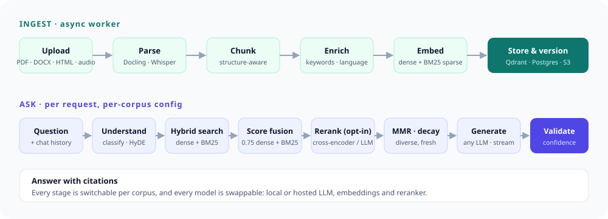

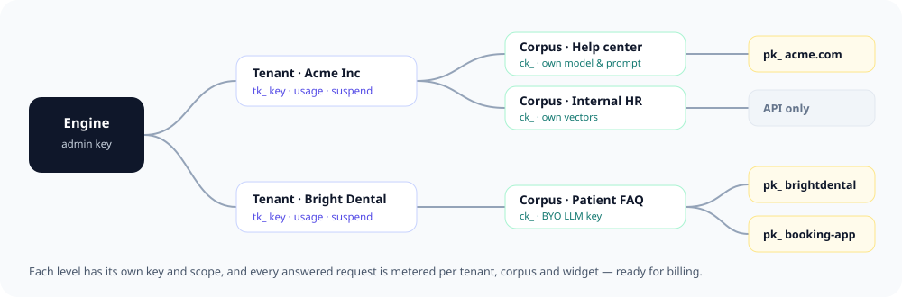

<details>
<summary><b>Architecture deep dive</b> — layers, pipelines, provider pattern, data model, tech stack</summary>

### Architecture Overview

Full end-to-end pipeline — from document upload through to validated AI-generated answers with citations.

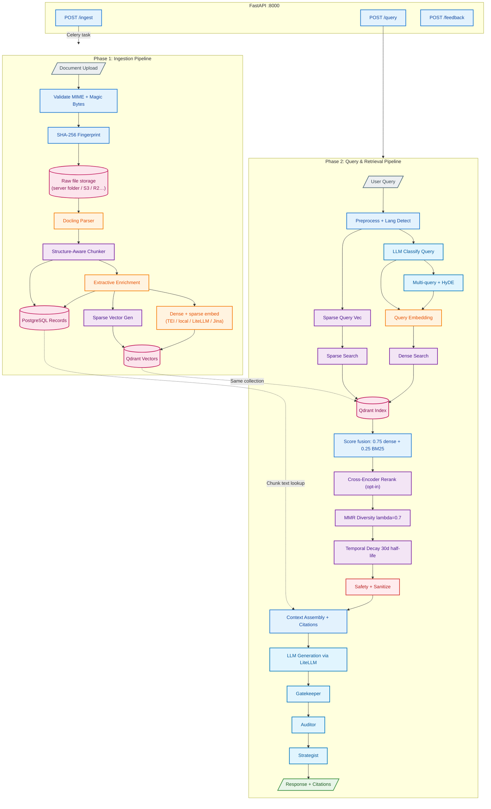

### Ingestion Pipeline

9-step deterministic pipeline that transforms raw documents into searchable vector embeddings.

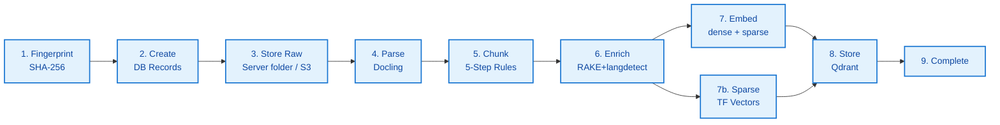

**Chunking** is structure-aware with a 5-step deterministic pipeline:
1. Heading-based splits (preserve document hierarchy)
2. Table/code block isolation (keep structured data intact)
3. Size normalization (target ~300 tokens, hard max 1000)
4. Overlap injection (64-token sliding window)
5. Parent-child linking (hierarchical chunk relationships)

**Supported formats:** PDF, DOCX, TXT, Markdown, HTML

### Query & Retrieval Pipeline

15-step pipeline from raw query to validated, cited response.

```mermaid
flowchart LR
    classDef step fill:#e3f2fd,stroke:#1976d2,stroke-width:2px,color:#0d47a1
    classDef rerank fill:#f3e5f5,stroke:#7b1fa2,stroke-width:2px,color:#4a148c
    classDef llmstep fill:#e1f5fe,stroke:#0277bd,stroke-width:2px,color:#01579b
    classDef safety fill:#ffebee,stroke:#d32f2f,stroke-width:2px,color:#b71c1c

    A["1. Preprocess\nLang+Stopwords"]:::step
    B["2. Classify\nLLM"]:::llmstep
    C["3. Variants\nMulti-query"]:::llmstep
    D["4. Embed\nquery"]:::step
    E["5. Sparse\nQuery Vec"]:::step
    F["6. Hybrid\nSearch"]:::step
    G["7. Score\nFusion"]:::step
    H["8. Rerank\n(opt-in)"]:::rerank
    I["9. MMR\nDiversity"]:::rerank
    J["10. Temporal\nDecay"]:::rerank
    K["11. Safety\nSanitize"]:::safety
    L["12. Context\nAssembly"]:::step
    M["13. LLM\nGenerate"]:::llmstep
    N["14. Validate\n3-Stage"]:::llmstep
    O["15. Log\nand Return"]:::step

    A --> B --> C --> D --> E --> F --> G --> H --> I --> J --> K --> L --> M --> N --> O
```

**Query Understanding:**
- LLM-based query classification (simple, multi-step, comparison, analytical)
- Multi-query expansion for broader recall
- HyDE (Hypothetical Document Embeddings) for semantic enhancement

**Hybrid Retrieval:**
- Dense search (cosine similarity via Qdrant), queries embedded with the model's own instruction
- Keyword search: BM25 with stopwords and Snowball stemming, the same analyzer for chunks and
  queries; each chunk indexed with its section heading
- Weighted score fusion (0.75 dense, 0.25 keyword, on per-query normalized scores); RRF per corpus

**Reranking Pipeline:**
- Cross-encoder reranking (BGE-reranker-v2-m3), opt-in per corpus
- MMR diversity filter (lambda=0.7, configurable)
- Temporal decay (30-day half-life, configurable)

**3-Stage Response Validation:**
- **Gatekeeper** — checks factual grounding against retrieved context
- **Auditor** — verifies citation accuracy and completeness
- **Strategist** — assesses response quality and confidence scoring

### Provider Pattern

Every external dependency has an abstract base class (ABC) and a swappable implementation. No vendor lock-in.

```mermaid
classDiagram
    class DocumentParserProvider {
        <<ABC>>
        +parse(path, mime_type) ParsedDocument
    }
    class EmbeddingProvider {
        <<ABC>>
        +embed_texts(texts, task) list~EmbeddingResult~
        +embed_query(text) EmbeddingResult
        +health_check() bool
    }
    class VectorStorageProvider {
        <<ABC>>
        +create_collection(name, size)
        +upsert(collection, points)
        +search(collection, vector, limit, filters)
        +search_sparse(collection, sparse_vector, limit, filters)
        +health_check() bool
    }
    class ObjectStorageProvider {
        <<ABC>>
        +upload(bucket, key, data)
        +download(bucket, key) bytes
    }
    class EnrichmentProvider {
        <<ABC>>
        +enrich_batch(chunks) list~EnrichmentResult~
    }
    class LLMProvider {
        <<ABC>>
        +complete(messages) LLMResponse
        +complete_stream(messages) AsyncIterator
        +complete_json(messages) LLMResponse
    }
    class RerankProvider {
        <<ABC>>
        +rerank(query, texts, top_k) list~RerankResult~
    }

    DocumentParserProvider <|-- DoclingParserProvider : implements
    EmbeddingProvider <|-- TEIEmbeddingProvider : implements
    EmbeddingProvider <|-- LiteLLMEmbeddingProvider : implements
    EmbeddingProvider <|-- JinaEmbeddingProvider : implements
    EmbeddingProvider <|-- BGEM3Provider : implements
    EmbeddingProvider <|-- TEIProvider : implements
    VectorStorageProvider <|-- QdrantVectorProvider : implements
    ObjectStorageProvider <|-- S3ObjectStorageProvider : implements
    EnrichmentProvider <|-- ExtractiveEnrichmentProvider : implements
    LLMProvider <|-- LiteLLMProvider : implements
    RerankProvider <|-- BGERerankProvider : implements
```

| Module | Interface | Implementations |
|---|---|---|
| `parsing/` | `DocumentParserProvider` | `DoclingParserProvider` |
| `embeddings/` | `EmbeddingProvider` | `TEIEmbeddingProvider`, `BgeM3EmbeddingProvider` (local), `LiteLLMEmbeddingProvider` (OpenAI, Cohere, Voyage…), `JinaEmbeddingProvider` |
| `vectordb/` | `VectorStorageProvider` | `QdrantVectorProvider` |
| `storage/` | `ObjectStorageProvider` | `S3ObjectStorageProvider` |
| `enrichment/` | `EnrichmentProvider` | `ExtractiveEnrichmentProvider` |
| `llm/` | `LLMProvider` | `LiteLLMProvider` (routes to any model via OpenRouter/LiteLLM) |
| `reranking/` | `RerankProvider` | `BGERerankProvider` |
| `accounts/email/` | `EmailProvider` | `SMTPEmailProvider`, `LogEmailProvider` (development; refused in production), `DisabledEmailProvider` |

### Data Model

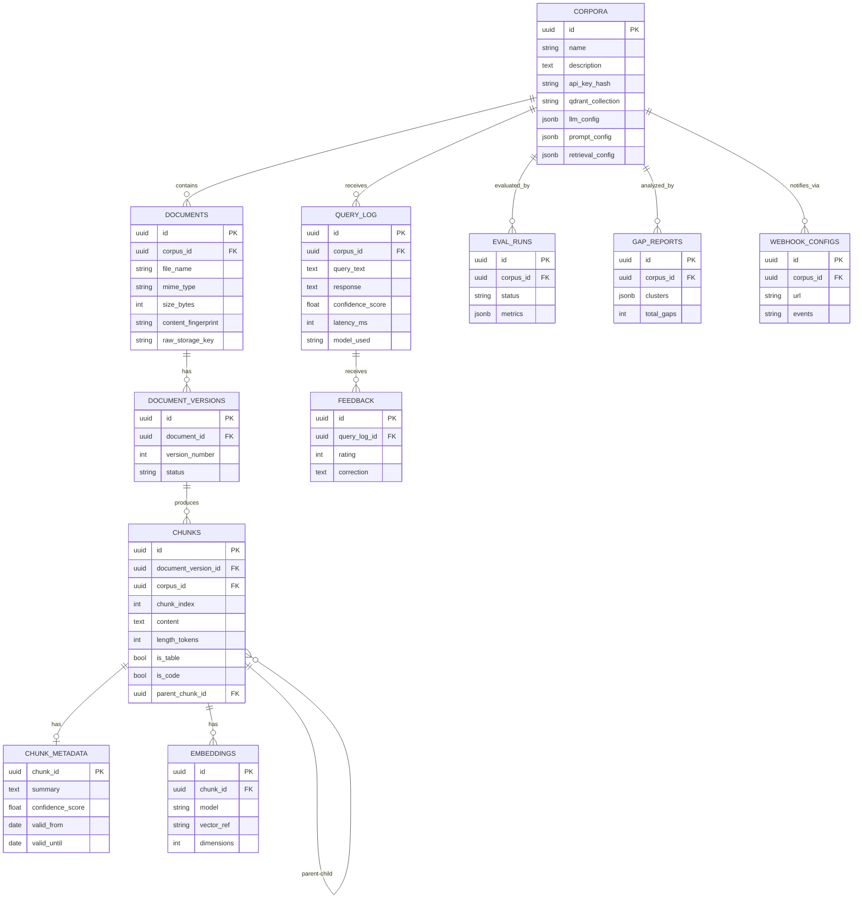

### Multi-Corpus Architecture

Each corpus gets isolated storage and configurable behavior:

- **Dedicated Qdrant collection** per corpus (automatic lifecycle management)
- **Per-corpus API key** authentication (bcrypt-hashed, rotatable), plus tenant keys (`tk_`) that manage a set of corpora, and the tenant's users (owners and members), who sign in to the dashboard and act with the tenant's scope
- **Five credential kinds, one scoping rule**: the admin key (or the super admin's sign-in), a tenant key, a corpus key, a publishable widget key (chat only), and a workspace sign-in (`Authorization: Bearer`); `resolve_scope` and `authorized_corpus_ids` decide what each reaches
- **3-tier config resolution**: Request headers > Corpus config (DB JSONB) > Engine defaults (.env)
- **BYOK support**: Bring Your Own LLM Key (Fernet-encrypted at rest)
- **Retrieval presets**: Economy (fast/cheap), Standard (balanced), Premium (max quality)
- **Self-service config API**: Tenants can view and update their own corpus settings

```
Request comes in with an X-API-Key header (ck_ corpus key)
    |
    v
Auth middleware validates key against corpus.api_key_hash
    |
    v
Config resolver merges: request overrides > corpus.retrieval_config > engine .env defaults
    |
    v
Query executes with per-corpus settings (model, top_k, reranking, MMR, etc.)
```

### Tech Stack

| Component | Technology | Purpose |
|---|---|---|
| Language | Python 3.12+ | Async-first, type-safe with mypy strict |
| API | FastAPI | REST API with OpenAPI docs, SSE streaming |
| Database | PostgreSQL 16 | SQLAlchemy 2.0 async, Alembic migrations |
| Vector DB | Qdrant 1.13 | Dense + sparse vectors, per-corpus collections |
| Object Storage | A folder on the server (default) or any S3-compatible service | Raw document storage |
| Cache | Valkey 8 | Query response cache, embedding cache |
| Task Queue | Celery + Valkey | Async ingestion, periodic evaluation tasks |
| Scheduler | Celery Beat + RedBeat | RAGAS evaluation, gap detection, optimization |
| Document Parsing | Docling | PDF, DOCX, HTML, Markdown extraction |
| Embeddings | TEI / BGE local / LiteLLM (OpenAI, Cohere, Voyage…) / Jina | Configurable per engine and per corpus |
| LLM | LiteLLM | Routes to any provider (OpenAI, Anthropic, Google, local) |
| Reranking | BGE-reranker-v2-m3 | Cross-encoder for precision reranking |
| Observability | Langfuse (self-hosted) | Deep tracing, cost tracking, score reporting |
| Evaluation | RAGAS | Automated quality metrics (faithfulness, relevancy, etc.) |
| Gap Detection | BERTopic | Cluster unanswered queries to find knowledge gaps |
| Optimization | Optuna | Bayesian hyperparameter tuning for retrieval settings |

</details>

---

## API Reference

Every route takes its key in the `X-API-Key` header, or, for dashboard users,
`Authorization: Bearer <access token>` from `POST /api/v1/auth/login` (a super-admin sign-in
acts as the admin key, a workspace sign-in as its tenant's key); except the widget routes
(`X-Widget-Key`), `/api/v1/public/` routes and the signed-out `/api/v1/auth/` routes (no key).
When both headers are sent, `X-API-Key` wins. Errors carry a machine-readable `code` next to
`detail`, e.g. `{"detail": "API key required", "code": "auth_required"}`.
The full, generated reference is [`docs/openapi.json`](docs/openapi.json) (and `/docs` on a
non-production engine).

**"Any key"** below means an admin, tenant or corpus key, scoped the same way everywhere: a
corpus key reaches only its own corpus (naming another is `403`); a tenant key reaches only the
corpora it owns (another tenant's is `403`) and names the corpus with `corpus_id`; the admin key
reaches everything and also names the corpus. A corpus key never needs `corpus_id`.

### Identity

| Method | Endpoint | Auth | Description |
|---|---|---|---|
| `GET` | `/api/v1/whoami` | Any key or sign-in | Which kind of credential this is (`auth`: `api_key` / `session`), its tenant / corpus, `role`, the signed-in `user`, and, for a `tk_` or `ck_` key, its `permission`, `key_name` and `key_id` |
| `GET` | `/api/v1/health` | None | Liveness: health of the API and each backing service (`ok` or `degraded`); always HTTP 200 |
| `GET` | `/api/v1/health/ready` | None | Readiness: the same list, but HTTP 503 (`not_ready`) when Postgres, Valkey or Qdrant is down; object storage is listed, not required. Use it for load balancers, uptime monitors and deploy scripts |
| `GET` | `/api/v1/info` | Any key | Engine version, enabled features (including COB: `features.cob`), models and the limits a UI should mirror |

### Accounts and sessions

| Method | Endpoint | Auth | Description |
|---|---|---|---|
| `POST` | `/api/v1/auth/login` | None | `{email, password, tenant_id?}` → access token (15 min) + rotating refresh token, the user, the current workspace and every workspace; 401 `invalid_credentials` for any wrong e-mail or password; 429 `account_locked` / `rate_limited` |
| `POST` | `/api/v1/auth/refresh` | None | `{refresh_token}` → a new pair; each refresh token works once, and reusing the replaced one ends the session (401 `refresh_token_reused`) |
| `POST` | `/api/v1/auth/logout` | None | `{refresh_token}` → 204, always |
| `POST` | `/api/v1/auth/signup` | None | `{business_name, name, email, password}` → 202 `{"status": "verification_sent", "email"}` for every address (an existing account gets an e-mail saying so instead of a code); 403 `signup_closed` with the operator's contact text in closed mode; 422 `weak_password`; 503 `email_not_configured` / `email_unavailable` |
| `POST` | `/api/v1/auth/verify` | None | `{email, code}` → creates the workspace with you as its owner and signs you in (the login response); `tenant.status` is `active` (open sign-up) or `pending` (waiting for approval); 400 `invalid_code` / `code_expired` |
| `POST` | `/api/v1/auth/resend` | None | `{email, purpose: "verify" \| "reset"}` → 202 `{"status": "sent_if_applicable"}`, always |
| `POST` | `/api/v1/auth/forgot` | None | `{email}` → 202 `{"status": "sent_if_applicable"}`, always; e-mails a reset code to a verified account |
| `POST` | `/api/v1/auth/reset` | None | `{email, code, new_password}`: set a password with an e-mailed code (the super admin's first one too); ends every session; 422 `weak_password`, 400 `invalid_code` / `code_expired` |
| `GET` | `/api/v1/auth/me` | Sign-in | The user, current workspace, workspaces and session id |
| `PATCH` | `/api/v1/auth/me` | Sign-in | Change your name |
| `POST` | `/api/v1/auth/change-password` | Sign-in | `{current_password, new_password}`; ends your other sessions |
| `GET` | `/api/v1/auth/sessions` | Sign-in | Your active sessions, newest first |
| `DELETE` | `/api/v1/auth/sessions/{id}` | Sign-in | End one of your sessions |
| `POST` | `/api/v1/auth/sessions/revoke-others` | Sign-in | End every session but this one |
| `POST` | `/api/v1/auth/switch-tenant` | Sign-in | `{tenant_id}` → an access token for another workspace you belong to; the super admin may enter only the operator's own workspace (see [The operator's own workspace](#the-operators-own-workspace)), anything else is 403 `not_member` |
| `POST` | `/api/v1/auth/switch-admin` | Super admin sign-in | Leave the operator workspace for the admin view: a new access token with `tenant: null`; 403 `not_superadmin` for anyone else |

Every account route answers 503 `accounts_not_configured` while `RAG_SESSION_SECRET` is unset, and
503 `rate_limiter_unavailable` when Valkey is down (sign-in limits fail closed). Signed-in routes
answer an API key with 403 `session_required`.

### Teams and invitations

| Method | Endpoint | Auth | Description |
|---|---|---|---|
| `GET` | `/api/v1/tenants/me/members` | Tenant key or sign-in | `{members, invitations}`: the team and its open invitations (members may view) |
| `POST` | `/api/v1/tenants/me/members` | Tenant key or owner | `{email, role: "owner" \| "member"}` → 201, the link is e-mailed (7 days, single use; inviting the address again replaces it); 409 `already_member` / `superadmin_email`; 503 `email_not_configured` / `email_unavailable`; 20 invites an hour per workspace |
| `DELETE` | `/api/v1/tenants/me/invitations/{id}` | Tenant key or owner | Revoke an open invitation |
| `POST` | `/api/v1/tenants/me/invitations/{id}/resend` | Tenant key or owner | E-mail a new link, valid 7 more days (the old one stops working) |
| `PATCH` | `/api/v1/tenants/me/members/{user_id}` | Tenant key or owner | `{role}`; 409 `last_owner` when demoting the only owner |
| `DELETE` | `/api/v1/tenants/me/members/{user_id}` | Tenant key or owner; anyone for themselves | Remove someone, or leave; their sessions in this workspace end, the account stays; 409 `last_owner` |
| `GET` | `/api/v1/admin/tenants/{id}/members` | Admin key | Any tenant's team (also `PATCH` / `DELETE …/members/{user_id}`, `DELETE …/invitations/{id}`, and `POST …/invitations/{id}/resend`, which returns the new `accept_url`) |
| `POST` | `/api/v1/admin/tenants/{id}/invitations` | Admin key | `{email, role}` → 201 with `accept_url`, the link to send yourself when there is no SMTP (it is e-mailed too when there is) |
| `POST` | `/api/v1/invitations/view` | None | `{token}` → workspace, role, address, inviter, expiry and `account_exists`; 404 `invitation_invalid` for an unknown, expired, revoked or used link |
| `POST` | `/api/v1/invitations/accept` | None, or sign-in | `{token, name?, password?}`. Signed in as the invited address: joins (`{"accepted": true, "tenant"}`; 403 `invitation_email_mismatch` for another address). Not signed in: creates the account (already verified), joins and signs in (the login response); 409 `account_exists` if the address has one (sign in first) |

The invitation token only travels in the link's `#fragment` and the POST body, never in a URL the
engine receives. Owner-only routes answer a member's sign-in with 403 `owner_required` (see
[Teams](#teams)).

### Ingestion and documents

| Method | Endpoint | Auth | Description |
|---|---|---|---|
| `POST` | `/api/v1/ingest` | Any key | Upload a document for async ingestion (202) |
| `POST` | `/api/v1/ingest/records` | Any key | Import up to 1000 text records by id (202) |
| `GET` | `/api/v1/ingest/jobs/{id}` | Any key | One ingestion job: corpus, file, mode, status, similar documents for a review |
| `GET` | `/api/v1/ingest/jobs` | Any key | List ingestion jobs; `status`, `corpus_id`, `offset`, `limit`, with `total` |
| `POST` | `/api/v1/ingest/jobs/{id}/retry` | `write` key | Run a failed upload again from its stored file, as a new job (the failed one stays); 202 `{job_id, status}`. `409 job_not_retryable` with `reason` `records_job`, `not_failed`, `source_unknown` or `file_missing`; the document limit applies |
| `POST` | `/api/v1/ingest/{job_id}/confirm` | Any key | Resolve a near-duplicate held for review |
| `GET` | `/api/v1/documents` | Any key | List a corpus's documents (`corpus_id` for admin/tenant keys; `search`; `source=website\|articles\|files`) |
| `GET` | `/api/v1/documents/{id}` | Any key | A document, its versions and its chunks (paginated, read-only) |
| `GET` | `/api/v1/documents/{id}/versions` | Any key | A document's version history |
| `POST` | `/api/v1/documents/{id}/versions/{version_id}/restore` | Any key; owner sign-in | Make an old version live again |
| `POST` | `/api/v1/documents/{new_id}/replace/{old_id}` | Any key; owner sign-in | Merge a new upload into an existing document's history |
| `DELETE` | `/api/v1/documents/{id}` | Any key; owner sign-in | Delete a document, its versions and vectors |

"Owner sign-in" means the route is owner-only for dashboard users: a member's sign-in gets 403
`owner_required` (see [Teams](#teams)); every key keeps its powers.

### Asking

| Method | Endpoint | Auth | Description |
|---|---|---|---|
| `POST` | `/api/v1/query` | Any key | Answer with citations; with the assistant on the response adds `label`, `route`, `language`, `quick_replies`, `cta`, `ui`, `timings`, `assistant_version`; the optional `assistant` option takes `{conversation_id, page_url, use_draft, debug, simulate}` |
| `POST` | `/api/v1/query/stream` | Any key | Answer, streamed (SSE: `stage` progress, `meta`, `sources` with score breakdowns, `token`, `quick_replies`, `ui`, `trace` for a debug turn, `done` with `query_id` and per-stage `timings`, `error`); see [How a message is answered](#how-a-message-is-answered) |
| `POST` | `/api/v1/query/retrieve` | Any key | Ranked chunks only, no LLM call |
| `GET` | `/api/v1/query/{id}` | Any key | One past question and answer |
| `POST` | `/api/v1/feedback` | Any key | Rate an answer |
| `GET` | `/api/v1/feedback` | Any key | Ratings with their question; `corpus_id`, rating and date filters, paged |
| `GET` | `/api/v1/feedback/stats` | Any key | Feedback totals for a corpus |
| `POST` | `/api/v1/corpora/{id}/conversations` | Any key | Start a conversation (also list, get, `PATCH`, `DELETE`) |
| `POST` | `/api/v1/corpora/{id}/conversations/{cid}/messages` | Any key | Send a message; JSON or SSE with `Accept: text/event-stream` |
| `POST` | `/api/v1/corpora/{id}/memories` | Any key | Store a memory (also bulk, search, list, get, delete, purge) |

`/query`, `/query/stream`, conversation messages and widget chat answer 429
`question_cap_reached` (with `Retry-After`) once the tenant's plan's monthly questions are used;
`/query/retrieve` is never capped. See [Plans and usage caps](#plans-and-usage-caps).

### Website widget

| Method | Endpoint | Auth | Description |
|---|---|---|---|
| `POST` | `/api/v1/corpora/{id}/widget-keys` | Any key | Create a publishable widget key (also `GET`, `PATCH`, `DELETE`, `POST …/rotate`) |
| `GET` | `/widget.js` | Public | The embeddable chat widget script |
| `GET` | `/api/v1/widget/config` | Widget key | Widget branding; with the assistant on also its name, avatar, AI disclosure line, language, `starters` and `proactive` greetings |
| `POST` | `/api/v1/widget/chat` | Widget key | Visitor chat, streamed (SSE: `stage`, `meta` with the chat's `session`, `sources`, `token`, `quick_replies`, `ui`, `done`, `error`); the body may carry `session`, `page_url` and `utm` |
| `POST` | `/api/v1/widget/event` | Widget key | A chip tap or button click or dismissal (`{session, type, cta_type?}` with `type` one of `chip_click`, `cta_click`, `cta_dismiss`): 204; 400 `widget_session_invalid`, 409 `assistant_disabled`, 429. Counters only, no free text; limited separately from chat |

### Website learning

| Method | Endpoint | Auth | Description |
|---|---|---|---|
| `GET` | `/api/v1/corpora/{id}/website` | Any key | Settings, the plan's limits, the sites with progress, and allowed sites not read yet |
| `PATCH` | `/api/v1/corpora/{id}/website` | Owner | `{enabled?, exclude_patterns?, refresh_mode?, adaptive?}` (up to 50 paths of 200 characters; matching pages are archived now; a new schedule applies to every learned page at once) |
| `POST` | `/api/v1/corpora/{id}/website/learn` | Any key | `{origin}`, an allowed site of an active widget key: 202; 422 `website_url_invalid`, `website_not_allowed`, `website_blocked`; 409 `website_learning_disabled` |
| `POST` | `/api/v1/corpora/{id}/website/reread` | Any key | Read every site again: 202 `{queued}`; 429 `website_reread_too_soon` once per 10 minutes |
| `DELETE` | `/api/v1/corpora/{id}/website/sources/{source_id}` | Owner | Archive the site's pages and remove the site: 204 |
| `GET` | `/api/v1/corpora/{id}/website/pages` | Any key | `?status&source_id&q&offset&limit` (at most 100): `{items, total, counts}`; `status` also takes `waiting` |
| `POST` | `/api/v1/corpora/{id}/website/pages/{page_id}/reread` | Any key | Read one page again: 202 |
| `PATCH` | `/api/v1/corpora/{id}/website/pages/{page_id}` | Owner | `{excluded}`: leave a page out (archived now) or include it again |
| `POST` | `/api/v1/corpora/{id}/website/learn-key` | Owner | Make the push link: 201 `{key, push_url, hint}`, shown once; a new one replaces the old |
| `DELETE` | `/api/v1/corpora/{id}/website/learn-key` | Owner | Remove the push link: 204 |
| `POST` | `/api/v1/public/learn/{key}` | The key | `{url?, urlList?, host?, key?, keyLocation?}` (IndexNow-shaped): 202 `{accepted, rejected}`; 404 `learn_key_invalid`, 422 `learn_key_mismatch`, 429 `learn_rate_limited`, 503 `learn_unavailable`, 409 `website_learning_disabled` |
| `GET` | `/api/v1/public/learn/{key}` | The key | `?url=`: the same for one page |
| `POST` | `/api/v1/widget/page` | Widget key | `{page_url, fingerprint}` from the widget's freshness sensor: always 204 |
| `GET` | `/api/v1/home` | Workspace sign-in or tenant key | The business Home: assistant, website sites with progress, and today's conversations, leads and open handoffs; `?corpus_id` (default: the workspace's oldest knowledge base). 403 `no_workspace` for the admin |
| `POST` | `/api/v1/corpora/{id}/articles` | Any key (write) | `{kind: "article" \| "faq", title, body}` (body up to 50,000 characters): 202, one document; 409 `document_limit_reached` |
| `GET` | `/api/v1/corpora/{id}/articles/{document_id}` | Any key | The text as written (the document's id or the article's own id); 404 `article_not_found` |
| `PUT` | `/api/v1/corpora/{id}/articles/{document_id}` | Any key (write) | Change the text; the assistant learns a new version. 422 `article_kind_changed` |
| `GET` | `/api/v1/onboarding` | Workspace sign-in or tenant key | Where the workspace is in the first-run steps: step, status, website, the script to install, whether the assistant has loaded on the site (and on which refused addresses) and how many pages are learned |
| `POST` | `/api/v1/onboarding/website` | Owner | `{website, assistant_name?, avatar_url?, business_type?, whatsapp?, hours?}`: knowledge base, assistant, widget key and website learning in one call; idempotent. A failing step returns that route's own error (`kb_limit_reached`, `widget_key_limit_reached`, `website_blocked`) and keeps what succeeded |
| `PATCH` | `/api/v1/onboarding` | Owner | `{step?, status?: "dismissed" \| "done"}`: move to a step, skip or finish |
| `GET` | `/api/v1/corpora/{id}/website/suggestions` | Any key | `?lang=en\|hi-Latn`: up to six first questions made from the learned pages and the card's opening hours; no model call |
| `POST` | `/api/v1/corpora/{id}/assistant/avatar` | Owner | Multipart `file` (PNG, JPEG or WebP, at least 64 px, up to `RAG_AVATAR_MAX_BYTES`): 201 `{avatar_url}`; 422 `avatar_invalid`, 413 `avatar_too_large` |
| `GET` | `/api/v1/public/avatars/{uuid}.png` | None | The re-saved 256 px PNG, with `nosniff`, a sandboxing CSP and a year-long immutable cache; 404 `avatar_not_found` |

### Corpora and tenants

| Method | Endpoint | Auth | Description |
|---|---|---|---|
| `POST` | `/api/v1/corpora` | Admin or tenant key | Create a corpus (admin: `tenant_id` required; optionally its own `embedding_config`); returns its `ck_` key once |
| `GET` | `/api/v1/corpora` | Admin or tenant key | List corpora with owner, document/chunk counts and last activity; `tenant_id`, `offset`, `limit` |
| `GET` | `/api/v1/corpora/{id}` | Admin or owning tenant | Corpus details (secrets redacted) |
| `PUT` | `/api/v1/corpora/{id}` | Admin or owning tenant | Update a corpus (only sent fields change; null clears one); admin can move it to another tenant with `tenant_id` (every corpus has one; `null` is refused) |
| `DELETE` | `/api/v1/corpora/{id}` | Admin or owning tenant | Delete a corpus and all its data. With an API key it needs `?confirm_name=<the exact name>` (422 `confirmation_required`, or `confirm_mismatch` for another name); a dashboard sign-in confirms in the UI |
| `GET` | `/api/v1/corpora/{id}/delete-preview` | Admin or owning tenant | Dry run: what a delete would remove (documents, chunks, widget keys, conversations, memories) and the `confirm_name` to send; changes nothing |
| `POST` | `/api/v1/corpora/{id}/rotate-key` | Admin or owning tenant | Replace the corpus's default key (other named keys are untouched) |
| `GET`, `POST` | `/api/v1/corpora/{id}/keys` | Owner, or a `full` key | The knowledge base's named `ck_` keys: list (name, prefix, permission, last used, who made it) and create (`{name, permission}`, permission defaults to `read`; the key is in the response once) |
| `PATCH`, `DELETE` | `/api/v1/corpora/{id}/keys/{key_id}` | Owner, or a `full` key | Rename a key or change its permission (applies on its next request); revoke it |
| `POST` | `/api/v1/corpora/{id}/keys/{key_id}/rotate` | Owner, or a `full` key | A new secret for that key (returned once); the old one stops at once |
| `GET` | `/api/v1/corpora/{id}/assistant` | Any key that reaches it | The published assistant and the draft (`enabled`, `published`, `draft`) |
| `PUT`, `PATCH` | `/api/v1/corpora/{id}/assistant/draft` | Same (`write` for a key) | Replace the draft, or merge a JSON merge patch into it; `base_revision` guards against a stale edit (409 `assistant_draft_conflict`, 422 with the field path) |
| `POST` | `/api/v1/corpora/{id}/assistant/draft/from-template` | Same | Start the draft from a template (`{template, keep_identity?}`) |
| `DELETE` | `/api/v1/corpora/{id}/assistant/draft` | Same | Discard the draft (204); the published assistant is untouched |
| `POST` | `/api/v1/corpora/{id}/assistant/publish` | Owner (a member's sign-in is refused) | `{base_revision, note?}`: publish the draft as the next version after the publish checks |
| `GET` | `/api/v1/corpora/{id}/assistant/versions` | Any key that reaches it | Published and archived versions, newest first (`offset`, `limit`); `…/versions/{n}` returns one |
| `POST` | `/api/v1/corpora/{id}/assistant/versions/{n}/restore` | Owner | Publish version `n` again as a new version |
| `POST` | `/api/v1/corpora/{id}/assistant/enabled` | Owner | `{enabled}`: switch the assistant on or off (a new published version) |
| `POST` | `/api/v1/corpora/{id}/assistant/setup` | Any key that reaches it | Start a guided setup (`{business_type?, website_url?}`, 201); older unfinished sessions are abandoned |
| `GET` | `/api/v1/corpora/{id}/assistant/setup/{sid}` | Same | One session: status, proposal, confirmed `profile`, answers, per-item `provenance`, `embedding_multilingual`, `recommend_multilingual` |
| `POST` | `/api/v1/corpora/{id}/assistant/setup/{sid}/propose` | `write` key | `{pages: [{url, title, text}], crawl_job_id?}` (at most `RAG_SETUP_MAX_PAGES` pages and `RAG_SETUP_MAX_CHARS` characters): the proposal; 503 `assistant_llm_unavailable` without a model |
| `GET` | `/api/v1/corpora/{id}/assistant/setup/{sid}/questions` | Same | The 12 questions with prefill and the `profile` to confirm |
| `POST` | `/api/v1/corpora/{id}/assistant/setup/{sid}/answers` | `write` key | `{answers, business_type?, profile?, partial?}`; `partial: true` saves progress with required questions still open (generate checks them and names the first missing one); a bad or missing answer is a 422 whose `loc` is `["body","answers",<question id>]` |
| `POST` | `/api/v1/corpora/{id}/assistant/setup/{sid}/generate` | `write` key | `{wording?: "ai"\|"template", base_revision?}`: writes the draft; returns `draft_revision`, `config`, `provenance`, `wording_used`, `warnings` |
| `POST` | `/api/v1/corpora/{id}/assistant/setup/{sid}/tests` | `write` key | Create the setup's test set and start its run (202) |
| `GET` | `/api/v1/corpora/{id}/assistant/setup/{sid}/gaps` | Same | `{run_status, items: [{question, message}]}`; empty while the run is unfinished |
| `POST` | `/api/v1/corpora/{id}/assistant/setup/{sid}/apply` | Owner (a member's sign-in is refused) | `{base_revision, note?}`: publish the generated draft |
| `POST` | `/api/v1/corpora/{id}/assistant/compile` | Any key that reaches it | The prompt for a sample turn (`{config?, sample?}`), from the draft by default; no model call |
| `POST` | `/api/v1/corpora/{id}/assistant/rules/improve` | `write` key (members may use it) | `{instruction, type, rule_id?}`: a cleaner wording and the enabled rules it may conflict with; nothing is saved. One fast-model call, metered under source `assistant`; 503 `assistant_llm_unavailable` without a model, 502 `assistant_llm_failed` when it does not answer |
| `GET` | `/api/v1/assistant/templates` | Any key | The eight business templates; `…/templates/{key}` returns one with its ten test questions |
| `GET` | `/api/v1/config` | Any key | A corpus's prompt, retrieval and (redacted) LLM settings |
| `PATCH` | `/api/v1/config` | Any key | Change a corpus's prompt and retrieval settings (null clears a field) |
| `POST` | `/api/v1/admin/tenants` | Admin key | Create an active tenant on `plan_id` (default: the default plan); `max_corpora` overrides the plan's knowledge-base limit (also get, `PUT` — `max_corpora: null` follows the plan again — and `POST …/rotate-key`); `PUT {"is_active": false}` suspends and needs `confirm_name` |
| `GET` | `/api/v1/admin/tenants` | Admin key | Tenants with status, plan, owners, counts and questions this month; `status`, `search`, `offset`, `limit` (100, at most 500) → `{items, count, total, offset, limit}` |
| `POST` | `/api/v1/admin/tenants/{id}/activate` | Admin key | Activate a pending sign-up; `{plan_id?, note?}`; the owners are e-mailed (naming the plan) |
| `POST` | `/api/v1/admin/tenants/{id}/suspend` | Admin key | `{confirm_name, reason?}`: every key, widget and sign-in of the tenant stops at once; `confirm_name` must be its exact name (422 `confirm_mismatch`); the operator's own workspace is never suspended (409 `operator_workspace_protected`) |
| `POST` | `/api/v1/admin/tenants/{id}/reactivate` | Admin key | Undo a suspension |
| `POST` | `/api/v1/admin/tenants/{id}/decline` | Admin key | `{reason?}`: remove a pending sign-up and its account (204); the owner gets a polite e-mail |
| `DELETE` | `/api/v1/admin/tenants/{id}?confirm_name=<name>` | Admin key | Delete a tenant and everything it owns (requires `?confirm_name=<name>`, 422 `confirmation_required` without it; the operator's own workspace also needs `&confirm_operator_workspace=true`, else 422 `operator_confirmation_required`) |
| `GET` | `/api/v1/admin/tenants/{id}/delete-preview` | Admin key | Dry run: knowledge bases, documents, chunks, widget keys, conversations, members and keys a delete would remove, and the `confirm_name` to send |
| `GET`, `POST` | `/api/v1/admin/tenants/{id}/keys` | Admin key | A customer's named `tk_` keys (list, create); `PATCH`, `DELETE` and `POST …/rotate` on `…/keys/{key_id}` as for a knowledge base |
| `GET`, `POST` | `/api/v1/tenants/me/keys` | Owner sign-in, or a `full` `tk_` key | The caller's own workspace's named keys, with `PATCH`, `DELETE` and `POST …/rotate` on `…/keys/{key_id}` |
| `GET` | `/api/v1/tenants/me` | Tenant key or sign-in | The tenant's own record, status, plan and limits; `POST …/me/rotate-key` replaces its key. Tenant records (here and under `/admin/tenants`) carry `has_api_key`: whether a `tk_` key was ever issued (a sign-up has none until one is rotated in) |

### Plans

| Method | Endpoint | Auth | Description |
|---|---|---|---|
| `GET` | `/api/v1/admin/plans` | Admin key | Plans with how many tenants use each (`include_inactive`, default true); `is_builtin` marks the plan the engine seeded (read-only) and `is_internal` the locked Internal plan (`include_inactive=false`, the picker of plans a customer can be put on, leaves it out); also `POST`, `GET/PATCH/DELETE …/{id}` — see [Plans and usage caps](#plans-and-usage-caps) (409 `plan_name_taken`, `plan_in_use`, `plan_is_default`) |
| `POST` | `/api/v1/admin/tenants/{id}/plan` | Admin key | `{plan_id}`: move the tenant to another active plan (404 `plan_not_found`, 409 `plan_inactive`) |
| `GET` | `/api/v1/admin/tenants/{id}/plan` | Admin key | The tenant's plan, effective limits and usage this month |
| `GET` | `/api/v1/tenants/me/plan` | Tenant key or sign-in | `{plan, limits, usage: {month, questions, knowledge_bases, documents, widget_keys}, resets_at}` — usage against the plan (owners and members) |

### Pipelines

| Method | Endpoint | Auth | Description |
|---|---|---|---|
| `GET` | `/api/v1/admin/pipelines` | Admin key | Pipeline profiles, the default first: `{items, default_id}`; each has its settings, what its blank fields mean right now (`resolved`) and how many plans and businesses use it; also `POST` (422 `invalid_profile` names the rule that was broken, 409 `profile_name_taken`) — see [Answer speed and fair use](#answer-speed-and-fair-use) |
| `GET` | `/api/v1/admin/pipelines/{id}` | Admin key | One profile; also `PATCH` (the `config` sent replaces the whole config) and `DELETE` (409 `profile_in_use` with the counts of plans and businesses using it, 409 `profile_is_default`) |
| `POST` | `/api/v1/admin/pipelines/{id}/clone` | Admin key | `{name, label?}`: a copy under a new name |
| `POST` | `/api/v1/admin/pipelines/{id}/default` | Admin key | Make it the default profile (the old default stops being one in the same step) |
| `GET` | `/api/v1/admin/pipelines/lanes` | Admin key | The answer lanes now: slots and how many are taken, by priority |
| `GET` | `/api/v1/admin/local-llm` | Admin key | The free local model: `{enabled, state, model, models, checked_at}`, state `not_configured`, `starting`, `pulling`, `ready` or `down` (a live check) |
| `POST` | `/api/v1/admin/local-llm/test` | Admin key | Make the local model say a few words: `{ok, first_token_ms, total_ms, tokens_per_s, answer}`; 503 `local_llm_unavailable` when it is not ready, 429 `local_llm_test_too_soon` within 10 seconds |
| `GET` | `/api/v1/admin/pipelines/tenants/{tenant_id}` | Admin key | The profile a business answers with, and whether it comes from its own override, its plan or the default; `PUT {profile_id}` gives it one of its own (`null`: back to its plan's) |
| `PATCH` | `/api/v1/admin/plans/{id}` | Admin key | A plan's `pipeline_profile_id` (and `POST`): which profile its businesses answer with; 404 `profile_not_found` |

### Fair use

| Method | Endpoint | Auth | Description |
|---|---|---|---|
| `GET` | `/api/v1/admin/fair-use` | Admin key | Businesses with their fair-use state (`ok`, `near`, `throttled`, `stopped`), the most worrying first, with the most serious limit for a business that is not `ok`: `?q`, `?state`, `?offset`, `?limit` (at most 100) → `{items, total}` |
| `GET` | `/api/v1/admin/fair-use/tenants/{tenant_id}` | Admin key | One business's effective limits and policy (its plan's, then its own), `overridden`, how much of each is used now, its state and what the engine decided for it today |
| `PUT` | `/api/v1/admin/fair-use/tenants/{tenant_id}` | Admin key | `{limits: {field: number\|null}, policy: {field: value}, clear: [field]}`: limits or a policy of its own (`null` = unlimited, `clear` = follow the plan again); 422 `invalid_fair_use` names the rule; audited as `fair_use.overrides_updated` |
| `GET` | `/api/v1/fair-use` | Sign-in or tenant key | A workspace's own read-only view: `{answer_speed, state, metrics: [{metric, used, limit, pct, level, resets_at}]}`; AI usage carries `pct` only; members see the same; a knowledge-base key gets 403 `scope_forbidden` |
| `PATCH` | `/api/v1/admin/plans/{id}` | Admin key | A plan's `fair_use_limits` and `fair_use_policy` (and `POST`): what each business on it may use and what happens past a limit (422 `invalid_fair_use`); each changed field is listed in the audit row |
| `PATCH` | `/api/v1/admin/settings` | Admin key | `pipelines: {engine_ai_spend_per_day_usd_micro, engine_spend_alert_pct, crawl_concurrency}`: the engine-wide safety rails |

Errors: `fair_use_limit` (429, with `metric`, `limit`, `used`, `resets_at` and `Retry-After`: the
legacy API path, and uploads per day), `storage_limit_reached` (409, with `limit_mb`, `used_mb`,
`adding_mb`), `invalid_fair_use` (422).

### Engine settings and branding

| Method | Endpoint | Auth | Description |
|---|---|---|---|
| `GET` | `/api/v1/admin/settings` | Admin key | Sign-up mode (`open`, `approval`, `closed`) and white-label branding, with who changed them last |
| `PATCH` | `/api/v1/admin/settings` | Admin key | Change them (only sent fields change; null resets a field to its default); audited |
| `GET` | `/api/v1/public/branding` | Public | Product name, logo, colour, support e-mail, contact text/link, sign-up mode, whether sign-in is on (`accounts_enabled`), the password policy, and the "cob-rag-engine by Callobuzz" line (`powered_by`, plain text; `null` when the operator hides it under Branding) |
| `GET` | `/api/v1/admin/smtp` | Admin key | E-mail provider in use (`smtp`, `log`, `disabled`) and the SMTP settings; whether a username/password is set, never their values |
| `POST` | `/api/v1/admin/smtp/test` | Admin key | Send a branded test e-mail to `{"to": ...}` now; 503 `email_not_configured`, 502 `smtp_test_failed` (with `smtp_code`, `error`) |

### Audit

| Method | Endpoint | Auth | Description |
|---|---|---|---|
| `GET` | `/api/v1/admin/audit` | Admin key | The operator's audit trail, newest first: sign-ups and approvals, suspensions and deletions, plan and settings changes, invitations and team changes, password resets, lockouts and refresh-token reuse. Filters: `tenant_id`, `action` (exact, or a prefix ending in `.` such as `tenant.`; 422 otherwise), `actor` (part of who did it), `start`/`end` (ISO datetimes; default the last 90 days, at most 366), `offset`, `limit` (50, at most 200) → `{items, total, offset, limit}` |

Each row names who acted (`actor_kind`: `admin_key`, `tenant_key`, `corpus_key`, `user` or
`system`, with a label snapshot), the tenant, the target, `details` (never a password, code or
token) and the client IP. Rows are kept indefinitely and there is no delete API: the trail is the
operator's record. Tenants have no view of it.

### Models and embeddings

| Method | Endpoint | Auth | Description |
|---|---|---|---|
| `GET` | `/api/v1/models` | Any key | Curated LLM catalog |
| `GET` | `/api/v1/models/presets` | Any key | Retrieval presets (economy / standard / premium) |
| `POST` | `/api/v1/models/discover/openrouter` | Any key + `X-OpenRouter-Key` | Models available on OpenRouter |
| `GET` | `/api/v1/models/embeddings` | Any key | Embedding model catalog |
| `GET` | `/api/v1/migrations` | Admin or tenant key | Embedding migrations across corpora (`corpus_id`, `status`, paged); also `/migrations/{id}` and `/corpora/{id}/migrations` |
| `POST` | `/api/v1/migrations/{id}/approve` | Admin key | Start an embedding migration (also `cancel`, `retry`, `rollback`) |

### Usage, analytics and quality

| Method | Endpoint | Auth | Description |
|---|---|---|---|
| `GET` | `/api/v1/usage` | Any key | Metered requests, tokens and real cost by day, corpus, source, tenant, payer or model |
| `GET` | `/api/v1/usage/consumption` | Tenant key, workspace session or admin (a `ck_` key gets 403) | This month at a glance for the header: platform cost and OpenRouter balance (operator), questions against the plan, or own-key spend |
| `GET` | `/api/v1/admin/costs` | Admin | Platform costs: today, month, range and breakdowns by customer, knowledge base, model, source, payer |
| `GET` | `/api/v1/admin/costs/export` | Admin | The range as CSV, rupees and dollars |
| `GET` | `/api/v1/admin/billing/providers` | Admin | What OpenRouter, OpenAI, Anthropic and manual providers have left, with the one to look at first (amounts in USD micro-units, never a key) |
| `PUT` | `/api/v1/admin/billing/providers/{provider}` | Admin | A manual balance, its date and note, an alert level, a name, or the provider's admin key (`openrouter`, `openai`, `anthropic`, `manual:<id>`, `manual:new`) |
| `POST` | `/api/v1/admin/billing/providers/{provider}/refresh` | Admin | Ask the provider again now (once a minute each; 429 `provider_refresh_too_soon`) |
| `GET` | `/api/v1/analytics/queries/history` | Any key | Past questions (also `count`, `trends`, `confidence`) |
| `GET` | `/api/v1/analytics/gaps` | Any key | Knowledge-gap reports; `POST …/run` queues one |
| `POST` | `/api/v1/golden` | Any key | Add a golden Q&A pair (also list with `total`, `PATCH` to edit, delete — owner-only for sign-ins — import, export, from-feedback) |
| `GET` | `/api/v1/corpora/{id}/golden-sets` | Any key | Test sets with question counts and last run (also `POST` to create one, `POST …/from-template`, `GET`/`PATCH`/`DELETE …/{set_id}` — delete needs `full` and an owner —, `POST …/{set_id}/pairs`) |
| `GET` | `/api/v1/corpora/{id}/eval/criteria` | Any key | Your own judge criteria (also `POST`, `PATCH`/`DELETE …/{criterion_id}`) |
| `GET` | `/api/v1/corpora/{id}/eval/settings` | Any key | Judge model and pass thresholds (`PUT`: owner, `write`; the judge key is never returned) |
| `POST` | `/api/v1/corpora/{id}/eval/estimate` | Any key | What a run would cost (no model call) |
| `POST` | `/api/v1/corpora/{id}/eval/runs` | `write` key | Start a fast or full run against a settings snapshot; 202, then poll (`GET` lists runs, `GET …/{run_id}` has metrics, intervals, tags and warnings, `GET …/{run_id}/samples` has one row per question with filters `failed_only`, `metric`+`below`, `tag`) |
| `PATCH` | `/api/v1/corpora/{id}/eval/samples/{sample_id}` | `write` key | Rate an answer good, acceptable or poor |
| `POST` | `/api/v1/corpora/{id}/eval/compare` | Any key | Compare 2 to 4 completed runs of one set |
| `GET` | `/api/v1/corpora/{id}/assistant/review` | Any key | The review inbox (`kind`, `from`, `to`) |
| `POST` | `/api/v1/corpora/{id}/assistant/review/actions` | `write` key | Dismiss an item, or add an answer or a rule to the draft |
| `POST` | `/api/v1/admin/eval/trigger` | Admin key | Queue a RAGAS evaluation run; poll `/admin/eval/runs/{id}` |
| `POST` | `/api/v1/admin/optimize/trigger` | Admin key | Queue a retrieval optimisation run |
| `POST` | `/api/v1/admin/gaps/trigger` | Admin key | Queue gap detection |
| `PUT` | `/api/v1/admin/config/retrieval` | Admin key | Engine-wide retrieval overrides |

### Billing

| Method | Endpoint | Auth | Description |
|---|---|---|---|
| `GET` | `/api/v1/admin/billing/plans/{plan_id}/pricing` | Admin | How customers on a plan pay (`version: null` and the defaults when it has no pricing; amounts in minor units) |
| `PUT` | `/api/v1/admin/billing/plans/{plan_id}/pricing` | Admin | Replace the pricing with a new version; the response lists what `changed` (409 `pricing_locked` for the Internal plan, 409 `currency_mismatch`) |
| `GET` | `/api/v1/admin/billing/plans/{plan_id}/pricing/history` | Admin | Every version, newest first |
| `GET` | `/api/v1/admin/billing/accounts` | Admin | Every customer's billing (`q`, `payment_type`, `offset`, `limit` up to 100); the COB workspace is never listed |
| `GET` | `/api/v1/admin/billing/accounts/{tenant_id}` | Admin | One account with its effective terms and what it overrides (created on first read) |
| `PATCH` | `/api/v1/admin/billing/accounts/{tenant_id}` | Admin | Set or clear (`null`) overrides, limit overrides, currency, pause override, billing day, notes (409 `currency_locked`, `billing_exempt`) |
| `GET` | `/api/v1/billing/account` | Workspace sign-in or `tk_` key | The workspace's own terms; money fields are `null` for a member unless the plan allows it (`ck_` 403 `scope_forbidden`, admin 403 `no_workspace`) |
| `GET` / `PUT` | `/api/v1/billing/tax-details` | Owner | Who the workspace's tax invoices are made out to (GST number optional; its state wins; 422 `invalid_gstin`) |
| `GET` | `/api/v1/billing/payments/config` | Owner | Whether online payment is on, the public key id, limits, whether tax details are complete |
| `POST` | `/api/v1/billing/payments/quote` | Owner | What a payment costs with GST (409 `tax_details_required`, 422 `amount_out_of_range`) |
| `POST` | `/api/v1/billing/payments/orders` | Owner | Start a payment: the quote and what the payment window needs (same `idempotency_key`, same order) |
| `POST` | `/api/v1/billing/payments/orders/{order_id}/verify` | Owner | The payment window's result; checks the signature, asks Razorpay what happened, credits the balance (400 `payments_signature_invalid`) |
| `GET` | `/api/v1/billing/payments` | Owner | The workspace's own payments (no fees) |
| `GET` / `PUT` | `/api/v1/admin/company` | Admin | The deployer's company details |
| `GET` / `PUT` | `/api/v1/admin/billing/tax-profile` | Admin | The seller's GST number, SAC code, invoice prefix, LUT |
| `GET` / `PUT` | `/api/v1/admin/billing/payments/settings` | Admin | Payment provider keys (write-only), limits, the webhook address and the events to tick |
| `POST` | `/api/v1/admin/billing/payments/settings/test` | Admin | Test the saved keys (once per 10 seconds; 422 `payments_test_failed`) |
| `GET` | `/api/v1/admin/billing/payments` | Admin | Payments received (`tenant_id`, `status`, `start`, `end`), with each fee |
| `GET` | `/api/v1/admin/billing/payments/{payment_id}` | Admin | One payment with refunds, deliveries and `refundable_minor` |
| `POST` | `/api/v1/admin/billing/payments/{payment_id}/refunds` | Admin | Refund from unused balance (409 `refund_exceeds_refundable`, `refund_window_closed`; 502 `refund_failed`) |
| `POST` | `/api/v1/admin/billing/accounts/{tenant_id}/payment-links` | Admin | A link a customer opens to pay |
| `GET` | `/api/v1/admin/billing/payments/events` | Admin | Webhook deliveries that failed or are waiting |
| `POST` | `/api/v1/admin/billing/payments/events/{event_id}/retry` | Admin | Run one again now (409 `payment_event_not_retryable`) |
| `POST` | `/api/v1/public/payments/razorpay/webhook` | Signature | Razorpay's deliveries (400 `payments_signature_invalid`, 404 `payments_disabled`) |

| `GET` | `/api/v1/admin/billing/accounts/{tenant_id}/statements` | Admin | A customer's monthly statements, newest first (`month`, `opening_minor`, `closing_minor`, `live`) |
| `GET` | `/api/v1/admin/billing/accounts/{tenant_id}/statements/{month}` | Admin | One month (`YYYY-MM`) as `format=json` (default), `csv` or `html` (printable page); 404 `statement_not_found` before the account or in the future |
| `GET` | `/api/v1/admin/billing/pnl` | Admin | The platform P&L: `start`, `end` (`YYYY-MM`, at most 24 months), `currency` (`INR` or `USD`); 422 `invalid_range`, `range_too_long` |
| `GET` | `/api/v1/value/settings` | Workspace sign-in or tenant key | The values behind the value report (or the suggestions for this kind of business until saved) |
| `PUT` | `/api/v1/value/settings` | Workspace owner | Save the four values and the e-mail switch (a member gets 403 `owner_required`) |
| `GET` | `/api/v1/value/report` | Workspace sign-in or tenant key | A month's numbers with the estimated value and its formula; `?month=YYYY-MM`, `format=html` for the printable page; 422 `value_month_invalid` |
| `GET` | `/api/v1/value/reports` | Workspace sign-in or tenant key | The frozen months, newest first |
| `GET` | `/api/v1/admin/tenants/{tenant_id}/value-report` | Admin | One business's value report, as its owner sees it |
| `GET` | `/api/v1/billing/statements` | Workspace owner | The workspace's own monthly statements (a member gets 403 `owner_required`) |
| `GET` | `/api/v1/billing/statements/{month}` | Workspace owner | One month as `format=json`, `csv` or `html` |
| `POST` | `/api/v1/billing/top-up-requests` | Workspace owner | Ask the operator to add money (`amount_minor`, `note`, both optional) -> 202 `{sent}`; one an hour per workspace (429 `topup_request_too_soon`) |

All billing routes answer 404 `billing_disabled` when `RAG_BILLING_ENABLED=false`.

### COB

COB routes take a dashboard sign-in only (an API key, even the admin key, gets `403 session_required`), except the public one below, which takes no credential at all.

| Method | Endpoint | Auth | Description |
|---|---|---|---|
| `POST` | `/api/v1/cob/chat` | Sign-in | Ask COB; streams `meta`, `stage`, `sources`, `token`, `quick_replies`, `ui`, `done` (or `error`). Body: `message`, optional `conversation_id`, `context` (`route`, `kb_id`, `docs_slug`) and `language` |
| `GET` | `/api/v1/cob/conversations` | Sign-in | Your own COB conversations in this workspace, newest first (`offset`, `limit` up to 50) |
| `GET` | `/api/v1/cob/conversations/{id}` | Sign-in | One of your conversations with its messages, sources and buttons |
| `DELETE` | `/api/v1/cob/conversations/{id}` | Sign-in | Delete one of your conversations |
| `POST` | `/api/v1/cob/messages/{id}/feedback` | Sign-in | Thumbs up (`1`) or down (`-1`) on a COB answer, with an optional comment |
| `GET` | `/api/v1/cob/starters` | Sign-in | The starter questions for a dashboard screen (`route`, optional `language`) |
| `POST` | `/api/v1/cob/actions/{id}/confirm` | Sign-in | Run an action card you were shown, once. Body: `confirm_name` (the exact name, for destructive cards). `200` with `status` `done` or `failed` (the route's own `http_status` and `code`; a rotated key in `secret`); `404 cob_proposal_not_found`, `409 cob_proposal_used` / `cob_proposal_scope_changed`, `410 cob_proposal_expired`, `422 confirm_mismatch` |
| `POST` | `/api/v1/cob/actions/{id}/cancel` | Sign-in | Dismiss a card without doing anything |
| `GET` | `/api/v1/docs/tree` | Sign-in | The Docs topics and pages your role may read, with the docs version |
| `GET` | `/api/v1/docs/pages/{slug}` | Sign-in | One Docs page as Markdown with its contents list and previous/next (`404 docs_page_not_found` for an unknown or hidden page) |
| `GET` | `/api/v1/docs/search` | Sign-in | Search the Docs (`q`, `limit` up to 20): free, no model, never a question |
| `POST` | `/api/v1/public/cob/chat` | None | Ask COB from a sign-in page: docs-only, nothing stored, limited per IP and per day. Streams like `/api/v1/cob/chat`. Body: `message`, optional `history` (up to 6) and `language`. `404 cob_public_disabled`, `429 cob_public_rate_limited`, `503 cob_public_unavailable` |
| `GET` | `/api/v1/admin/cob/status` | Operator sign-in | What COB's knowledge base holds and how the last sync went |
| `POST` | `/api/v1/admin/cob/resync` | Operator sign-in | Queue a re-read of the docs |
| `GET` | `/api/v1/admin/cob/review` | Operator sign-in | COB's weak answers, grouped by question (`days` up to 90, `rating` `all` or `down`, `limit` up to 100): reasons, role, language, the help page cited and masked thumbs-down comments |

### Content Portal (`RAG_ENABLE_CONTENT_PORTAL=true`)

Every portal route takes any key, scoped like the rest: a workspace belongs to one corpus, and a
key reaches the workspaces of the corpora in its scope (another client's is `403`).

| Method | Endpoint | Auth | Description |
|---|---|---|---|
| `POST` | `/api/v1/portal/workspaces` | Any key (scoped) | Create a workspace (`corpus_id` for admin/tenant keys) |
| `GET` | `/api/v1/portal/workspaces` | Any key (scoped) | Workspaces of the key's corpora, or of one with `corpus_id`; `status`, paged |
| `GET` | `/api/v1/portal/workspaces/{id}` | Any key (scoped) | One workspace with counts (also `PATCH`, `DELETE`, `POST …/lock`, `…/unlock`) |
| `POST` | `/api/v1/portal/workspaces/{id}/content` | Any key (scoped) | Stage a file, text or URL for AI structuring (also list, get, `…/reprocess`) |
| `GET` | `/api/v1/portal/workspaces/{id}/chunks` | Any key (scoped) | Staged chunks (also add, edit, split, merge, reorder, delete, approve, reject) |
| `POST` | `/api/v1/portal/workspaces/{id}/submit` | Any key (scoped) | Review workflow (also `approve`, `reject`, `ingest`, `GET …/audit-trail`) |
| `POST` | `/api/v1/portal/workspaces/{id}/chat` | Any key (scoped) | AI assistant for the workspace (also `…/chat/history`, `…/chat/execute`) |
| `POST` | `/api/v1/portal/workspaces/from-ingestion` | Any key (scoped) | Review the active version of an ingested document; `…/finalize-review` publishes the review as a new version (the reviewed one stays restorable), `…/review-status` |
| `GET` | `/api/v1/portal/corpus/{id}/rules` | Any key (scoped) | Content routing rules (also `POST`, `PATCH`, `DELETE`) |

### Leads

| Method | Endpoint | Auth | Description |
|---|---|---|---|
| `POST` | `/api/v1/widget/lead` | Widget key | A visitor's lead form (needs the chat session; honeypot, per-visitor limit) |
| `POST` | `/api/v1/widget/handoff` | Widget key | A visitor tapped a way to reach a person (needs the chat session; own per-visitor limit) |
| `GET` | `/api/v1/handoffs` | Key `read` / sign-in | List handoffs: `corpus_id`, `status`, `reason`, `channel`, `from`, `to`, paging |
| `GET` | `/api/v1/handoffs/{id}` | Key `write` / sign-in | One handoff with its summary, masked chat and the lead of a call-back |
| `PATCH` | `/api/v1/handoffs/{id}` | Key `write` / sign-in | Mark a handoff `handled` or `new` |
| `GET` | `/api/v1/handoffs/lookup` | Key `read` / sign-in | Find the chat a visitor quoted a reference for: `?ref=SD-4F7K` (any case) returns the matching conversation, handoff and lead ids per knowledge base (TV2) |
| `GET` | `/privacy/withdraw` | None | The page a withdrawal link opens |
| `POST` | `/api/v1/public/leads/withdraw` | None (secret link) | Withdraw consent and erase the lead (idempotent, 10 per hour per address) |
| `GET` | `/api/v1/leads` | Key `write` / sign-in | List leads: `corpus_id`, `status`, `qualification`, `trigger`, `date_from`, `date_to`, `q` (exact phone or e-mail), `page_url`, paging |
| `GET` | `/api/v1/leads/{id}` | Key `write` / sign-in | One lead with summary, notes, consent record and transcript |
| `PATCH` | `/api/v1/leads/{id}` | Key `write` / sign-in | Status, assignee, notes, qualification |
| `DELETE` | `/api/v1/leads/{id}` | Key `full`, owner | Erase a lead and its website chat (audited) |
| `GET` | `/api/v1/leads/export.csv` | Key `write`, owner | CSV (same filters, including `qualification`), at most `RAG_LEAD_EXPORT_MAX_ROWS` rows (audited) |
| `GET` `POST` | `/api/v1/corpora/{id}/webhooks` | Key `full` | A knowledge base's own webhooks (`lead.created`, `handoff.requested`) |
| `PATCH` `DELETE` | `/api/v1/corpora/{id}/webhooks/{webhook_id}` | Key `full`, owner | Pause, resume or remove one |

Error codes: `lead_consent_required`, `lead_invalid_phone`, `lead_invalid_email`,
`lead_field_invalid` (with `field` and `reason`), `lead_rate_limited` (with `Retry-After`),
`widget_session_invalid`, `leads_disabled`, `assistant_disabled`, `encryption_not_configured`,
`lead_not_found`, `export_too_large`, `withdraw_token_invalid`, `webhook_event_not_allowed`,
`webhook_url_not_allowed`, `webhook_not_found`, `handoff_rate_limited` (with `Retry-After`),
`handoff_disabled`, `handoff_channel_unavailable` (with `channel`), `callback_window_invalid`,
`handoff_not_found`.

### Webhooks

| Method | Endpoint | Auth | Description |
|---|---|---|---|
| `POST` | `/api/v1/webhooks` | Admin key | Register a webhook endpoint |
| `GET` | `/api/v1/webhooks` | Admin key | List webhooks |
| `PATCH` | `/api/v1/webhooks/{id}` | Admin key | Enable or disable a webhook (`{"enabled": false}`) |
| `DELETE` | `/api/v1/webhooks/{id}` | Admin key | Remove a webhook |
| `POST` | `/api/v1/webhooks/{id}/test` | Admin key | Send a signed test event |

Engine-wide webhooks receive the operator's events only. `lead.created` and `handoff.requested` carry a visitor's contact data and go only to the webhooks of the knowledge base they belong to (see Leads above); asking for them here is refused with `webhook_event_not_allowed`.

---

## Run a public demo

Set `RAG_DEMO_MODE=true` on a separate server to turn a copy into a demo anyone can try: the sign-in page shows two sign-ins (the platform owner and the owner of a made-up clinic in Pune), deleting, keys, e-mail, WhatsApp and plans are switched off with one friendly sentence, nothing is sent out, model use has a daily ceiling, and everything is put back every night. `RAG_FRAME_ANCESTORS` lets another site show the dashboard in a frame. The steps are in the deployment guide, "Run a public demo".

| Setting | What it does |
|---|---|
| `RAG_DEMO_MODE` | Turns the copy into a demo (default `false`) |
| `RAG_DEMO_OWNER_EMAIL` | The demo business owner's sign-in; must differ from `RAG_SUPERADMIN_EMAIL`, which is the platform owner's |
| `RAG_DEMO_PASSWORD` | The password of both sign-ins; shown to every visitor on purpose |
| `RAG_DEMO_RESET_AT_UTC` | When the nightly reset runs, `HH:MM` in UTC (default `21:30`, which is 03:00 in India) |
| `RAG_DEMO_ANSWERS_PER_DAY` | The most answers the whole demo gives in a day (default `300`); only answers that call the model count. When it is used up everyone sees a polite "try tomorrow" |
| `RAG_DEMO_ANSWERS_PER_VISITOR_PER_DAY` | The most answers one visitor gets in a day (default `15`). A visitor is a keyed hash of the client address plus the signed-in user; people behind one office address share it |
| `RAG_DEMO_MODEL_CALLS_PER_DAY` | The most model calls in a day (default `1200`), a hard stop under the answer limits. A demo day starts at `RAG_DEMO_RESET_AT_UTC`, so every limit starts again when the demo resets |
| `RAG_FRAME_ANCESTORS` | Sites that may show the dashboard in a frame (empty keeps the dashboard's own address only) |

## Configuration

All environment variables are prefixed with `RAG_` and loaded by `pydantic-settings` (`src/callobuzz_rag/core/config.py`). There is one file, `.env`, written by `make setup` from [`.env.example`](.env.example), which documents every setting: section 1 holds what you must fill in, the rest is grouped by topic, and "Advanced" holds safe defaults. Docker Compose, `make dev-app` and pytest-from-anywhere all read that same file; containers additionally get service-name addresses (`postgres`, `redis`, …) from `docker-compose.yml`.

Optional services are switched on with `COMPOSE_PROFILES` in `.env`: `tei` (the bundled embedding container, on by default; `make setup` drops it when you pick a hosted embedding API or in-process embeddings, so it never downloads its model), `observability` (self-hosted Langfuse), `transcription` (Whisper), `local-llm` (a small model that answers for free on the CPU).

**Key configuration areas:**

| Category | Example Variables |
|---|---|
| Database | `RAG_DB_HOST`, `RAG_DB_PORT`, `RAG_DB_USER`, `RAG_DB_PASSWORD` |
| Vector DB | `RAG_QDRANT_HOST`, `RAG_QDRANT_PORT`, `RAG_QDRANT_API_KEY` |
| Object storage | `RAG_STORAGE_PROVIDER` (`local` default, or `s3`), `RAG_STORAGE_LOCAL_ROOT`; for `s3`: `RAG_S3_ENDPOINT`, `RAG_S3_ACCESS_KEY`, `RAG_S3_SECRET_KEY` (any S3-compatible provider) |
| Embeddings | `RAG_EMBEDDING_PROVIDER` (local/tei/jina), `RAG_EMBEDDING_MODEL`, `RAG_EMBEDDING_DIMENSIONS` |
| LLM | `RAG_LLM_PROVIDER`, `RAG_LLM_MODEL`, `RAG_LLM_API_KEY`, `RAG_LLM_FAST_MODEL`, `RAG_LLM_THINKING`, `RAG_LLM_FAST_THINKING`, `RAG_LLM_LANGUAGE_MODELS`, `RAG_LLM_TIMEOUT_SECONDS` |
| OCR | `RAG_OCR_ENGINE` (rapidocr/tesseract/paddleocr/off), `RAG_OCR_LANGS` (`en`, `hi,en`) |
| Retrieval | `RAG_QUERY_TOP_K`, `RAG_HYBRID_SEARCH_ENABLED`, `RAG_MMR_ENABLED` |
| Reranking | `RAG_RERANK_PROVIDER` (local/llm), `RAG_RERANK_MODEL` |
| Answer lanes | `RAG_ANSWER_SLOTS`, `RAG_ANSWER_SLOTS_RESERVED_HIGH`, `RAG_ANSWER_SLOTS_LOW_MAX`, `RAG_ANSWER_QUEUE_MAX_WAIT_SECONDS`, `RAG_ANSWER_LEASE_SECONDS`, `RAG_RERANK_API_KEY` (a hosted re-ranking service for profiles that use it) |
| Fair use | `RAG_FAIR_USE_ENABLED` (false: no fair-use limit is checked), `RAG_FAIR_USE_ALERT_TASK_TIMEOUT_SECONDS` (the background write of alerts and decision counts) |
| Free local model | `RAG_LOCAL_LLM_ENABLED`, `RAG_LOCAL_LLM_URL` (`RAG_LOCAL_LLM_URL_CONTAINER` inside compose), `RAG_LOCAL_LLM_MODEL` (downloaded once at first start), `RAG_LOCAL_LLM_SLOTS` (answers at once), `RAG_LOCAL_LLM_NUM_CTX`, `RAG_LOCAL_LLM_TIMEOUT_SECONDS`, `RAG_LOCAL_LLM_KEEP_ALIVE`, `RAG_LOCAL_LLM_HOST_PORT`, `RAG_LOCAL_LLM_IMAGE` |
| Observability | `RAG_LANGFUSE_ENABLED`, `RAG_LANGFUSE_HOST` |
| Security | `RAG_ADMIN_API_KEY`, `RAG_ENCRYPTION_KEY`, `RAG_CORS_ORIGINS`, `RAG_ENV`, `RAG_TRUST_PROXY_HEADERS`, `RAG_TRUSTED_PROXY_HOPS` |
| Accounts | `RAG_SESSION_SECRET`, `RAG_SUPERADMIN_EMAIL`, `RAG_ACCESS_TOKEN_MINUTES`, `RAG_REFRESH_TOKEN_DAYS`, `RAG_SESSION_MAX_DAYS` |
| E-mail | `RAG_EMAIL_PROVIDER`, `RAG_SMTP_HOST`, `RAG_SMTP_PORT`, `RAG_SMTP_USERNAME`, `RAG_SMTP_PASSWORD`, `RAG_SMTP_FROM`, `RAG_SMTP_SECURITY`, `RAG_DASHBOARD_URL` |
| Dashboard | `RAG_DASHBOARD_ENGINE_URL`, `RAG_DASHBOARD_SCRAPER_URL`, `RAG_DASHBOARD_USD_TO_INR` |
| Guided setup | `RAG_SETUP_MAX_PAGES`, `RAG_SETUP_MAX_CHARS` |
| Assistant | `RAG_ASSISTANT_DEFAULT_FOR_NEW_KBS`, `RAG_ASSISTANT_TRANSLATE_TIMEOUT_MS`, `RAG_ASSISTANT_LABEL_TIMEOUT_MS`, `RAG_ASSISTANT_LABEL_CACHE_TTL_S`, `RAG_ASSISTANT_MIN_RETRIEVAL_SCORE`, `RAG_ASSISTANT_SESSION_TTL_HOURS` |
| Handoff | `RAG_HANDOFF_RATE_LIMIT_PER_HOUR` |
| Leads | `RAG_LEAD_RATE_LIMIT_PER_HOUR`, `RAG_LEAD_RETENTION_SCHEDULE_CRON`, `RAG_LEAD_EXPORT_MAX_ROWS`, `RAG_LEAD_DIGEST_HOUR` (local hour of the daily digest, default 9; needs `RAG_ENCRYPTION_KEY` and, for withdrawal links, `RAG_PUBLIC_URL`) |
| COB | `RAG_COB_ENABLED` (the dashboard COB), `RAG_COB_PUBLIC_ENABLED` (the docs-only COB on the sign-in pages), `RAG_COB_PUBLIC_DAILY_LIMIT`, `RAG_COB_PUBLIC_PER_IP_PER_HOUR`, `RAG_COB_HISTORY_DAYS` |
| Provider balances | `RAG_OPENROUTER_MANAGEMENT_KEY` (optional, reads OpenRouter account credits), `RAG_OPENAI_ADMIN_KEY` and `RAG_ANTHROPIC_ADMIN_KEY` (optional, official spend by day and model); all empty by default, never returned by any API |
| Payments | `RAG_PAYMENTS_PROVIDER` (`razorpay` or `none`; empty follows the dashboard setting), `RAG_RAZORPAY_KEY_ID`, `RAG_RAZORPAY_KEY_SECRET` and `RAG_RAZORPAY_WEBHOOK_SECRET` (each overrides the key saved on Billing → Payments); the limits are engine settings |
| Billing | `RAG_BILLING_ENABLED` (default `true`; nothing is charged until a plan has pricing), `RAG_BILLING_POST_INTERVAL_SECONDS` (how often usage charges are posted, 15 to 3600, default 60) and `RAG_BILLING_RECONCILE_CRON` (daily reconciliation, UTC, default `30 3 * * *`); the default currency for new billing accounts (INR) is kept in the engine settings row |

The answer model ships as `openai/gpt-oss-120b` on OpenRouter at `RAG_LLM_THINKING=low` (it cannot be switched off; `low` is its minimum and the level it was measured at). Use a small non-thinking model for `RAG_LLM_FAST_MODEL`: the default is `openai/gpt-6-luna` at thinking off, the measured pick (highest business-question recall and accuracy of the models that pass every label bar: 98.9% accurate, p90 about 1.9 s, about ₹13.6 per 1,000 messages). It labels every message and suggests follow-ups; a thinking model makes replies slow.

> **Budget option.** `google/gemma-4-26b-a4b-it` as the fast model is 64% cheaper (about ₹4.9 per 1,000 messages) and 97.7% accurate, p90 about 1.9 s: the cheapest model that passes every bar. Set `RAG_LLM_FAST_MODEL=google/gemma-4-26b-a4b-it`, or pick it in the setup wizard, which shows both and defaults to Luna. Numbers: the "Fast models" table above, rupees at 84 to the dollar.

Before exposing a deployment, read the lines marked **⚠ PRODUCTION** in `.env.example`. All ports bind to `127.0.0.1` by default (`RAG_BIND_ADDR`).
In production, `RAG_CORS_ORIGINS` must list the origin the dashboard is served from (for example
`["https://admin.example.com"]`): the browser calls the API from there with an `Authorization`
header, and `RAG_DASHBOARD_URL` must point at it too (the links in e-mails open it).
`RAG_DASHBOARD_ENGINE_URL` and `RAG_DASHBOARD_SCRAPER_URL` must be the public addresses the
browser uses for the engine and the scraper: the dashboard's Content-Security-Policy allows
network calls to those two only.

**A fast model and thinking.** Helper calls (rewriting the search question, classifying it,
splitting it up, re-ranking through the LLM) run on `RAG_LLM_FAST_MODEL`, a small quick model from
the same provider (the setup wizard suggests one per provider; keep it a model that does not
"think"). Empty means the main model does the helper work, with a one-time warning in the log when
it is a thinking model. Greetings and questions of three words or fewer skip the rewrite.

Thinking is one setting for every model: `RAG_LLM_THINKING` for answers and `RAG_LLM_FAST_THINKING`
(default `off`) for the helper calls, each `off`, `minimal`, `low`, `medium`, `high` or
`provider-default` (empty `RAG_LLM_THINKING` = provider default). A knowledge base overrides them
with `llm_config.thinking` and `llm_config.fast_thinking`. Off is fastest and cheapest; turn it on
only for hard questions. Each model family is switched its own way (`llm/thinking.py`): through
OpenRouter its `reasoning` object, planned from a snapshot of OpenRouter's per-model reasoning
metadata (`llm/openrouter_reasoning.json`); otherwise LiteLLM's `reasoning_effort` or the
provider's own field (`thinking.type`, `chat_template_kwargs.enable_thinking`). A model that
cannot stop thinking gets its minimum (gpt-oss `low`, GPT-5 `minimal`, Gemini 3 Flash `minimal`),
and every answer reports what it ran at as `thinking_effective` in `token_usage` / `done.usage`.
Reasoning text never reaches the answer (inline `<think>` blocks are stripped), while reasoning
tokens are counted and paid for like any output. If a provider refuses a thinking parameter the
call is retried with the next option and that one is not sent again; a rate limit or a timeout is
not retried that way. The older `RAG_LLM_REASONING_EFFORT` / `llm_config.reasoning_effort` still
work (`none` = `off`); the new names win where both are set. `python -m benchmarks.thinking_check`
checks the mapping against OpenRouter (`--drift`, free) or with one paid call per model.

**A model per language.** The conversation director detects the language of every message before
it answers (rules only, no model call), so the answer model can follow it: `RAG_LLM_LANGUAGE_MODELS`
is a JSON map from a language code (`en`, `hi` for Devanagari, `hi-Latn` for Hinglish, plus `mr`,
`ta`, `te`, `bn`, `gu`, `kn`, `ml`, `pa`) to a model id of the engine's provider. The setup wizard
offers `{"hi":"google/gemma-4-31b-it","hi-Latn":"google/gemma-4-31b-it"}` on OpenRouter (default
yes), and `.env.example` ships it as the active line for OpenRouter (the wizard clears it for any
other provider, whose model ids differ: clear or change it yourself if you edit
`RAG_LLM_PROVIDER` by hand). English and every language not listed use `RAG_LLM_MODEL`, which
ships as `openai/gpt-oss-120b`. Why: in the answer benchmark ([`benchmarks/README.md`](benchmarks/README.md#answer-models))
Gemma 4 31B had the best Hindi and Hinglish tone and the fastest first word (0.61 s) on that
slice, and gpt-oss-120b the best English. Routed models answer at their lowest thinking setting
(Gemma off, gpt-oss `low`, its minimum). A knowledge base overrides the engine with
`llm_config.language_models` (an owner setting: a map names models, `{}` turns the switch off,
`null` goes back to the engine's map). Precedence: `X-LLM-*` headers, the knowledge base's map, its
`llm_config.model`, the engine's map, the engine's default model. An engine-level id is ignored,
with a log line, when the request uses another provider or endpoint than the engine's (a
knowledge base with its own key on another company). The label, search and follow-up calls stay on
the fast model; `done.model`, the usage record, the cost and the owner trace (`trace.model`) name
the model that wrote the answer. Every surface that writes a customer-facing answer routes: the
director, `/query` and `/query/stream` (assistant off), widget chat (assistant off) and the older
conversation message endpoints. Outside the director the language is detected from the visitor's
message with the same rules, the routed model answers at its lowest thinking setting, and the usage
record and `done.model` name it; the helper calls (search rewrite, validation) stay on the main
model.

**Behind a reverse proxy.** `RAG_TRUST_PROXY_HEADERS=true` (old name
`RAG_WIDGET_TRUST_PROXY_HEADERS` still works; default `false`) makes the engine take the caller's
address from `X-Forwarded-For` for every per-IP decision: the widget's rate limit, the sign-in and
sign-up limits, session rows and the audit log. Each proxy appends the address it saw, so the
visitor's own entries come first and can be forged; the engine reads from the right,
`RAG_TRUSTED_PROXY_HOPS` entries in (default `1`, the number of proxies in front of it: Nginx or Caddy
alone is 1, Cloudflare then Nginx that appends is 2). A missing, too-short or non-address header
falls back to the connecting address. The engine does not read `CF-Connecting-IP`; the
[deploy guide](https://callobuzz.github.io/cob-rag-engine/deploy.html) shows Caddy, Nginx and
Cloudflare configurations with the right count.

### E-mail

The engine sends transactional e-mail (verification and reset codes, invitations, sign-up and activation notices) over any SMTP server: Gmail or Google Workspace, Amazon SES, Postmark, Mailgun or a local relay. Set `RAG_SMTP_HOST`, `RAG_SMTP_PORT`, `RAG_SMTP_USERNAME`, `RAG_SMTP_PASSWORD`, `RAG_SMTP_FROM` (`"Your Product <no-reply@your-domain>"`) and `RAG_SMTP_SECURITY` (`starttls`, the default and mandatory when chosen; `ssl` for implicit TLS on 465; `none` only for a local relay). `.env.example` has worked examples. `RAG_DASHBOARD_URL` is the base of every link in a message; in production, set it to your dashboard's public HTTPS address.

- Messages are HTML plus plain text, carry the branding from the engine settings above, and always end with a "cob-rag-engine by Callobuzz" line, which no setting removes.
- They are sent by the `mailer` compose service, a small Celery worker on its own `email` queue, so a code never waits behind a long ingest. Temporary SMTP failures are retried after 15, 30, 60, 120 and 240 seconds; a message whose code would already have expired is dropped. Natively, `make dev-worker` serves the `email` queue too.
- Without SMTP, development (`RAG_ENV=dev`) uses the log provider: messages, codes included, are written to the `mailer` service's log (`docker compose logs mailer`, lines starting `DEV EMAIL`). The super-admin set-password link is the exception: the bootstrap prints it in the app log. Production never does that: `RAG_EMAIL_PROVIDER=log` with `RAG_ENV=prod` refuses to start, and production without SMTP has e-mail disabled (sign-up and password reset report they are unavailable; everything key-based keeps working).
- Check the configuration with `GET /api/v1/admin/smtp` and send yourself a test message with `POST /api/v1/admin/smtp/test`.

### Accounts and sign-in

People sign in to the dashboard with an e-mail and a password; applications, agents and scripts
keep using API keys exactly as before ("accounts are for people; keys are for machines").

- **`RAG_SESSION_SECRET`** signs the sign-in tokens (`make setup` generates it; a
  comma-separated list rotates it: the first signs, all verify). Without it, sign-in is off and
  every key keeps working.
- **The super admin** is the account whose e-mail is `RAG_SUPERADMIN_EMAIL`. On start the container
  runs `python -m callobuzz_rag.accounts.bootstrap` (natively: `make bootstrap`), which creates
  the account and e-mails a set-password code valid 24 hours, or, with no SMTP configured, prints a
  one-time link to the app's console:
  `docker compose logs app | grep -A4 "ONE-TIME SET-PASSWORD"`. Open the link (the dashboard's
  set-password page), or `POST /api/v1/auth/reset` with the e-mail, the code and a new password.
  Until the password is set, every start issues a fresh code and voids the previous one; after
  that the bootstrap only reports "super admin ready". `make bootstrap ARGS=--resend` issues a new
  code on purpose. Changing `RAG_SUPERADMIN_EMAIL` demotes the previous super admin. The same run creates the
  super admin's own workspace, see [The operator's own workspace](#the-operators-own-workspace).
- Passwords are argon2id, 10 to 128 characters, not one of the 10,000 most common, and must not
  contain the e-mail's name part. Sign-ins last 15 minutes per access token, refreshed for up to 30
  days of inactivity and 90 days at most; a password change or reset ends the other sessions.
- Sign-in is rate-limited per IP and per e-mail, with a lockout from the fifth wrong password
  (1 minute, doubling to 15). The limits live in Valkey and fail closed.

### Sign-up and approval

Customers can sign up by themselves: business name, their name, e-mail and password, then a
6-digit code e-mailed to them (10 minutes, 5 tries). The workspace is created when the code is
entered, with the signer-up as its owner. The operator picks the sign-up mode
(`PATCH /api/v1/admin/settings {"signup_mode": ...}`):

- **`open`**: the workspace is active at once and the customer lands in the dashboard.
- **`approval`** (the default): the workspace is `pending`; the customer sees a "we'll activate you
  soon" page and the super admin gets a "New sign-up" e-mail. The operator then activates it
  (`POST /api/v1/admin/tenants/{id}/activate`, with an optional note such as how they paid) or
  declines it (`POST …/decline`: the workspace and its account are removed, and the customer gets a
  polite e-mail).
- **`closed`**: sign-up answers 403 `signup_closed` with the operator's "contact us" text and link.

Sign-up needs e-mail (SMTP, or the log provider in development); `GET /api/v1/public/branding`
reports `signup_available`. Sign-up, resend and forgot-password answer every address the same
way, so they never reveal which e-mails have accounts. "Forgot password" e-mails a reset code
(`POST /api/v1/auth/forgot`, then `/auth/reset`).

**A workspace is `pending`, `active` or `suspended`.** Suspending (`POST …/suspend`, with the
workspace's name typed exactly) stops everything at once: its tenant key, every knowledge-base key,
its website widgets (visitors see "This assistant is not available right now.") and its members'
sign-ins, which are ended. A pending or suspended workspace's keys get 403 `workspace_not_active`
on every route; its members can still sign in and see the status page (`/api/v1/whoami`,
`/api/v1/tenants/me`, `/api/v1/auth/*`) and nothing else. `POST …/reactivate` restores it on the
next request. Deleting (`DELETE …?confirm_name=<name>`) removes the workspace and everything it
owns: its knowledge bases with their vectors and files, its members, and the accounts that
belonged only to it. A daily task clears expired codes, old sessions and sign-ups never verified
within 7 days.

### API keys and permissions

`ck_` (knowledge base) and `tk_` (customer) keys are rows of `api_keys`: any number per owner, each
with a name, a prefix shown in the dashboard, who made it, when it was last used (written at most
once a minute) and a **permission**. Only a bcrypt hash is stored; the key is shown once, when it is
created or rotated. A key is found in O(1) by two non-secret segments (the owner's id and the first
characters of the key's random part), so a request runs bcrypt on at most one or two rows. Keys
issued before named keys existed became each owner's **Default key**: same hash, `full`
permission, nothing re-issued.

| Permission | Allows |
|---|---|
| `read` | Search, ask (`POST /query`, `/query/stream`, `/query/retrieve`, a conversation turn), list and get |
| `write` | `read`, plus adding and changing content (ingest, records, version restore), prompt and retrieval settings, widget keys, conversations and memories |
| `full` | `write`, plus deleting (a knowledge base, a document, widget keys, memories), rotating, and managing keys |

Every route is classified `read`, `write`, `delete` or `manage` in one table
(`src/callobuzz_rag/api/permissions.py`), enforced in the auth middleware before any route code
runs; a test fails when an authenticated route is missing from it, and a route in no row needs
`full`. A call a key's permission does not allow gets 403 `key_permission_denied` naming what it
needs (`permission`, `required`). The admin key and dashboard sign-ins carry no permission (sessions
keep the owner/member rules above). Creating, rotating, changing and revoking keys is audited
(`api_key.created`, `.rotated`, `.updated`, `.revoked`), never with the key itself.

**Deleting with a key needs the name.** Deleting a knowledge base, a document or a customer with an
API key (the admin key, `tk_`, `ck_`) needs `?confirm_name=<the exact name>`: without it a 422
`confirmation_required` (the body carries the `confirm_name` to send), with another name a 422
`confirm_mismatch`, and nothing is deleted either way. The matching `GET …/delete-preview` says what
would go. The SDKs and cob-rag-mcp take `confirm_name`; dashboard sign-ins keep their own typed
confirmation.

### Teams

A workspace's owners invite teammates by e-mail as **Owner** or **Member**. The invitee opens the
link (valid 7 days, single use): without an account they set a name and password, with one they
sign in and accept. Owners change roles and remove people; the last owner can neither leave nor be
demoted. The operator can do the same on any tenant, and only the operator's invitations return
the accept link (`accept_url`), so a customer's first owner can be onboarded with no SMTP (e.g. in
closed mode: create the tenant, invite the owner, send them the link).

| Can do | Owner | Member |
|---|:-:|:-:|
| Use playground, view everything, upload content, edit prompts and retrieval | ✓ | ✓ |
| Create or delete knowledge bases, delete documents, restore an old document version, delete golden pairs | ✓ | — |
| Create, rotate or revoke API keys and widget keys; set the model key (BYOK) | ✓ | — |
| Invite, remove or change teammates; see plan and usage vs caps | ✓ | view |

A member's sign-in gets 403 `owner_required` on the owner-only routes: creating, deleting or
rotating the key of a knowledge base; `PUT /api/v1/corpora/{id}` with `llm_config`,
`embedding_config` or `tenant_id` (members may change the name, description, prompts and
retrieval); deleting, replacing or restoring a version of documents; deleting golden pairs;
widget-key writes; `POST /api/v1/tenants/me/rotate-key`; bulk memory deletes; deleting a Content
Portal workspace; and the team writes. Webhook subscriptions and the audit log are the operator's
alone (admin key or super admin): no workspace sign-in reaches them. API keys keep their powers: a
tenant key acts as an owner, a knowledge-base key keeps what it could do. Role changes and removal
apply on the next request.

### Website learning

| Setting | Default | Meaning |
|---|---|---|
| `RAG_WEBSITE_LEARNING_ENABLED` | `true` | Engine-wide switch; off: nothing is read and the routes answer 409 |
| `RAG_WEBSITE_BOT_NAME` | `CobRagBot` | Product token in the User-Agent and for `robots.txt` groups |
| `RAG_WEBSITE_MAX_PAGES` | `2000` | Most pages per workspace, whatever the plan says (1-50,000) |
| `RAG_WEBSITE_MAX_DEPTH` | `5` | Link depth (1-10) |
| `RAG_WEBSITE_MAX_DISCOVERED` | `20000` | URLs examined per run |
| `RAG_WEBSITE_CONCURRENCY` | `2` | Parallel requests per site (1-8) |
| `RAG_WEBSITE_REQUEST_DELAY_MS` | `500` | Pause between requests to one site (a `Crawl-delay` up to 10 s wins) |
| `RAG_WEBSITE_TIMEOUT_SECONDS` | `20` | Whole-request budget, redirects included |
| `RAG_WEBSITE_MAX_RESPONSE_BYTES` | `5242880` | Largest page or sitemap read |
| `RAG_WEBSITE_ALLOW_PRIVATE_NETWORKS` | `false` | Lift the private-address guard (intranets); scope and scheme checks stay |
| `RAG_WEBSITE_RENDER_URL` | `http://scraper:8001` in `.env.example` | The scraper's address for pages that need a browser; empty = off |
| `RAG_WEBSITE_RENDER_TOKEN` | generated | Shared secret with the scraper (`SCRAPER_RENDER_TOKEN`); empty = off |
| `RAG_AVATAR_MAX_BYTES` | `1048576` | Largest assistant picture a business can upload (it is re-saved as a 256 px PNG) |
| `RAG_WEBSITE_CHECK_INTERVAL_SECONDS` | `300` | How often the freshness scheduler looks for pages that are due (60-3600) |
| `RAG_WEBSITE_PUSH_PER_MINUTE` | `60` | Addresses one update link may send per minute |
| `RAG_WEBSITE_PUSH_PER_DAY` | `2000` | Addresses one update link may send per day |
| `RAG_WEBSITE_SENSOR_SAMPLE` | `0.2` | Share of page views on which the widget reports a page's text code (0-1; 0 turns the sensor off) |
| `RAG_WEBSITE_SENSOR_MIN_INTERVAL_SECONDS` | `1800` | Least time between two widget-triggered checks of one page |

The plan decides the rest: `website_learning_enabled` and `website_pages_max` on each plan.

### Ports

| Service | Host port | Purpose |
|---|---|---|
| RAG API | 8000 | FastAPI application (`/docs` in dev); `RAG_APP_HOST_PORT` |
| Scraper | 8001 | Web scraper service; `RAG_SCRAPER_HOST_PORT` |
| Dashboard | 8090 | The dashboard (operator and customer teams); `RAG_DASHBOARD_HOST_PORT` |
| Legacy dashboard | 8091 | The previous dashboard (`legacy-dashboard` profile, this release only) |
| PostgreSQL | 5433 | Main database |
| Valkey | 6380 | Cache + Celery broker |
| Qdrant | 6333 / 6334 | Vector search REST / gRPC |
| TEI | 8081 | Text Embeddings Inference (`tei` profile) |
| Langfuse | 3002 | Observability UI (`observability` profile) |
| Whisper | 9010 | ASR (`transcription` profile) |
| Local model | 11434 | Ollama, the free CPU answers (`local-llm` profile) |

---

## Operations

**Stored files of deleted corpora and workspaces.** Deleting a corpus removes its uploaded
documents (`corpus/{id}/`) and Content Portal uploads (`portal/{id}/`); deleting a portal
workspace removes `portal/{corpus}/{workspace}/`. The request only queues that work: a Celery
task deletes each folder with a bounded S3 client (5 s connect, 30 s read, 3 attempts) and
retries five times before giving up with an `ERROR` log naming the folder. Files such a failure
leaves behind — and files of corpora deleted by engines before 0.2, which never removed them —
are found by the storage garbage collector:

```bash
python -m callobuzz_rag.storage.gc            # dry run: every orphaned folder, object count and size
python -m callobuzz_rag.storage.gc --apply    # delete them (prints the list first; no prompt)
```

It considers only the engine's own layouts, skips a folder holding a file younger than
`--min-age-minutes` (default 60: it may belong to an upload still in progress), and reads the
database after listing the bucket, so it is safe on a live system. In Docker:
`docker compose exec app python -m callobuzz_rag.storage.gc`.

**Rebuilding vectors.** `python -m callobuzz_rag.retrieval.reindex` rebuilds keyword (and with
`--dense`, dense) vectors from Postgres after an indexing change; `--rebuild --corpus <id>`
recreates a lost collection; `--payload-hash` fills `text_hash` on chunks stored before it existed
and `--rehash-blocks` seeds the page-furniture counts (both write nothing without `--apply`, and
neither re-embeds; run both once after upgrading an install that already holds documents).
`python -m callobuzz_rag.core.reencrypt --apply` re-encrypts stored LLM keys
under the primary encryption key after a rotation.

**Upgrade note: Hindi and other Indic text.** Keyword vectors built before the tokenizer fix hold word fragments for Devanagari, Bengali, Tamil and the other Indic scripts. After upgrading an install that already holds such documents, run `python -m callobuzz_rag.retrieval.reindex --apply` once (in Docker: `docker compose exec app python -m callobuzz_rag.retrieval.reindex --apply`). It rebuilds keyword vectors from Postgres without re-embedding; a fresh install needs nothing.

---

## Development

```bash
# Testing
make test                   # Everything that needs no running services
make test-integration       # Integration tests (needs Docker)
pytest tests/unit/test_chunking.py -v          # Single test file
pytest tests/unit/test_chunking.py::test_name  # Single test function

# Code Quality
make lint                   # ruff check + mypy strict mode
make format                 # ruff format + auto-fix

# Database
make migrate                # alembic upgrade head
make migration msg="desc"   # Generate new Alembic migration

# OCR (scans): `make venv` installs everything the engine needs, onnxruntime included. A venv made
# before a dependency was added is stale: `pip install -e ".[dev]"` again. Hindi OCR with PaddleOCR
# also needs `pip install -e ".[ocr-paddle]"`; the slow OCR tests run with `pytest -m slow tests/unit/test_ocr_scans.py`.

# Docker
make up                     # docker compose up -d --build
make up-gpu                 # with the NVIDIA overlay
make logs                   # follow all logs
make down                   # stop (keeps data); `make clean` also deletes the volumes
```

### Code Style

- Python 3.12+ features (`StrEnum`, `list[T]` type hints)
- Line length: 100 characters
- Double quotes, space indentation
- Ruff rules: E, W, F, I, N, UP, B, SIM, TC, RUF
- mypy strict mode with `pydantic.mypy` plugin
- All async (SQLAlchemy async, httpx async, `asyncio.to_thread()` for blocking libs)

---

## Project Structure

```
.
    src/callobuzz_rag/
        api/                    # FastAPI routes, schemas, auth middleware
            routes/             # Endpoint handlers (ingest, query, corpus, admin, etc.)
            schemas/            # Pydantic request/response models
        analytics/              # Query analytics, cost tracking, usage metering, optimization
        chunking/               # Structure-aware 5-step chunking pipeline
        core/                   # Config, exceptions, tracing, secrets, presets
        db/                     # SQLAlchemy 2.0 async models + Alembic migrations
            models/             # All database models (15 tables)
        embeddings/             # TEI, local BGE, LiteLLM (hosted) and Jina providers + factory
        enrichment/             # Metadata extraction (RAKE keywords, language detection)
        evaluation/             # RAGAS evaluation runner, golden dataset, scheduler
        gaps/                   # Knowledge gap detection via BERTopic clustering
        llm/                    # LiteLLM provider (routes to any LLM)
        parsing/                # Docling document parser
        pipeline/               # Ingestion orchestrator (9-step pipeline)
        retrieval/              # Query orchestrator, hybrid search, context assembly
            reranking/          # Cross-encoder reranking (BGE-reranker-v2-m3)
            validation/         # 3-stage response validation (gatekeeper/auditor/strategist)
        storage/                # local-folder and S3 object storage providers
        vectordb/               # Qdrant vector storage + collection lifecycle
        widget/                 # Embeddable chat widget: widget.js, key security, rate limits
        worker/                 # Celery tasks, beat schedules, task definitions

    services/
        scraper/                # Web scraper microservice (crawl, extract, verify, deliver)
        dashboard/              # The dashboard (React, served by nginx on :8090)
        chat/                   # Legacy single-page dashboard (:8091, removed next release)

    tests/
        unit/                   # 70+ unit test files
        integration/            # Integration tests (needs Docker)
        fuzz/                   # Fuzz tests (corrupted files)
        golden/                 # Golden dataset tests (chunking regression)

    clients/
        python/                 # cob-rag-client (Python SDK)
        js/                     # cob-rag-client (JavaScript/TypeScript SDK)
    benchmarks/                 # Reproducible retrieval benchmark + results
    docs/                       # Landing page (GitHub Pages) and diagrams
    alembic/                    # Database migration scripts
    scripts/                    # Docker entrypoint, secrets generator, utilities
    docker-compose.yml          # The full local stack
    docker-compose.gpu.yml      # NVIDIA GPU overlay
```

---

## Services

### Web Scraper (`services/scraper/`)

Companion microservice that crawls websites and feeds extracted content into the RAG engine's ingestion pipeline.

- Sitemap discovery and recursive crawling
- Content extraction with readability heuristics
- Verification rules (quality gates before delivery)
- HTML dashboard for monitoring crawl jobs
- Delivers extracted documents to the ingestion API

### Dashboard (`services/dashboard/`)

The web app on http://127.0.0.1:8090, started by `docker compose up`. It shows your branding
(product name, logo, colour) and always a small "cob-rag-engine by Callobuzz" line.

- **Two views.** The operator (the super admin, or the admin key) sees everything: customers and
  their sign-ups, plans, sign-up & branding, e-mail, the audit log, migrations, webhooks, models
  and engine info. A customer's team (owners and members, or the tenant key) sees its own
  workspace: knowledge bases, documents and uploads, the crawler, the playground and
  conversations, the website widget, agents (MCP), usage, insights and quality, the Content
  Portal when it is on, its team and its plan & usage. Members can use everything but the
  owner-only actions.
- **Assistant.** Each knowledge base has an **Assistant** tab: start from a template, edit identity,
  voice, languages, topics, guidance rules, leads and talk-to-a-person settings, preview against
  the draft (owners see sources, scores, fact checks and the prompt), publish and roll back. See
  [Assistants, leads and handoff](#assistants-leads-and-handoff).
- **Sign-in.** E-mail and password (with sign-up, verification, password reset and invitations,
  once `RAG_SESSION_SECRET` is set; see [Accounts and sign-in](#accounts-and-sign-in)), or
  **Use an API key instead** with the admin key or a tenant key (`tk_…`). Knowledge-base keys
  (`ck_…`) do not open the dashboard.
- **Settings.** The container writes its `config.js` and its Content-Security-Policy from
  `RAG_DASHBOARD_ENGINE_URL` and `RAG_DASHBOARD_SCRAPER_URL` (where the browser reaches the
  engine and the scraper, default `http://127.0.0.1:8000` and `:8001`) and
  `RAG_DASHBOARD_USD_TO_INR` (the display-only rate for the ₹ / $ toggle, default 85). Change
  them in `.env` and run `docker compose up -d dashboard`. The engine's `RAG_CORS_ORIGINS`
  must list the dashboard's origin.
- **Image.** `services/dashboard/Dockerfile`: Node 22 builds the app, `nginx:1.27-alpine` serves
  it as a non-root user on port 8080 (published on 8090), with a fallback to `index.html` for
  deep links, long caching for hashed assets and `/healthz` for health checks.
- **Legacy dashboard.** The previous single-page dashboard (`services/chat/`) stays available
  for this release on http://127.0.0.1:8091: add `legacy-dashboard` to `COMPOSE_PROFILES` (or run
  `docker compose --profile legacy-dashboard up -d dashboard-legacy`). It is removed in the next
  release.
- **Development.** Node 22 and pnpm: `cd services/dashboard && pnpm install && pnpm dev` serves it
  on http://127.0.0.1:5173 (add that origin to `RAG_CORS_ORIGINS`); `pnpm test`, `pnpm e2e` and
  `make dashboard-test`. See [`services/dashboard/README.md`](services/dashboard/README.md).

---

## Roadmap

### Coming next

In roughly this order, with no dates. None of these is in the code yet; each starts after the
live final test of this release.

| What | Why it matters | Status |
|---|---|---|
| **Live chat and a bot team** | An inbox (web and phone) where a business's staff take over a chat, and named specialist bots ("Riya from Sales has joined") with a visible handover. | Next |
| **GraphRAG and images** | Answers that join facts across documents, and diagrams and pictures as searchable content, as optional add-ons with their own budgets. | Planned |
| **Agents and actions** | Assistants that do things: book a home sample collection, check an order. The agent loop and web search are written; they are not yet exposed through a route. | Planned |
| **Enterprise connectors** | Google Drive, Notion, Confluence and more, with incremental sync. | Later |
| **Stripe** | A second payment provider beside Razorpay. | Later |

### Done

| Phase | Status | Epics | Description |
|---|---|---|---|
| 1. Core Ingestion | Done | 14 | Document parsing, chunking, embedding, vector storage, Celery worker |
| 2. Query & Retrieval | Done | 14 | Hybrid search, RRF fusion, reranking, LLM generation, 3-stage validation |
| 3. Learning & Observability | Done | 14 | Langfuse tracing, RAGAS evaluation, gap detection, Bayesian optimization |
| 4. Multi-Corpus Engine | Done | 11 | Per-corpus isolation, auth middleware, config resolution, BYOK encryption |
| 5. Tenant Config & Marketplace | Done | 12 | Retrieval presets, model catalog, self-service config API |
| 6. Re-ingestion & Versioning | Done | — | Version stacks, similarity detection, pending review, mode-aware ingestion |
| Content Portal | Done | 12 | Pre-ingestion AI structuring, chunk editor, review workflows |
| 7. Conversational & Agentic | Done | 18 | Conversations, memory, audio transcription. The agentic loop and web search are built but not yet exposed through the API |
| Tenant layer | Done | — | `tk_` tenant keys above corpora, tenant-scoped admin |
| Website chat widget | Done | — | Publishable domain-locked keys, rate limits, embeddable streaming widget |
| Embedding migration | Done | — | Per-corpus embedding config, drift detection, blue-green re-embed |
| Dashboard | Done | 12 | React dashboard on :8090 for the operator and each customer's team: sign-in, knowledge bases, content, playground, widget, customers and plans, crawler, insights and quality, branding and engine pages, Content Portal; light and dark |
| Conversation layer | Done | 9 | Assistant configuration and versions, the director with its two answer gates, leads with consent and encryption, talking to a person, suggestion chips and one next step, golden tests and the review inbox, guided setup, proactive greetings, lead qualification, the daily digest, rule improvement, and the widget in English, Hindi and Hinglish |
| Billing and wallets | Done | 7 | Plan pricing, prepaid wallets, an append-only ledger, the polite pause, add-ons, statements and the P&L |
| Answer speed and fair use | Done | 4 | Pipeline profiles, answer lanes, fair-use limits, the free local model |
| Business layer | Done | 5 | Website learning and freshness, simple mode, first-run setup, COB help |
| COB, the built-in assistant | Done | 9 | Answers about the product, 18 confirmed actions, a public version on the sign-in pages |
| Trust and value | Done | 6 | A person one tap away, reference codes, no-surprise billing, the value report, disclosure and freshness, the WhatsApp channel |
| Payments and a hosted service | Done | 6 | Razorpay payments, GST invoices, legal pages, plans for a hosted service, self-service plan changes |
| Public website | Done | 4 | A public website for the operator's brand with an editor |
| Install and open source | Done | — | The one-command installer, upgrade and rollback; AGPL-3.0 with a commercial licence, no licence checks |
| Accounts | Done | 9 | Scoped Content Portal, e-mail sign-up and approval, sign-in with rotating refresh tokens, teams and owner-only routes, plans with four caps, white-label branding, your own SMTP, audit log, account attacks in the isolation benchmark |

What comes next is in [Coming next](#coming-next) above.

---


## Contributing

Contributions are welcome under the [CLA](CLA.md): when you open a pull request, the CLA bot asks you to sign once by commenting. [CONTRIBUTING.md](CONTRIBUTING.md) has the setup and the checks. To report a security issue, follow [SECURITY.md](SECURITY.md) rather than opening a public issue.

---

## License

cob-rag-engine is open source. The engine and the dashboard are under the **GNU AGPL-3.0** (see [`LICENSE`](LICENSE)). The client libraries in `clients/` and the website widget scripts are under the **MIT** licence, so you can put them in your own closed products. You can run it, change it and charge the businesses you serve.

If you change the engine and let other people use your version over a network, AGPL-3.0 section 13 asks you to offer those people the source of your version.

A company that does not want the AGPL-3.0 conditions can ask Callobuzz for a **commercial licence**: https://callobuzz.com/contact (see [`COMMERCIAL-LICENSE.md`](COMMERCIAL-LICENSE.md)). Every contribution is made under the [CLA](CLA.md).

Third-party components keep their own licences; they are listed with their texts in [`THIRD_PARTY_NOTICES.txt`](THIRD_PARTY_NOTICES.txt). Questions about licensing: [callobuzz@gmail.com](mailto:callobuzz@gmail.com).
